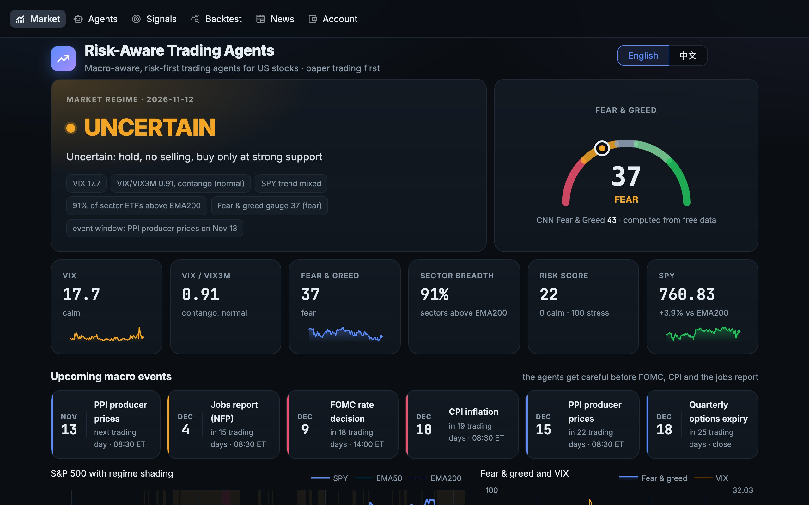
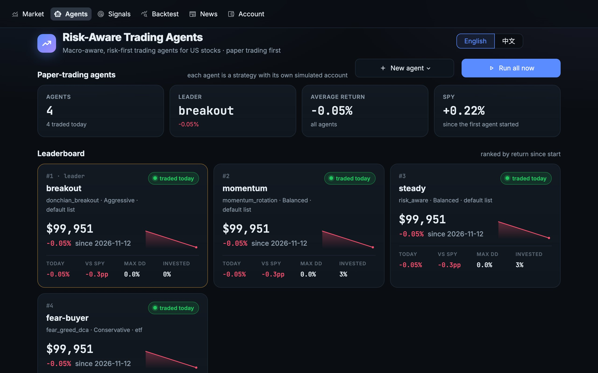
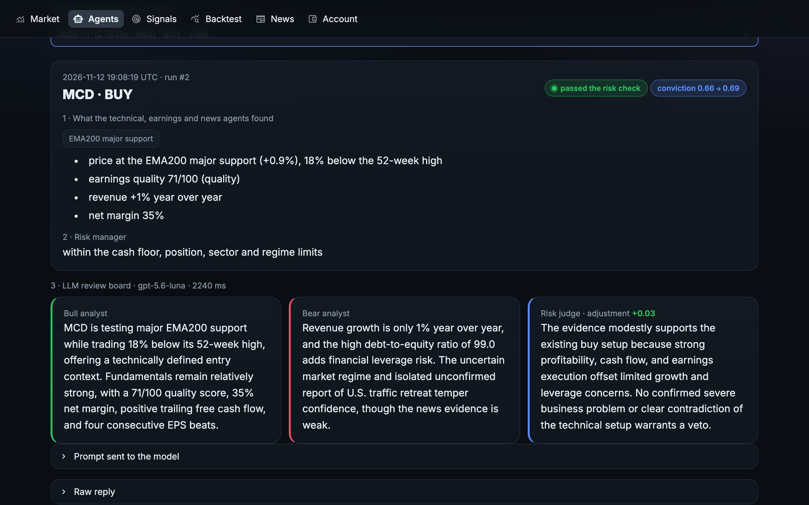
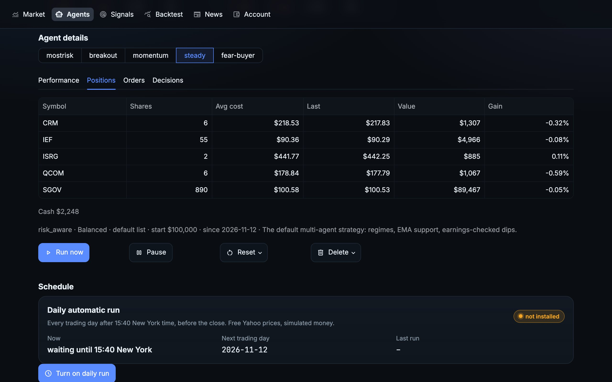
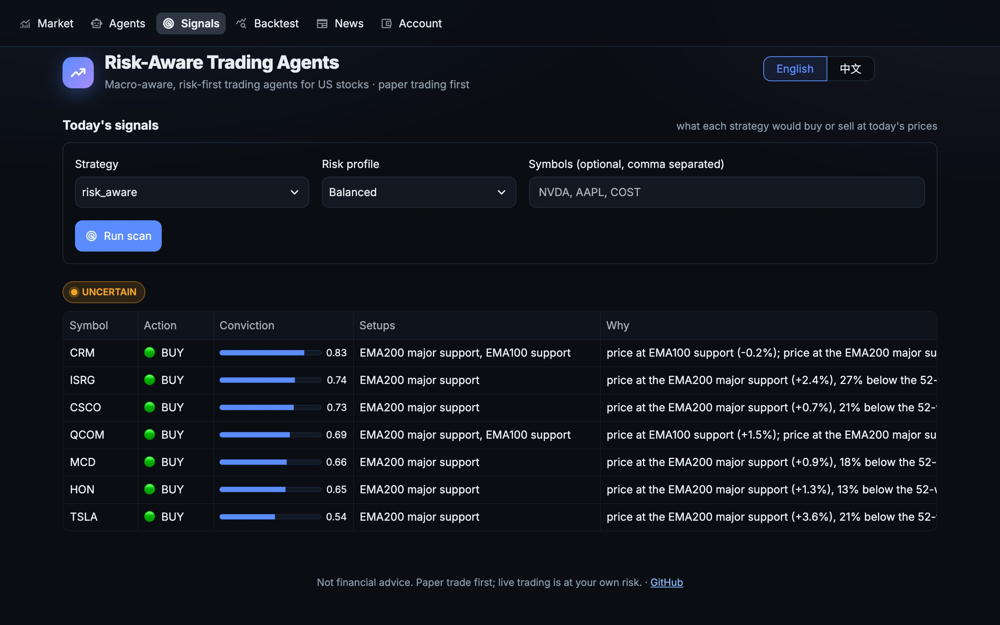
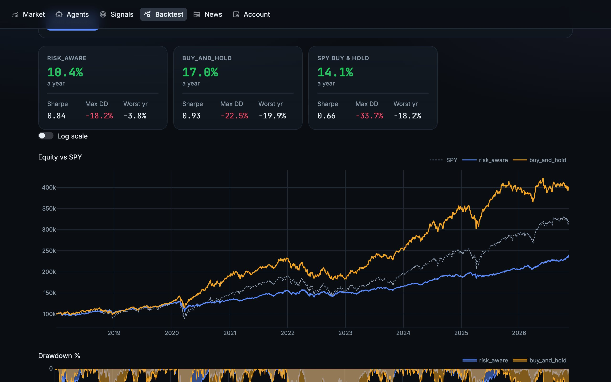
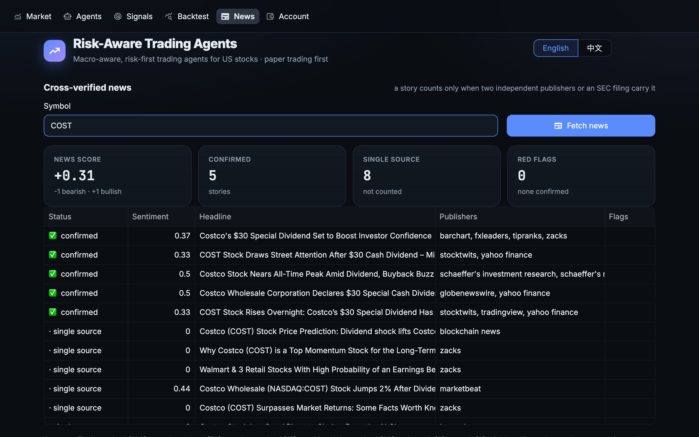
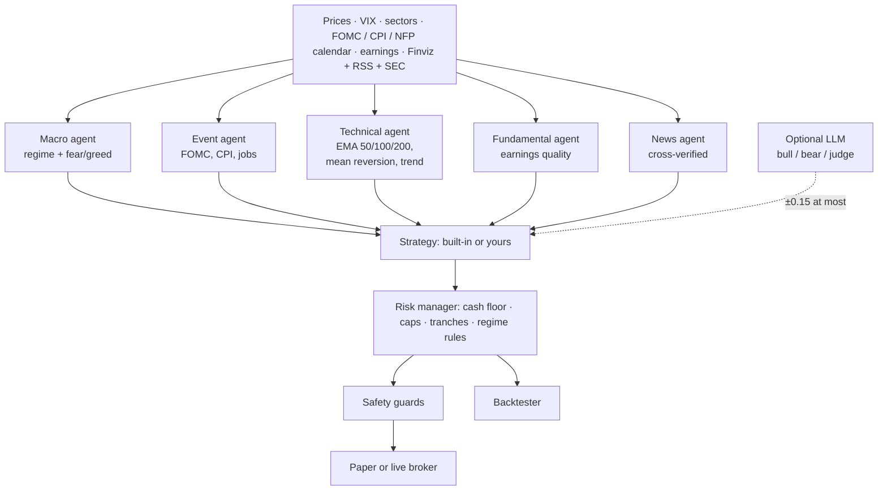
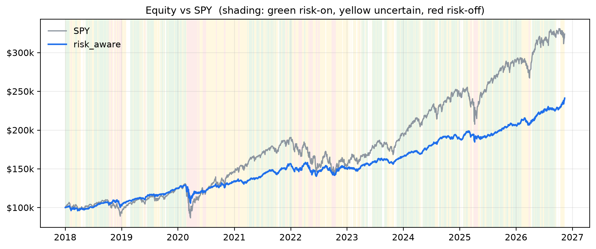

<div align="center">

# 📈 Risk-Aware Trading Agents

### AI trading agents for US stocks that check the macro calendar, the fear index and verified news before they buy

*Buy when others are afraid · keep 30% in cash · never panic-sell*

**Market regimes from FOMC · CPI · jobs reports · VIX · dip buying at EMA 50 / 100 / 200 · earnings-checked dips · Finviz + RSS + SEC news, cross-verified · daily paper-trading agents · an MCP server for Claude · 11 strategies including options · backtest your own · paper and live trading on 10 brokers · English and 中文**

[中文说明 → README_zh.md](README_zh.md) · [Website](https://jackson-cmd.github.io/risk-aware-trading-agents/) · [What's new](#-whats-new) · [Screenshots](#-screenshots) · [Quick start](#-quick-start) · [Paper agents](#-paper-trading-agents) · [MCP](#-mcp-server) · [Strategy library](#-strategy-library) · [Brokers](#-brokers) · [Changelog](CHANGELOG.md)

[](https://github.com/jackson-cmd/risk-aware-trading-agents/actions/workflows/ci.yml)
[](https://www.python.org/)
[](LICENSE)
[](#-safety)
[](CHANGELOG.md)
[](#-mcp-server)
[](#-strategy-library)
[](#-brokers)
[](README_zh.md)



</div>

---

## Contents

- [🆕 What's new](#-whats-new) · [📸 Screenshots](#-screenshots) · [💡 The idea](#-the-idea) · [✨ Highlights](#-highlights) · [🚀 Quick start](#-quick-start)
- [🤖 Paper-trading agents](#-paper-trading-agents) · [🔗 MCP server](#-mcp-server)
- [🧠 How it works](#-how-it-works): [Market regimes](#what-the-agent-does-in-each-regime) · [Risk profiles](#risk-profiles)
- [📊 Backtest](#-backtest) · [📚 Strategy library](#-strategy-library): [Options](#options-backtest-only) · [🧩 Write your own strategy](#-write-your-own-strategy)
- [🔌 Brokers](#-brokers) · [🔒 Safety](#-safety) · [🔧 Configuration](#-configuration) · [💻 CLI](#-cli) · [📁 Project layout](#-project-layout)
- [🧭 Roadmap](#-roadmap) · [🤝 Contributing](#-contributing) · [❗ Disclaimer](#-disclaimer) · [📜 License](#-license)

## 🆕 What's new

<sub>Latest release **0.4.0** (2026-11-12). The full history is in the [changelog](CHANGELOG.md).</sub>

| | New in 0.4.0 |
|---|---|
|  | **🧠 An LLM for each agent**: give any paper-trading agent GPT (for example `gpt-5.6-luna`), Claude, or a free local model through Ollama. A bull analyst, a bear analyst and a judge review every buy; they can move conviction by at most ±0.15 or veto it, never create a trade. [How →](#-paper-trading-agents) |
|  | **🔍 See how every decision was made**: the setups and reasons, what the risk manager said, the bull, bear and judge, and the exact prompt and raw reply, on the dashboard's Decisions tab or with `riskaware agents why NAME`. Everything stays on your computer. [Details →](docs/agents.md#an-llm-for-each-agent) |
|  | **🏠 Free local models**: `ollama:qwen2.5:3b` runs on your own machine; `riskaware llm-check ollama:qwen2.5:3b` tests a key or a model in one command. [Set it up →](docs/agents.md#an-llm-for-each-agent) |
|  | **📰 Cleaner news**: stories about other companies or the market no longer count toward a stock, so one company's red flag cannot land on another. [How it works →](#-highlights) |
|  | **🛡️ Fixes**: replies from the LLM use strict JSON schema output, and the daily new-position limit now holds across several runs on the same day. [Changelog →](CHANGELOG.md) |

<sub>0.3.0 added daily paper-trading agents, the MCP server and the new dashboard; 0.2.0 added options to the backtester and four stock strategies. See the [changelog](CHANGELOG.md).</sub>

## 📸 Screenshots

Every page of the dashboard (`riskaware dashboard`), in English and 中文. Click a picture to open it full size.

<table>
<tr><td width="50%"><a href="site/assets/dashboard_en.jpg"></a><br><sub><b>Market</b> — the regime, fear and greed, VIX, breadth and the macro calendar</sub></td><td width="50%"><a href="site/assets/agents_en.jpg"></a><br><sub><b>Agents</b> — paper-trading agents ranked against SPY</sub></td></tr>
<tr><td width="50%"><a href="site/assets/decisions_en.jpg"></a><br><sub><b>How it decided</b> — the setups, the risk check, and the LLM's bull case, bear case and verdict</sub></td><td width="50%"><a href="site/assets/agent_detail_en.jpg"></a><br><sub><b>Agent details</b> — positions, orders and the reason behind every decision</sub></td></tr>
<tr><td width="50%"><a href="site/assets/signals_en.jpg"></a><br><sub><b>Signals</b> — what a strategy would buy or sell today, with conviction and reasons</sub></td><td width="50%"><a href="site/assets/backtest_en.jpg"></a><br><sub><b>Backtest</b> — any strategy against SPY, with drawdowns and every trade</sub></td></tr>
<tr><td width="50%"><a href="site/assets/news_en.jpg"></a><br><sub><b>Cross-verified news</b> — a story counts only when two publishers or an SEC filing carry it</sub></td></tr>
</table>

---

## 💡 The idea

Most trading bots either chase every signal or need a quant team to configure. This one follows a simple, explainable discipline that long-term investors already use: buy quality stocks when they pull back to their moving averages, add when fear is high and the earnings still hold up, trim when prices run too far, never panic-sell into uncertainty, and always keep a cash reserve. Four agents check the market, the calendar, the company and the news; a deterministic risk manager has the final word on every order.

> Not financial advice. It starts in paper mode, and live trading needs three explicit switches.

## ✨ Highlights

- **Macro-aware market regimes.** VIX and its term structure (VIX/VIX3M), sector breadth, credit appetite (HYG vs IEF), safe-haven demand, a fear-and-greed gauge computed from free data (and CNN's Fear & Greed for reference), and the **FOMC, CPI, jobs report, PPI, GDP and PCE** calendar put the market in one of four regimes: risk-on, neutral, uncertain, risk-off.
- **Buy low, sell high.** Pullbacks to **EMA 50 / 100 / 200**, RSI(2) and z-score mean reversion, **quality dips that must pass an earnings check** (revenue growth, margins, free cash flow, leverage, EPS beats), breakouts and trend continuation in strong markets. Take-profit trims when a stock runs far above EMA50; trend exits after a break of a falling EMA50.
- **No panic selling.** When the regime is uncertain or risk-off the agent holds, does not sell, and only buys at strong support. Only confirmed disasters (fraud, bankruptcy, delisting, restatement) or an optional hard stop can force an exit.
- **Risk first.** A **30% cash + T-bill floor**, position, sector and speculative ("lottery ticket") caps, volatility-scaled sizes, buying in tranches, a Treasury sleeve for conservative profiles, idle cash parked in a T-bill ETF, a drawdown pause, a kill switch.
- **Cross-verified news.** Finviz (free), Google News, Nasdaq, Seeking Alpha and Yahoo RSS plus the company's own **SEC 8-K filings**. A story only counts when two independent publishers or an SEC filing carry it, and only toward the company it names, so a single fake headline cannot make the agent buy or sell and one company's bad news cannot land on another.
- **10 brokers, one interface.** Built-in paper account, **Alpaca, Interactive Brokers, Public.com, Charles Schwab, tastytrade, Tradier, Futu/moomoo, Tiger Brokers, Longbridge**.
- **Options strategies (backtest).** An aggressive call-buying strategy and the wheel (cash-secured puts and covered calls), with premium caps, put collateral outside the cash floor, assignment and expiry.
- **Backtest anything, including your own strategy.** Write one Python method; the same strategy object runs in backtests, paper and live trading with the same risk engine. Compare strategies side by side with an HTML report.
- **Daily paper-trading agents.** Run several strategies side by side, each on its own paper account with free prices. A background job trades them every trading day, and a leaderboard compares them with SPY.
- **Works with Claude (MCP).** `riskaware mcp` gives Claude, Cursor or any MCP client the regime, signals, news, backtests and the paper agents.
- **Optional LLM review, per agent.** A bull analyst, a bear analyst and a risk judge (GPT, Claude, any OpenAI-compatible model such as DeepSeek or Qwen, or a free local model through Ollama) can nudge conviction by at most ±0.15 or veto a buy. They can never create a trade or change a limit. News reaches them only as quoted, untrusted text, and every prompt and reply is kept in the local journal so you can see how each decision was made.
- **Bilingual.** CLI, dashboard, reports and docs in English and 中文.

## 🚀 Quick start

```bash
git clone https://github.com/jackson-cmd/risk-aware-trading-agents
cd risk-aware-trading-agents
pip install -e ".[dashboard,mcp]"    # Python 3.10+
```

```bash
riskaware init                        # 2-minute wizard: language, risk profile, broker, watchlist
riskaware regime                      # market regime, VIX, fear & greed, next FOMC / CPI / jobs report
riskaware scan                        # today's signals, each with its reasons
riskaware analyze NVDA                # what every agent thinks about one stock
riskaware news AAPL                   # cross-verified headlines
riskaware backtest --compare buy_and_hold,ema_bounce
riskaware run                         # one paper-trading cycle (built-in paper account)
riskaware agents init                 # four starter paper-trading agents
riskaware agents run                  # let them trade once now
riskaware agents schedule --install   # ...and every trading day from now on
riskaware dashboard                   # web UI (English / 中文)
```

No account or API key is needed for any of the commands above. Add `--lang zh` to any command for Chinese output.

## 🤖 Paper-trading agents

An agent is a strategy with its own paper account. Pick a strategy (built-in or your own file), a risk profile, a stock list and the starting cash, and the agent trades that account once every trading day on free Yahoo Finance prices. Run several side by side and see which one beats SPY. Agents only ever use the built-in paper account, never a broker.

```bash
riskaware agents init                                    # steady, momentum, breakout, fear-buyer
riskaware agents add dips --strategy rsi2 --universe tech --cash 25000
riskaware agents add mine --strategy my_dip.py:MyDip --profile aggressive
riskaware agents add luna --strategy risk_aware --llm openai:gpt-5.6-luna   # with an LLM review board
riskaware agents add local --strategy risk_aware --llm ollama:qwen2.5:3b    # a free local model
riskaware agents run                                     # trade every active agent now
riskaware agents why luna                                # how it decided: setups, risk check, bull / bear / judge
riskaware agents                                         # the leaderboard
riskaware agents schedule --install                      # every trading day, by itself
```

The daily job (a LaunchAgent on macOS, a crontab line on Linux, a scheduled task on Windows) wakes every 15 minutes on weekdays and trades each agent once per trading day after 15:40 New York time, before the close. It skips holidays, catches up after the laptop sleeps, and keeps going when one agent fails. Each agent keeps its account, journal and daily equity in `~/.riskaware/arena/NAME/`. The **Agents** page of the dashboard shows the leaderboard and lets you create, run, pause, reset and delete agents; its **Decisions** tab shows how each decision was made, including the LLM's bull case, bear case and verdict and the exact prompt it was sent. GPT needs `OPENAI_API_KEY` in your `.env`; a local model needs [Ollama](https://ollama.com) (`ollama pull qwen2.5:3b`). More in [docs/agents.md](docs/agents.md).


## 🔗 MCP server

`riskaware mcp` serves the agents over the Model Context Protocol, so Claude, Cursor or any MCP client can use them:

```bash
pip install -e ".[mcp]"
claude mcp add riskaware -- riskaware mcp
```

Eleven tools: `market_regime`, `scan`, `analyze_stock`, `stock_news`, `list_strategies`, `backtest`, `agents_leaderboard`, `agent_detail`, `agent_decisions`, `agents_create` and `agents_run`. They are read-only or act on local paper accounts; no tool can send an order to a broker. Then just ask, for example "What regime is the market in, and what is coming up this week?" or "Backtest the wheel on megacap with $1M since 2018." Setup for Claude Desktop and other clients is in [docs/agents.md](docs/agents.md#use-it-from-claude-mcp).

## 🧠 How it works



### What the agent does in each regime

| Regime | Typical trigger | Buys | Sells | Size |
|---|---|---|---|---|
| 🟢 **Risk-on** | SPY above a rising EMA50 and EMA200, VIX < 20, most sectors above EMA200 | pullbacks, breakouts, dips | take profit, trend exits | 100% |
| ⚪ **Neutral** | none of the others | EMA support, mean reversion, quality dips | take profit | 75% |
| 🟡 **Uncertain** | 2 days before an FOMC decision, the day before CPI or the jobs report, VIX 20–30, fear gauge < 35, downtrend | EMA100 / EMA200 support only | **none: hold** | 50% |
| 🔴 **Risk-off** | VIX ≥ 30, VIX backwardation below EMA200, credit stress | quality dips and broad ETFs, small tranches | **none: hold** | 35% |

Emergency exits (a confirmed severe red flag, or the profile's hard stop) work in every regime.

### Risk profiles

| | Conservative | Balanced | Aggressive |
|---|---|---|---|
| Cash + T-bill floor | 30% | 30% | 30% |
| Treasury sleeve (IEF) | 15% | 5% | 0% |
| Max single stock / sector | 5% / 20% | 7% / 25% | 10% / 35% |
| Speculative sleeve (high-volatility names) | 0% | 3% (2 names) | 7% (3 names) |
| Minimum conviction | 0.65 | 0.58 | 0.52 |
| Earnings score needed for a dip buy | 70 | 60 | 50 |
| Take-profit trigger | +20% | +25% | +30% |
| Breakout entries | off | off | on |

Every limit can be overridden in `riskaware.yaml`. Positions are built in tranches (50% / 25% / 25% of the target); a later tranche needs a deeper support touch or a winning position, and trimmed positions can be rebuilt on the next pullback.

## 📊 Backtest

Built-in strategy, balanced profile, the 55-stock `megacap` list, $100k, signals at the close and fills the next day, 5 bps slippage, January 2018 to November 2026:

| | risk_aware | SPY buy & hold |
|---|---|---|
| CAGR | 10.4% | 14.1% |
| Volatility | 9.3% | 19.0% |
| Sharpe | 0.84 | 0.66 |
| Max drawdown | -18.2% | -33.7% |
| Worst calendar year | -3.7% | -18.2% |
| Average stocks / cash + T-bills | 57% / 39% | 100% / 0% |



Read it honestly: in a long bull market the agent earns less than the index because it keeps at least 30% in cash, and it loses roughly half as much when markets fall. The list is today's large caps, so it carries survivorship bias; backtests use neither news nor fundamentals (no free point-in-time archive), and past results do not predict future ones. Reproduce it with `riskaware backtest --compare buy_and_hold`.

```bash
riskaware backtest --strategy risk_aware --compare buy_and_hold,ema_bounce,rsi2 --start 2018-01-01 --open
riskaware backtest --preset etf --profile conservative
riskaware backtest --symbols AAPL,MSFT,NVDA,COST --cash 25000
riskaware backtest --synthetic                     # offline demo, no download
```

Every run writes a self-contained HTML report (metrics, equity and drawdown charts with regime shading, monthly returns, every trade with its reason) plus CSV files.

## 📚 Strategy library

Every built-in strategy runs through the same risk manager, so all of them keep the cash floor. Backtest any of them with `riskaware backtest --strategy NAME`; compare several with `--compare a,b,c`.

| Strategy | Type | Idea |
|---|---|---|
| `risk_aware` | stocks (default) | the multi-agent strategy described above |
| `momentum_rotation` | stocks | each month hold the strongest names by 6-month relative strength, above EMA200 |
| `donchian_breakout` | stocks | Turtle-style: 55-day highs on volume, exit on a 20-day low |
| `bollinger_reversion` | stocks | buy closes below the lower Bollinger band in uptrends, sell at the middle band |
| `fear_greed_dca` | stocks / ETFs | buy in steps when fear is high, trim in extreme greed |
| `ema_bounce`, `rsi2`, `golden_cross`, `buy_and_hold` | stocks | simple references and baselines |
| `aggressive_calls` | options | buy ~0.6-delta calls 45–60 days out on pullbacks in strong uptrends; +100% take profit, -50% stop |
| `wheel` | options | sell ~0.25-delta cash-secured puts near support; after assignment, sell covered calls above cost |

Backtests from January 2018 to November 2026 on the `megacap` list:

| Strategy | Profile, capital | CAGR | Sharpe | Max drawdown | Worst year |
|---|---|---|---|---|---|
| `wheel` | aggressive, $1M | 14.1% | 1.12 | -21.7% | +5.8% |
| `momentum_rotation` | balanced, $100k | 12.5% | 0.91 | -18.2% | -8.2% |
| `risk_aware` | balanced, $100k | 10.4% | 0.84 | -18.2% | -3.8% |
| `donchian_breakout` | balanced, $100k | 9.8% | 0.86 | -12.6% | -6.7% |
| `aggressive_calls` | aggressive, $100k | 6.7% | 0.30 | -40.3% | -24.7% |
| `bollinger_reversion` | balanced, $100k | 4.5% | 0.58 | -4.4% | +0.8% |
| SPY buy & hold | | 14.1% | 0.66 | -33.7% | -18.2% |

### Options (backtest only)

Option strategies open long calls or puts, cash-secured puts and covered calls. The risk manager caps the premium in long options (`options_sleeve`: 0% conservative, 3% balanced, 12% aggressive; `options_per_trade`: 0 / 1% / 3%), keeps put collateral out of the 30% cash floor and inside the single-stock cap, and never lets shares that back a written call be sold. Expiring options settle at intrinsic value; written puts are assigned into shares, covered calls are called away.

There is no free archive of historical option quotes, so the backtester prices options with Black-Scholes on a modelled implied volatility (VIX for index ETFs; realized volatility, a 10% volatility premium and a VIX scaling for stocks) and pays half of a 4% bid-ask spread plus $0.65 per contract. The results move with these assumptions: without the 10% volatility premium the wheel drops to a 0.81 Sharpe and `aggressive_calls` ranges from 3% to 15% a year depending on spread and volatility, always with a drawdown near -40%. Treat option backtests as the shape of a strategy, not a forecast. `riskaware run` skips option orders in this version.

Written puts need cash for 100 shares per contract inside the single-stock cap, so the wheel only trades names whose strike × 100 fits (about $10k per name on a $100k aggressive account); test it with `--cash 1000000` or a list of lower-priced names.

## 🧩 Write your own strategy

```bash
riskaware new-strategy my_dip          # creates my_dip.py from a template
riskaware backtest --strategy my_dip.py --compare risk_aware,buy_and_hold
riskaware run --strategy my_dip.py     # paper trade it
```

```python
from riskaware.strategy import Action, Signal, Strategy

class MyDip(Strategy):
    name = "my_dip"
    default_params = {"rsi_entry": 30, "take_profit": 0.20}

    def on_bar(self, ctx):
        signals = []
        for sym in ctx.universe:
            row = ctx.row(sym)                 # indicators at today's close
            if row is None:
                continue
            pos = ctx.position(sym)
            if pos is None and row["close"] > row["ema200"] and row["rsi14"] < self.params["rsi_entry"]:
                signals.append(Signal(sym, Action.BUY, strength=0.7, reason="oversold in an uptrend"))
            elif pos and pos.gain >= self.params["take_profit"]:
                signals.append(Signal(sym, Action.SELL, strength=0.8, fraction=0.5, reason="take profit"))
        return signals
```

A strategy only says what it wants and how sure it is; the risk manager decides the size and enforces the cash floor, caps and regime rules, so your strategy inherits the same protection. `ctx.market` has the regime, VIX and upcoming events; `ctx.quality(sym)` and `ctx.news(sym)` give the earnings verdict and the verified news in live runs. See [docs/custom-strategies.md](docs/custom-strategies.md).

## 🔌 Brokers

| Broker | `broker.name` | Paper trading | Install | Status |
|---|---|---|---|---|
| Built-in paper account | `paper` | always | built in | tested |
| Alpaca | `alpaca` | yes | built in | **tested on a paper account** (orders, fills, cancels, full cycle) |
| Public.com | `public` | no (live only) | built in | unit-tested against the documented API |
| Tradier | `tradier` | sandbox | built in | unit-tested against the documented API |
| Interactive Brokers | `ibkr` | paper account | `.[ibkr]` | written against `ib_async` |
| Charles Schwab | `schwab` | no | `.[schwab]` | written against `schwab-py` |
| tastytrade | `tastytrade` | cert sandbox | `.[tastytrade]` | written against the `tastytrade` SDK |
| Futu / moomoo | `futu` | simulate | `.[futu]` | written against `futu-api` (OpenD) |
| Tiger Brokers | `tiger` | paper account | `.[tiger]` | written against `tigeropen` |
| Longbridge | `longbridge` | paper account | `.[longbridge]` | written against `longport` |

Setup for each broker (keys, gateways, paper accounts) is in [docs/brokers.md](docs/brokers.md). Reports from live use of the SDK-based adapters are very welcome.

## 🔒 Safety

- `riskaware run` uses the paper account unless you change the broker; `--dry-run` previews without sending anything.
- A live order needs `execution.mode: live` in the config **and** `--live` on the command line **and** a typed confirmation (or `--yes`).
- Guards: limit price within a band of the quote, a per-order value cap, a maximum number of orders per run, no trading on market holidays, and deterministic client order ids so a rerun on the same day cannot duplicate an order.
- `riskaware halt` blocks all order submission until `riskaware resume`.
- Every run, decision and order is written to a local SQLite journal (`~/.riskaware/journal.db`), visible in the dashboard.
- API keys stay in `.env` (see [.env.example](.env.example)); they are never written to the config or the journal.

## 🔧 Configuration

`riskaware init` writes a commented `riskaware.yaml`; every key is optional.

```yaml
language: en                 # en | zh
profile: balanced            # conservative | balanced | aggressive
profile_overrides:
  cash_floor: 0.30           # cash + T-bill ETF never below 30%
  hard_stop: 0.30            # emergency exit after a 30% loss (null = never)
broker:
  name: alpaca
  options: {paper: true}
universe:
  preset: megacap            # megacap | tech | defensive | etf | sectors (combine with +)
  symbols: [PLTR, SHOP]
  cash_vehicle: SGOV         # idle cash goes into T-bills
news:
  min_independent_sources: 2
llm:
  enabled: false
  provider: anthropic        # or openai (any OpenAI-compatible endpoint)
```

`riskaware config` prints the resolved configuration; `riskaware doctor` checks data sources and the broker connection.

## 💻 CLI

| Command | What it does |
|---|---|
| `riskaware init` | config wizard |
| `riskaware doctor` | check packages, data sources, broker |
| `riskaware regime` | market regime and upcoming macro events |
| `riskaware calendar [--earnings] [--refresh]` | FOMC, CPI, jobs report, PPI, GDP, PCE, earnings dates |
| `riskaware scan` | today's signals |
| `riskaware analyze SYMBOL` | technical, earnings, news and the decision for one stock |
| `riskaware news SYMBOL [--all]` | cross-verified news |
| `riskaware plan` | preview today's orders against your account |
| `riskaware run [--dry-run] [--live]` | one trading cycle |
| `riskaware schedule [--print-cron]` | run every trading day at `execution.run_time` (New York) |
| `riskaware portfolio` | account, positions, open orders |
| `riskaware backtest` | backtest and compare strategies |
| `riskaware strategies` / `new-strategy` | list built-ins / create a strategy file |
| `riskaware brokers` | supported brokers and their requirements |
| `riskaware halt` / `resume` | kill switch |
| `riskaware agents [init\|add\|run\|list\|show\|pause\|resume\|reset\|remove]` | paper-trading agents |
| `riskaware agents schedule --install` | trade the agents every trading day |
| `riskaware mcp` | MCP server for Claude and other assistants |
| `riskaware dashboard` | web dashboard |

## 📁 Project layout

```
src/riskaware/
  agents/      macro regime, technical setups, earnings quality, news
  data/        prices (Yahoo, CSV, synthetic), FOMC/BLS/BEA calendar, fundamentals, CNN Fear & Greed
  news/        Finviz + RSS + SEC sources, clustering and cross-source verification
  strategy/    Strategy interface, the risk-aware strategy, examples, loader
  risk.py      the risk manager (cash floor, caps, tranches, regime rules)
  brokers/     paper + 9 broker adapters
  engine.py    paper / live cycle, guards, journal, state
  backtest/    backtester, metrics, HTML report
  llm/         optional bull / bear / judge review
  dashboard/   Streamlit app (pages, theme, charts)
  arena.py     paper-trading agents: accounts, daily runs, leaderboard
  scheduler.py the daily background job (launchd, cron, Task Scheduler)
  mcp_server.py  tools for Claude and other MCP clients
site/          bilingual project website (GitHub Pages)
docs/          design notes and guides (English and Chinese)
```

## 🧭 Roadmap

- Point-in-time fundamentals from SEC XBRL for backtests
- Live option orders (option chains from each broker), protective puts and collars
- More brokers (Webull, E*TRADE) and crypto / HK / A-share markets
- Walk-forward parameter studies

## 🤝 Contributing

Issues and pull requests are welcome: new brokers, data sources, strategies, translations. Run `pip install -e ".[dev]" && pytest` before you open a PR. See [CONTRIBUTING.md](CONTRIBUTING.md).

## ❗ Disclaimer

This software is for research and education. It is not investment advice, and nothing in it is a recommendation to buy or sell any security. Trading involves risk of loss. You are responsible for every order your account sends; test with paper trading first.

## 📜 License

[MIT](LICENSE)
