<div align="center">

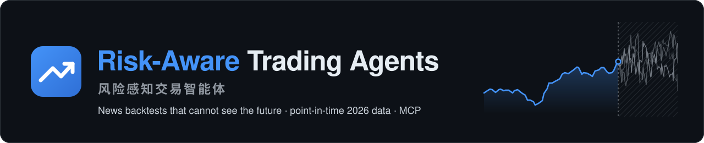

## LLM 交易智能体基准：新闻按发布的那一分钟回放

大多数新闻回测按日历日期把标题和价格对上，于是收盘后才发布的标题，也会按当天的收盘价成交。这里每条标题都在发布的那一分钟才出现，订单在下一个开盘成交，覆盖三段冻结的市场：2020 年暴跌、2022 年熊市和 2026 年。Llama、GPT、Claude 和 Gemini 分别在盲测和实名下交易这三段市场，每个模型跑三个种子，训练截止日之前和之后的成绩分开计分。

**它同时也是一套美股 AI 交易智能体：先看宏观日历、恐慌指数和经过交叉验证的新闻，再决定买不买。**

用 VIX 和 FOMC / CPI 日历判断市场状态 · 财报过关才抄底 · 始终留 30% 现金 · 新闻交叉验证 · 和 SPY 比的模拟盘智能体 · 不偷看未来的新闻回测 · 公开的 LLM 交易智能体榜单 · 供研究用的冻结 2020、2022、2026 三段市场 · 通过 MCP 接入 LLM 智能体 · 10 家券商的模拟盘和实盘。

[🌐 项目主页](https://jackson-cmd.github.io/risk-aware-trading-agents/?lang=zh) · [🏆 LLM 模型榜单](https://jackson-cmd.github.io/risk-aware-trading-agents/zh/leaderboard.html) · [English → README.md](README.md) · [🚀 快速开始](#-快速开始) · [🆕 新功能](#-新功能) · [🔬 研究工具箱](#-研究工具箱) · [🔗 MCP](#-mcp-服务器) · [📸 截图](#-截图一览) · [更新记录](docs/zh/CHANGELOG.md)

[](https://github.com/jackson-cmd/risk-aware-trading-agents/actions/workflows/ci.yml) [](https://pypi.org/project/risk-aware-trading-agents/) [](https://www.python.org/) [](LICENSE) [](#-mcp-服务器) [](https://github.com/jackson-cmd/risk-aware-trading-agents/pkgs/container/risk-aware-trading-agents) [](https://huggingface.co/datasets/jacksonwangpro1/point-in-time-market-data-2026) [](README.md)

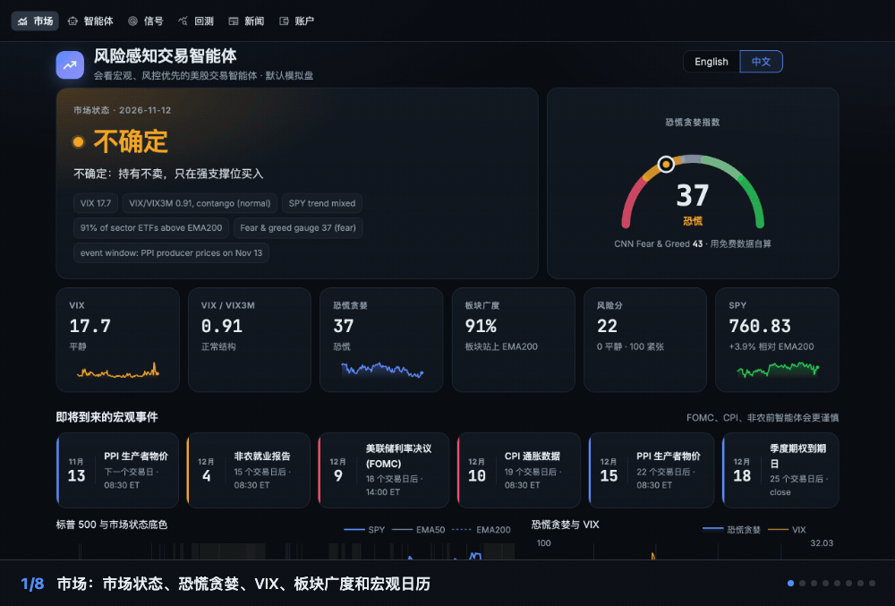

<sub>画面来自网页看板，以及在安装包自带的 2026 年数据上运行的 <code>riskaware research run</code>。回测展示的是策略过去会怎么做，不代表以后的收益。</sub>

</div>

## 🚀 快速开始

```bash
pip install "risk-aware-trading-agents[dashboard,mcp]"   # 需要 Python 3.10+
riskaware --lang zh dashboard   # 网页看板 http://localhost:8501，可切换中英文
```

然后在另一个终端里：

```bash
riskaware --lang zh init              # 两分钟配置向导：语言、风险档位、券商、股票池
riskaware --lang zh regime            # 市场状态、VIX、恐慌贪婪指数、下次 FOMC / CPI / 非农
riskaware --lang zh scan              # 今天的交易信号，每条都附理由
riskaware --lang zh analyze NVDA      # 各个智能体对一只股票的看法
riskaware --lang zh news AAPL         # 交叉验证后的新闻
riskaware --lang zh backtest --compare buy_and_hold,ema_bounce
riskaware --lang zh run               # 跑一次模拟盘交易（内置模拟账户）
riskaware --lang zh agents init       # 四个示例模拟盘智能体
riskaware --lang zh agents run        # 现在让它们交易一次
riskaware agents schedule --install   # 以后每个交易日自动交易
riskaware --lang zh research run -s swing_trend   # 在冻结的 2026 年市场上跑一个策略，带防偷看检查
riskaware --lang zh research run -s swing_trend --period 2022   # 同一个策略放到 2022 年熊市里
```

上面这些命令都不需要券商账户或 API key。在配置文件里写 `language: zh`，以后就不用每次加 `--lang zh`。想用 GitHub 上还没发版的最新代码，就改用 `pip install "risk-aware-trading-agents[dashboard,mcp] @ git+https://github.com/jackson-cmd/risk-aware-trading-agents"`；想改代码的话，先克隆仓库，再用 `pip install -e ".[dashboard,mcp]"` 安装。

**Docker**，x86-64 和 ARM 都能用：

```bash
docker run --rm -p 8501:8501 ghcr.io/jackson-cmd/risk-aware-trading-agents dashboard   # 网页看板 http://localhost:8501
docker run -i --rm ghcr.io/jackson-cmd/risk-aware-trading-agents mcp                   # 通过 stdio 提供 MCP 服务
```

还想跑每日模拟盘任务的话，先把 `riskaware.yaml`（`riskaware init` 生成）和要用券商 key 时的 `.env` 放在仓库根目录，然后运行 `docker compose -f docker/docker-compose.yml up -d`（或 `make docker`）。

**什么都不想装：** [](https://codespaces.new/jackson-cmd/risk-aware-trading-agents) 会在浏览器里打开整个仓库，依赖都已装好。在里面运行 `riskaware --lang zh dashboard`，8501 端口会自动打开。

## 这个项目适合你吗？

- 你做**美股，持有几天到几周**，想要一套看得懂的规则：好公司回调时买、始终留现金、从不恐慌割肉。
- 你想要**不会作弊的回测**：新闻按发布时间回放，次日开盘成交，研究工具箱的每次实验都做防偷看检查。
- 你在**研究 LLM 交易智能体**，需要别人也能复现的数据和流程：三段冻结的市场（2020 年暴跌、2022 年熊市、2026 年）、盲测模式、每次运行都有完整记录，还有可以提交成绩的[公开榜单](https://jackson-cmd.github.io/risk-aware-trading-agents/zh/leaderboard.html)。
- 你用 **Claude、Codex 或 Gemini**，想让它们帮你测试用大白话描述的策略，走你自己的订阅，不需要 API key。
- 你想**先模拟交易**：几个策略同时用模拟资金跑，每个交易日和 SPY 比一次。
- 你看**中文或英文**：命令行、网页看板、回测报告和文档都有两种语言。

<sub>如果你在找美股 AI 交易机器人、带历史新闻又不偷看未来的回测工具、按时间点记录的 2020、2022、2026 年价格、VIX 和新闻数据、LLM 交易智能体的评测基准和榜单、做交易研究用的 MCP 服务器，或者能接 Alpaca 等券商的模拟盘智能体：这里都有，而且开源。</sub>

---

## 目录

- [🚀 快速开始](#-快速开始) · [这个项目适合你吗？](#这个项目适合你吗) · [🆕 新功能](#-新功能) · [💡 设计思路](#-设计思路) · [四种用法](#四种用法)
- [✨ 功能导览](#-功能导览)：[工作原理](#-工作原理) · [新闻交叉验证](#-新闻交叉验证) · [模拟盘智能体](#-模拟盘智能体) · [MCP 服务器](#-mcp-服务器) · [策略实验室](#-策略实验室) · [LLM 榜单](#-llm-交易智能体榜单) · [研究工具箱](#-研究工具箱) · [回测](#-回测) · [策略库](#-策略库) · [写你自己的策略](#-写你自己的策略)
- [📸 截图一览](#-截图一览) · [🔌 支持的券商](#-支持的券商) · [🔒 安全机制](#-安全机制) · [🔧 配置](#-配置) · [🧰 内部结构](#-内部结构)：[命令一览](#-命令一览) · [目录结构](#-目录结构)
- [❓ 常见问题](#-常见问题) · [🧭 后续计划](#-后续计划) · [🤝 参与贡献](#-参与贡献) · [📝 引用](#-引用) · [❗ 免责声明](#-免责声明) · [📜 开源协议](#-开源协议)

## 🆕 新功能

- **0.7.2** · 🔗 **一步接入 Claude 和其他 MCP 客户端**：服务器上了官方 MCP Registry，`uvx risk-aware-trading-agents mcp` 不用先安装就能启动，每个版本还附带 Claude Desktop 扩展（`.mcpb`），打开就能装。[怎么用 →](#-mcp-服务器)
- **0.7.1** · 📦 **上架 PyPI 和 Docker**：`pip install risk-aware-trading-agents` 就能装；不想装 Python，也可以直接用 `ghcr.io/jackson-cmd/risk-aware-trading-agents` 跑网页看板或 MCP 服务器；在 GitHub Codespaces 里打开整个仓库，依赖都已装好。[怎么用 →](#-快速开始)
- **0.7.0** · 🔬 **冻结的 2026 年市场，供研究用**：全年按时间点记录的价格、VIX 和新闻随安装包提供。可以查任意一天收盘时已知的信息，可以让 Claude 把你描述的策略写成代码并测试，也可以让 LLM 一步一步把这一年交易一遍。每次运行都做防偷看检查，并留下可以用于论文的记录；趋势跟随赚了 **+21.1%**，同期 SPY 是 +12.1%。[怎么用 →](#-研究工具箱)
- **0.6.3** · ⏳ **长任务在后台接着跑**：扫描、回测、运行智能体和获取新闻，切到别的页面或刷新都不会中断，跑完点提示条就回到结果。

<details>
<summary>更早的版本</summary>

- **0.6.2** · ❓ **每个数字都能点开看说明**：每张卡片、每一列、每个输入框旁边都有 ?，说明它是什么、怎么算、怎么用，中英文都有。[看截图 →](#-截图一览)
- **0.6.1** · 🔎 **每笔回测交易背后的新闻**：选一笔交易，就能看到回测在那天收盘时看到的标题，以及第二天下的单。[怎么用 →](docs/zh/news-history.md#查看回测看到的新闻)
- **0.6.0** · 🗞️ **自带 2026 年新闻**：内置 64 只股票的 16,945 条标题和 SEC 公告，`riskaware backtest --news` 什么都不用下载就能用。带新闻的智能体赚了 **+15.9%**，同期 SPY +12.1%；最大回撤 **-5.3%**，SPY 是 -8.9%。[看结果 →](#2026-年至今带新闻)
- **0.6.0** · 🧪 **说出策略，AI 写代码并回测**：通过 MCP，Claude、Codex 或 Gemini 把策略写成代码；代码先检查有没有偷看未来和副作用，再放到单独的进程里跑。[怎么用 →](#-策略实验室)
- **0.6.0** · 🔭 **回测不偷看未来**：回测每天只能看到当天收盘前发布的新闻，策略也拿不到之后的价格。[细节 →](docs/zh/news-history.md#回测怎么防止偷看未来)
- **0.5.0** · 🔑 **不需要 API key**：智能体的复核可以走你的 Claude、ChatGPT 或 Gemini 订阅：`--llm claude-cli`、`codex-cli` 或 `gemini-cli`。[怎么用 →](docs/zh/agents.md#不需要-api-key用你的订阅)
- **0.5.0** · 🔌 **一条命令接上 MCP**：`riskaware mcp-setup claude-desktop`（或 `claude-code`、`codex`、`gemini`、`antigravity`）。[怎么配置 →](#-mcp-服务器)
- **0.5.0** · 🗄️ **自己的新闻库**：其他年份可以用免费的 SEC 8-K 公告、你自己的 Benzinga key 或任意 CSV 建库，回测按同样的规则回放。[怎么用 →](docs/zh/news-history.md)
- **0.4.0** 让每个智能体都能配 LLM 复核、每个决定都有记录；**0.3.0** 加入了每天自动跑的模拟盘智能体、MCP 服务器和新看板；**0.2.0** 加入了期权回测和四个股票策略。

完整的更新历史见[更新记录](docs/zh/CHANGELOG.md)。
</details>

---

## 💡 设计思路

很多交易机器人要么见信号就追，要么得有量化团队才配得起来。这个项目走的是长线投资者熟悉的一套简单、讲得清的纪律：好公司回调到均线时买，市场恐慌但财报依然扎实时加仓，涨得太远时减仓，行情不明朗时不恐慌割肉，并且始终留一笔现金。四个智能体分别看市场、宏观日历、公司基本面和新闻，最后由一个规则明确的风控模块决定每一笔订单。

**成绩。** 2026 年到目前为止，读安装包自带的新闻，智能体赚了 **+15.9%**，同期 SPY 是 +12.1%；夏普 1.70，SPY 是 0.77；最大回撤 **-5.3%**，SPY 是 -8.9%（[详情](#2026-年至今带新闻)）。2018 到 2026 年的长牛市里，它的年化收益比 SPY 低，10.4% 对 14.1%，但跌幅大约只有 SPY 的一半，-18.2% 对 -33.7%（[详情](#-回测)）。

> 不构成投资建议。默认是模拟盘，实盘需要同时打开三个开关。

## 四种用法

| | **网页看板** | **命令行** | **AI 助手（MCP）** | **Python** |
|---|---|---|---|---|
| 从这里开始 | `riskaware dashboard` | `riskaware scan` | `riskaware mcp-setup claude-desktop --apply` | `from riskaware.research import run_experiment` |
| 用来做什么 | 看市场状态、信号、智能体和回测，中英文都有 | 扫描、回测、模拟交易，以及让智能体每天自动交易 | 用大白话说出策略，让 Claude、Codex 或 Gemini 写代码、测试并解释结果 | 在冻结的 2020、2022、2026 年市场上做实验，留下能写进论文的记录 |
| 需要 | `dashboard` 扩展 | 不需要别的 | `mcp` 扩展；走你的订阅，不需要 API key | 不需要别的 |

```python
from riskaware.research import Experiment, run_experiment

r = run_experiment(Experiment(strategy="swing_trend", news=True, split="2026-07-01"))
print(r.summary()["metrics"], r.leak, r.folder)
```

---

## ✨ 功能导览

这里只列重点。每个命令和设置都在 [docs/zh/](docs/zh/) 的指南里；[项目主页](https://jackson-cmd.github.io/risk-aware-trading-agents/?lang=zh)上还有关于新闻回测、按时间点数据和 LLM 智能体的长文。

### 🧠 工作原理

- **看宏观的市场状态判断。** 综合 VIX 及其期限结构（VIX/VIX3M）、板块广度、信用偏好（HYG 对 IEF）、避险需求、用免费数据自算的恐慌贪婪指数（同时显示 CNN 恐慌贪婪指数作参考），以及 **FOMC 议息、CPI、非农、PPI、GDP、PCE** 的发布日历，把市场分成四种状态：偏多、中性、不确定、避险。
- **低买高卖。** 回踩 **EMA 50 / 100 / 200** 时买入；RSI(2) 和 z-score 均值回归；**财报过关才抄底**（看营收增长、利润率、自由现金流、负债、EPS 是否超预期）；强势行情里做突破和趋势延续。股价远远高于 EMA50 时分批止盈，跌破下行的 EMA50 时趋势减仓。
- **不恐慌卖出。** 市场处于不确定或避险状态时只持有、不卖出，只在强支撑位买入。只有公司自己在 8-K 公告或通稿里确认的重大利空（破产、退市、财报重述），或者你设置的硬止损，才会触发强制卖出。
- **风控优先。** **现金加短期国债始终不低于 30%**；单只股票、单个板块、高波动"小博大"仓位都有上限；按波动率决定仓位大小；分批建仓；保守档另配国债仓位；闲置现金自动买短期国债 ETF；回撤过大自动暂停买入；一键停止交易。
- **可选的 LLM 复核，每个智能体单独设置。** 多头分析师、空头分析师和风控裁判（GPT、Claude、任何 OpenAI 兼容模型比如 DeepSeek 或通义千问，或者用 Ollama 跑的免费本地模型）可以把信心分最多调高或调低 0.15，或者否决一笔买入。它们不能自己发起交易，也不能改任何限额。新闻只作为加了引号的不可信文本交给它们；每次的 prompt 和回复都存在本地日志里，每个决定是怎么做出来的都能看到。

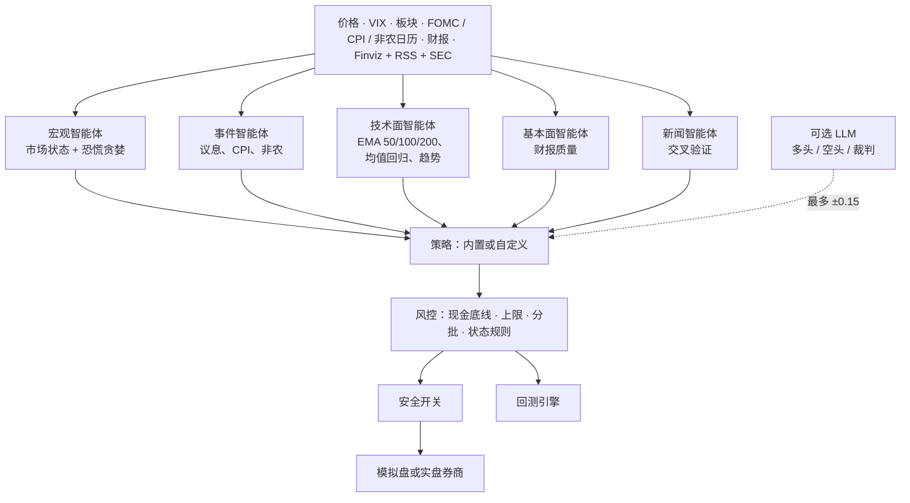

#### 不同市场状态下的做法

| 市场状态 | 典型触发条件 | 买入 | 卖出 | 仓位系数 |
|---|---|---|---|---|
| 🟢 **偏多** | SPY 在上行的 EMA50 和 EMA200 之上，VIX < 20，多数板块站上 EMA200 | 回调、突破、抄底 | 止盈、趋势破位减仓 | 100% |
| ⚪ **中性** | 其余情况 | EMA 支撑、均值回归、优质股抄底 | 止盈 | 75% |
| 🟡 **不确定** | FOMC 议息前两天、CPI 和非农发布前一天、VIX 20–30、恐慌指数 < 35、下跌趋势 | 只在 EMA100 / EMA200 支撑买 | **不卖：持有** | 50% |
| 🔴 **避险** | VIX ≥ 30、跌破 EMA200 且 VIX 期限倒挂、信用紧张 | 只抄优质股和宽基 ETF，小批量 | **不卖：持有** | 35% |

紧急卖出（公司自己在 8-K 公告或通稿里确认的严重利空，或者档位里的硬止损）在任何状态下都有效。

#### 风险档位

| | 保守 | 平衡 | 激进 |
|---|---|---|---|
| 现金 + 短期国债底线 | 30% | 30% | 30% |
| 国债仓位（IEF） | 15% | 5% | 0% |
| 单只股票 / 单个板块上限 | 5% / 20% | 7% / 25% | 10% / 35% |
| 高波动"小博大"仓位 | 0% | 3%（最多 2 只） | 7%（最多 3 只） |
| 最低信心分 | 0.65 | 0.58 | 0.52 |
| 抄底所需的财报分 | 70 | 60 | 50 |
| 止盈触发涨幅 | +20% | +25% | +30% |
| 突破买入 | 关 | 关 | 开 |

所有限额都可以在 `riskaware.yaml` 里改。每个仓位分三批建（目标仓位的 50% / 25% / 25%）；加第二、三批需要价格跌到更深的支撑，或者持仓已经盈利；减过仓的股票，下一次回调时还能补回来。

### 📰 新闻交叉验证

- **新闻来源。** Finviz（免费）、Google News、Nasdaq、Seeking Alpha、Yahoo 的 RSS，以及公司自己的 **SEC 8-K 公告**。
- **两家来源才算确认。** 一条新闻只算到它提到的那家公司头上；被两家独立媒体报道、公司自己发了通稿，或者有 SEC 公告佐证，才算"已确认"，上面的风险信号会挡住新的买入。
- **不容易被骗。** 只有公司自己的 8-K 公告，或者公司通稿证实了独立媒体先报道的消息，才会触发强制卖出，所以一条假新闻、一份假通稿加上别家的转载，或者别家公司的坏消息，都没法让它清仓。辟谣会抵消它所否认的那条新闻，不会被当成确认。

回测里走的是同样的检查，新闻按发布时间回放：见[用新闻回测](#用新闻回测)。

### 🤖 模拟盘智能体

一个智能体就是一个策略加一个属于它自己的模拟账户。选好策略（内置的或你自己写的文件）、风险档位、股票池和初始资金，它就每个交易日用雅虎财经的免费价格在这个账户里交易一次。几个智能体可以同时跑，看看谁能跑赢 SPY。智能体只会用内置的模拟账户，永远不会连接券商。

```bash
riskaware agents init                                    # steady、momentum、breakout、fear-buyer
riskaware agents add dips --strategy rsi2 --universe tech --cash 25000
riskaware agents add mine --strategy my_dip.py:MyDip --profile aggressive
riskaware agents add luna --strategy risk_aware --llm openai:gpt-5.6-luna   # 配一个 LLM 复核
riskaware agents add local --strategy risk_aware --llm ollama:qwen2.5:3b    # 免费的本地模型
riskaware agents run                                     # 让所有活跃的智能体现在交易一次
riskaware agents why luna                                # 它是怎么决定的：形态、风控、多方/空方/裁判
riskaware agents                                         # 排行榜
riskaware agents schedule --install                      # 以后每个交易日自动运行
```

后台任务（macOS 上是 LaunchAgent，Linux 上是一行 crontab，Windows 上是计划任务）在工作日每 15 分钟唤醒一次，每个交易日纽约时间 15:40 之后、收盘之前，让每个智能体交易一次。它会跳过节假日，电脑睡眠醒来会补跑，某个智能体出错也不影响其他的。每个智能体的账户、日志和每天的净值都存在 `~/.riskaware/arena/名字/`。网页看板的「智能体」页能看到排行榜，也能新建、运行、暂停、重置和删除智能体；其中的「决策」页显示每个决定是怎么做出来的，包括 LLM 的多方、空方意见和结论，以及发给它的完整 prompt。用 GPT 需要在 `.env` 里设置 `OPENAI_API_KEY`；用本地模型需要装 [Ollama](https://ollama.com)（`ollama pull qwen2.5:3b`）；`--llm claude-cli`、`codex-cli` 或 `gemini-cli` 则通过命令行工具用你的 Claude、ChatGPT 或 Gemini 订阅，不需要 API key。详见 [docs/zh/agents.md](docs/zh/agents.md)。

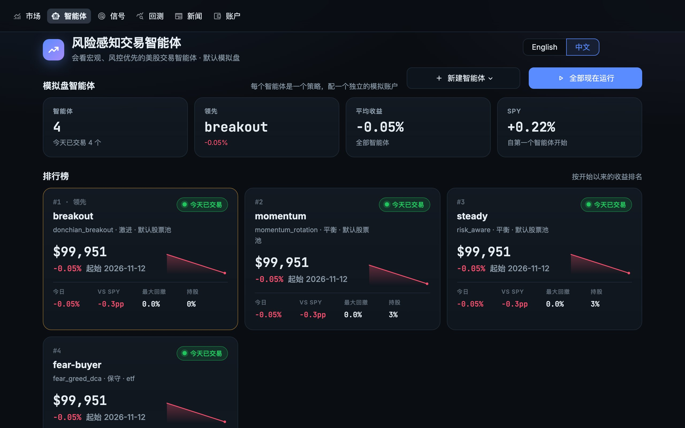

### 🔗 MCP 服务器

`riskaware mcp` 通过 Model Context Protocol 提供这些智能体的能力，Claude、Codex、Gemini、Cursor 或任何 MCP 客户端都能直接用，走你的订阅，不需要 API key。`riskaware mcp-setup` 会打印（加 `--apply` 则直接执行）接入那一步：

```bash
pip install risk-aware-trading-agents        # 从 0.7.2 起，MCP 服务器包含在基础安装里
riskaware mcp-setup claude-desktop --apply   # 也可以是 claude-code、codex（用你的 ChatGPT 登录）、gemini、antigravity
```

其他接入方式：在 Claude Desktop 里，从[最新版本](https://github.com/jackson-cmd/risk-aware-trading-agents/releases/latest)下载 `risk-aware-trading-agents-<版本号>.mcpb` 并打开。按命令启动服务器的客户端可以用 `uvx risk-aware-trading-agents mcp`（不用先安装）或 `docker run -i --rm ghcr.io/jackson-cmd/risk-aware-trading-agents mcp`。服务器已收录在官方 MCP Registry，名称是 `io.github.jackson-cmd/risk-aware-trading-agents`。

一共二十一个工具：`market_regime`、`scan`、`analyze_stock`、`stock_news`、`list_strategies`、`backtest`、`strategy_guide`、`backtest_code`、`agents_leaderboard`、`agent_detail`、`agent_decisions`、`agents_create` 和 `agents_run`，以及研究用的 `research_guide`、`market_day`、`run_experiment`、`list_experiments`、`experiment_report`、`trading_session_start`、`trading_session_step` 和 `trading_session_status`。它们要么只读，要么只操作本地模拟账户，没有任何工具能向券商下单。之后直接问就行，比如「现在市场是什么状态，这周有什么重要数据？」或者「用 100 万美元在 megacap 上回测 2018 年以来的 wheel」。ChatGPT 本身只能连远程服务器，所以 OpenAI 这边用 Codex，它走你的 ChatGPT 登录。详见 [docs/zh/agents.md](docs/zh/agents.md#在-claudechatgpt-或-gemini-里使用mcp)。

### 🧪 策略实验室

用大白话说出你想要的策略，让 AI 来写。通过 MCP，Claude、Codex 或 Gemini 读 `strategy_guide`，把策略写成一个 Python 类，再用 `backtest_code` 回测。代码运行前，实验室会拒绝写死在代码里的日期和股票代码（两者都会让回测知道未来），也不允许读写文件、联网、访问私有属性。检查通过后，在一个没有任何 API key、有时间上限的单独进程里回测，返回的指标和 SPY、买入持有放在一起；有问题就返回要改的行。

> 写一个策略：上升趋势里连跌两天、最近新闻偏正面时买入，持有 10 天或涨 8% 卖出。用 2026 年的 tech 股票池带新闻回测。

`save_as` 把好用的策略保存下来，之后看板里能看到，也能当模拟盘智能体每天跑。从别处拿到的代码，用 `riskaware lab my_strategy.py --preset tech` 做同样的检查和回测。详见 [docs/zh/strategy-lab.md](docs/zh/strategy-lab.md)。

### 🏆 LLM 交易智能体榜单

[**rta-bench-1**](https://jackson-cmd.github.io/risk-aware-trading-agents/zh/leaderboard.html) 让各家 LLM 在同一套规则下当交易智能体比拼：56 只大盘股，每 5 个交易日收盘后决策一次，分别跑 2026 年至今、2022 年熊市和 2020 年暴跌，每段都盲测一遍、实名一遍；新闻按发布的那一分钟回放，成交按真实成本算。模型的训练截止日决定哪些成绩算数：截止日之后的时段才排名，它可能记得的时段单列。榜单上每个模型都写清楚靠什么赚钱（市场和风格暴露还是选股、行业、持仓时长、新闻触发的交易），并给出记忆分，旁边放着五个规则策略、SPY 和等权组合作对照。每条成绩是一个 JSON 文件，里面有模型的全部回复，任何人都能不调用模型就重放出同样的数字；想加一个模型，运行 `riskaware research submit` 再开一个 PR 就行。详见 [docs/zh/leaderboard.md](docs/zh/leaderboard.md)。

### 🔬 研究工具箱

三个很不一样的年份随安装包一起提供，冻结不变，做的实验任何人都能重跑：**2026** 年至今（上涨行情）、**2022** 年（加息熊市：SPY -18.2%）和 **2020** 年（疫情暴跌：SPY 23 天跌 34%，之后创新高）。每个时段都有 64 只股票和 25 个 ETF 从前两年起的日线、VIX 期限结构、当年的新闻标题，以及智能体用到的每个技术指标和市场状态读数，每个值都是当天收盘时已知的样子。

| 时段 | 测试区间 | 64 只股票的新闻 |
|---|---|---|
| `2026`（默认） | 2026-01-02 到 2026-11-11 | 16,945 条 Benzinga 标题和 SEC 8-K 公告 |
| `2022` | 全年 | 29,300 条 Benzinga 标题 |
| `2020` | 全年 | 19,618 条 Benzinga 标题 |

它们是从一个本地新闻库里切出来的：2011 到 2026 年约 320 万条 Benzinga 标题（2020 年约 20.2 万、2022 年约 27.0 万、2026 年约 25 万），足够回测读新闻的交易智能体、挖掘新闻因子。2026 年的数据也放在 [Hugging Face](https://huggingface.co/datasets/jacksonwangpro1/point-in-time-market-data-2026)，是 Parquet 格式，可在线浏览，另附原始文件。

```bash
riskaware research day 2026-04-08 --symbols NVDA,TSLA           # 那天收盘时已知的全部信息
riskaware research run --strategy swing_trend --split 2026-07-01
riskaware research run --strategy swing_trend --period 2022     # 熊市
riskaware research trade --llm ollama:qwen2.5:3b --universe core --blind --period 2020
```

- **按时间点。** 收盘出信号，次日开盘成交：基于日线的波段交易。标题发布之后才算数，技术指标只往回看。
- **每次运行都做防偷看检查。** 把三个切点之后的每个价格和每条标题都换成随机的，再跑一遍，每个切点之前的决定必须一模一样。LLM 运行则重放模型自己的回复，检查每个切点之前模型看到的内容一点没变，不用再问一遍模型。
- **留下可用于论文的记录。** 每次运行都保存数据哈希、代码、设置、指标、bootstrap 区间、成交和每一个决定。
- **为 LLM 设计。** 通过 MCP，你描述一个策略，Claude 就写代码并测试（`run_experiment`），可以查任意一天（`market_day`），也可以一步一步把一个时段交易一遍（`trading_session_start`），还能盲测：看不到股票代码、公司名和日期。

五种常见波段策略，megacap 的 56 只股票，最多 10 个等额仓位；收益写成「不开新闻 / 开新闻」：

| 策略 | 2026 年（到 11 月 11 日） | 2022 年 | 2020 年 |
|---|---:|---:|---:|
| 趋势跟随（EMA20 上穿 EMA50） | **+21.1%** / +19.6% | -6.0% / -5.0% | +36.6% / **+68.4%** |
| 新闻后的惯性（不开新闻时：同样的交易，改由价格异动触发） | +15.7% / +4.4% | -13.3% / -14.1% | +9.4% / +28.4% |
| Connors RSI(2) | +12.7% / +10.8% | -2.2% / -5.7% | +14.0% / +12.7% |
| 上升趋势中买回调 | +2.3% / +1.7% | **-4.7% / -4.0%** | +2.3% / +3.3% |
| 20 日突破 | -0.3% / -3.5% | -12.8% / -13.7% | +33.1% / +30.4% |
| SPY 买入持有 | +12.1% | -18.6% | +17.2% |
| 等权买入持有，同样 56 只股票 | +11.4% | -12.4% | +40.1% |

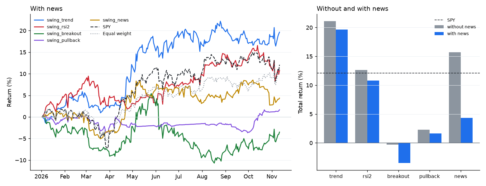

没有哪条规则年年都赢。两个上涨年份里趋势跟随最好；2022 年五个策略全都亏钱，但都比 SPY 亏得少，回调买入亏得最少。新闻过滤在 2026 年让收益变差，在 2020 年看起来有帮助，但 2020 年多出来的收益来自一个仓位：开新闻时空出了一个位置，趋势跟随在 2020 年 4 月买进了特斯拉，一直拿到年底。等权那一行能看出今天的大盘股带来的幸存者偏差，2020 年最大。所有区间都彼此重叠，每次运行都通过了防偷看检查。策略定义、带 95% 区间的完整表格和写论文的建议见 [docs/zh/research.md](docs/zh/research.md)。

### 📊 回测

内置策略、平衡档、55 只大盘股（`megacap` 股票池）、10 万美元本金、收盘出信号次日成交、5 个基点滑点，时间 2018 年 1 月到 2026 年 11 月：

| | risk_aware | SPY 买入持有 |
|---|---|---|
| 年化收益 | 10.4% | 14.1% |
| 波动率 | 9.3% | 19.0% |
| 夏普比率 | 0.84 | 0.66 |
| 最大回撤 | -18.2% | -33.7% |
| 最差年份 | -3.7% | -18.2% |
| 平均股票仓位 / 现金加短债 | 57% / 39% | 100% / 0% |

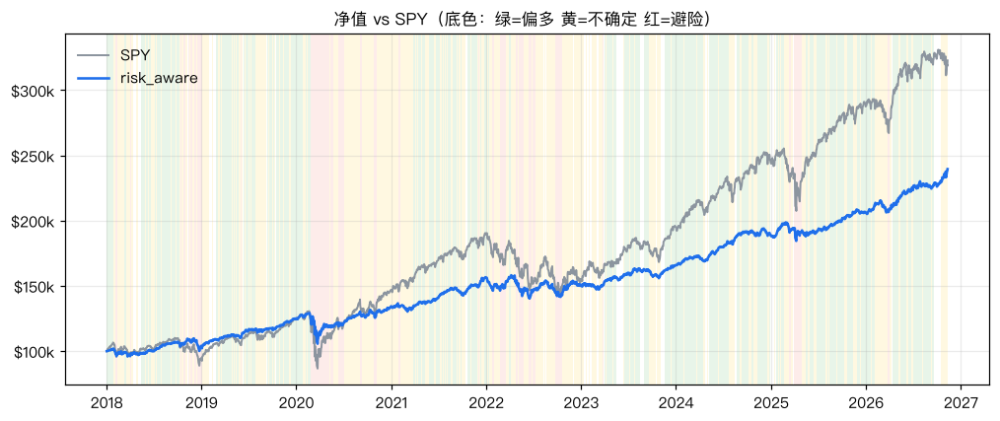

请客观看待这组数字：长牛市里它因为始终留 30% 以上现金，收益比指数低；市场下跌时它的亏损大约只有指数的一半。股票池是今天的大盘股，有幸存者偏差；这组数字没有用新闻和财报数据（2026 年带新闻的结果见下文）；过去的表现不代表未来。用 `riskaware backtest --compare buy_and_hold` 可以自己复现。

```bash
riskaware backtest --strategy risk_aware --compare buy_and_hold,ema_bounce,rsi2 --start 2018-01-01 --open
riskaware backtest --preset etf --profile conservative     # 只用 ETF、保守档
riskaware backtest --symbols AAPL,MSFT,NVDA,COST --cash 25000
riskaware backtest --synthetic                             # 离线演示，不下载数据
```

每次回测都会生成一个独立的 HTML 报告（各项指标、带市场状态底色的净值和回撤图、月度收益、每笔交易和理由）以及 CSV 文件。

#### 2026 年至今，带新闻

同一个智能体、同样的设置，回测 2026 年 1 月 2 日到 11 月 11 日，这次读安装包自带的新闻：这 56 只股票的 15,542 条 Benzinga 标题和 605 份 SEC 公告，每天只看当天收盘前已经发布的。

| 2026 年 1 月 2 日 – 11 月 11 日 | risk_aware + 新闻 | risk_aware，不带新闻 | SPY 买入持有 |
|---|---|---|---|
| 收益 | **+15.9%** | +15.4% | +12.1% |
| 波动率 | 8.2% | 7.8% | 14.0% |
| 夏普比率 | 1.70 | 1.73 | 0.77 |
| 最大回撤 | **-5.3%** | -5.3% | -8.9% |
| 平均股票 / 现金加短债 | 60% / 35% | 61% / 34% | 100% / 0% |

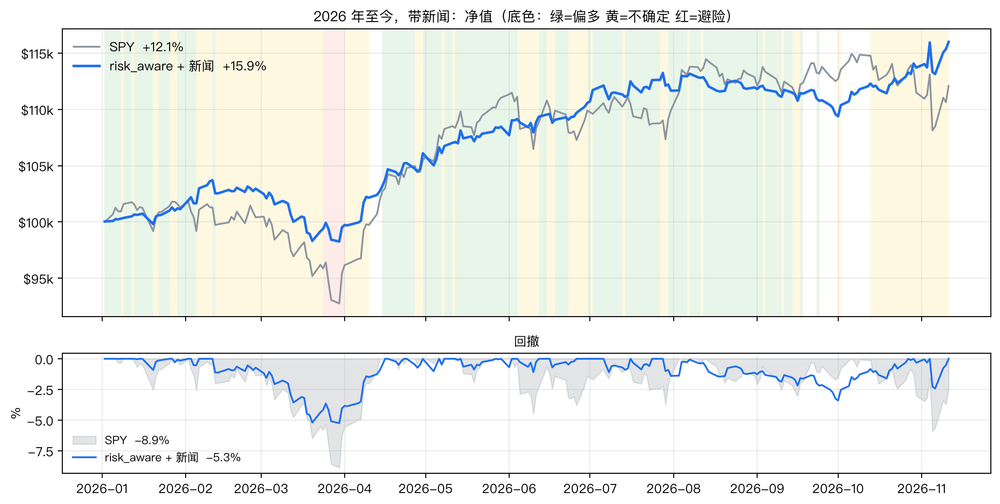

智能体平均只用 60% 的资金持股，收益却比 SPY 多 3.8 个百分点；最大回撤只有 SPY 的六成：三月那波下跌里它跌了 5.3%，SPY 跌了 8.9%。今年新闻让收益多了半个百分点。十个月的回测时间偏短，上面 2018–2026 年的那组数字仍然更有参考价值。用 `riskaware backtest --preset megacap --start 2026-01-02 --end 2026-11-11 --news` 可以自己复现。

#### 用新闻回测

回测只能用当天已经能看到的新闻，所以每条新闻都要有发布时间。2020、2022 和 2026 年的新闻随安装包自带，都是内置股票池的 64 只股票：分别是 19,618、29,300 和 16,945 条（Benzinga 标题，只有标题；2026 年另有 SEC 8-K 公告，1 月 1 日到 11 月 11 日）。其他年份用 `riskaware news-history` 在你自己的电脑上建新闻库（`~/.riskaware/news`，不进代码仓库）。回测加 `--news` 会把两者一起按天回放，走的是和实盘一样的聚类和两家来源交叉验证。每天只能看到当天收盘前（美东时间 16:00，提前收盘的日子是 13:00）发布的新闻，第二天才成交。

```bash
riskaware backtest --strategy examples/strategies/news_earnings_drift.py --preset megacap --start 2026-01-02 --news   # 2026 年什么都不用下载
riskaware news-history build --preset core --contact-email you@example.com   # 2018 年以来的 SEC 8-K 公告
riskaware news-history build --symbols AAPL,NVDA --source benzinga             # 用你自己的 BENZINGA_API_KEY
riskaware news-history import my_news.csv --tz America/New_York               # 列：timestamp, symbol, headline[, source, url, sentiment]
riskaware news-history status
riskaware news-history show NVDA --date 2024-05-22                             # 回测在那天收盘时看到了什么
riskaware backtest --strategy examples/strategies/news_earnings_drift.py --preset core --news --compare buy_and_hold
```

| 来源 | 存进新闻库的内容 | 费用 |
|---|---|---|
| 安装包自带 | 内置股票池 64 只股票的 2020、2022、2026 年 Benzinga 标题（只有标题），以及 2026 年的 SEC 8-K 公告 | 免费，装好就有 |
| SEC EDGAR | 每一份 8-K（财报、高管变动、并购、减值、财报重述），带 SEC 受理时间 | 免费；SEC 要求注明联系邮箱 |
| Benzinga | 用你自己的新闻 API key 拉到的标题 | 你的 Benzinga 套餐 |
| CSV | 任何你有权使用的新闻 | — |

`core` 股票池是 SPY、QQQ、AAPL、MSFT、NVDA、AMZN、GOOGL、META、TSLA。SPY、QQQ 是基金不是公司，SEC 新闻库里基本没有它们的公告；议息、CPI、非农日历本来就在每次回测里决定市场状态。Benzinga 算一家来源，只有 Benzinga 报道的新闻在有 SEC 公告或第二家媒体佐证之前都算"单一来源"。你下载或导入的新闻只存在你自己的电脑上。详见 [docs/zh/news-history.md](docs/zh/news-history.md)。

**更多历史数据。** 我们手里的新闻库大得多，2011 到 2026 年约 320 万条 Benzinga 标题（每年 20 万到 30 万条），放不进安装包，所以只带了内置股票池的 2020、2022 和 2026 年。如果你需要更多年份或更多股票，欢迎开 issue，我们再看怎么提供，比如做成单独下载。

### 📚 策略库

所有内置策略都走同一套风控，所以都会守住现金底线。用 `riskaware backtest --strategy 名字` 回测任意一个，用 `--compare a,b,c` 一起对比。

| 策略 | 类型 | 思路 |
|---|---|---|
| `risk_aware` | 股票（默认） | 上面介绍的多智能体策略 |
| `momentum_rotation` | 股票 | 每月持有 6 个月相对强度最强、站在 EMA200 之上的股票 |
| `donchian_breakout` | 股票 | 海龟式：放量创 55 日新高买入，跌破 20 日低点卖出 |
| `bollinger_reversion` | 股票 | 上升趋势中收盘跌破布林带下轨买入，回到中轨卖出 |
| `fear_greed_dca` | 股票 / ETF | 市场恐慌时分批买入，极度贪婪时减仓 |
| `ema_bounce`、`rsi2`、`golden_cross`、`buy_and_hold` | 股票 | 简单的参考策略和基准 |
| `swing_trend`、`swing_rsi2`、`swing_breakout`、`swing_pullback`、`swing_news` | 股票 | 五种教科书式的波段策略，可开关新闻，是[研究工具箱](#-研究工具箱)的基准 |
| `aggressive_calls` | 期权 | 强势上升趋势回调时，买入 45–60 天到期、delta 约 0.6 的看涨期权；赚 100% 止盈，亏 50% 止损 |
| `wheel` | 期权 | 在支撑位附近卖出 delta 约 0.25 的现金担保看跌期权；被行权拿到股票后，在成本价以上卖备兑看涨期权 |

2018 年 1 月到 2026 年 11 月，`megacap` 股票池的回测结果：

| 策略 | 档位、本金 | 年化收益 | 夏普 | 最大回撤 | 最差年份 |
|---|---|---|---|---|---|
| `wheel` | 激进、100 万美元 | 14.1% | 1.12 | -21.7% | +5.8% |
| `momentum_rotation` | 平衡、10 万美元 | 12.5% | 0.91 | -18.2% | -8.2% |
| `risk_aware` | 平衡、10 万美元 | 10.4% | 0.84 | -18.2% | -3.8% |
| `donchian_breakout` | 平衡、10 万美元 | 9.8% | 0.86 | -12.6% | -6.7% |
| `aggressive_calls` | 激进、10 万美元 | 6.7% | 0.30 | -40.3% | -24.7% |
| `bollinger_reversion` | 平衡、10 万美元 | 4.5% | 0.58 | -4.4% | +0.8% |
| SPY 买入持有 | | 14.1% | 0.66 | -33.7% | -18.2% |

#### 期权（目前只支持回测）

期权策略可以买入看涨或看跌期权、卖现金担保看跌期权、卖备兑看涨期权。风控会限制：买入期权的权利金总额（`options_sleeve`：保守 0%、平衡 3%、激进 12%）和单笔上限（`options_per_trade`：0 / 1% / 3%）；卖 put 的保证金不能占用 30% 的现金底线，被行权后的持仓也不能超过单票上限；为备兑 call 担保的股票不会被卖掉。到期时按内在价值结算；卖出的 put 被行权就买入股票，备兑 call 被行权就卖出股票。

市面上没有免费的历史期权报价，所以回测用 Black-Scholes 定价，隐含波动率由模型估算（指数 ETF 直接用 VIX；个股用历史波动率加 10% 的波动率溢价，再按 VIX 调整），每次成交付一半的 4% 买卖价差，外加每张 0.65 美元手续费。结果会随这些假设变化：去掉 10% 的波动率溢价后，wheel 的夏普降到 0.81；`aggressive_calls` 的年化在 3% 到 15% 之间，取决于价差和波动率的假设，但最大回撤始终在 -40% 左右。期权回测只能看策略的大致形态，不能当成收益预测。这个版本里 `riskaware run` 会跳过期权订单。

卖一张 put 需要准备买 100 股的现金，而且要在单票上限以内，所以 wheel 只会交易行权价 × 100 放得下的股票（10 万美元的激进账户每只大约 1 万美元）。测试 wheel 时请用 `--cash 1000000`，或者换成股价较低的股票池。

### 🧩 写你自己的策略

只要写一个 Python 方法，同一个策略对象就能在回测、模拟盘和实盘里运行，并且走同一套风控。

```bash
riskaware new-strategy my_dip          # 用模板生成 my_dip.py
riskaware backtest --strategy my_dip.py --compare risk_aware,buy_and_hold
riskaware run --strategy my_dip.py     # 用它跑模拟盘
```

```python
from riskaware.strategy import Action, Signal, Strategy

class MyDip(Strategy):
    name = "my_dip"
    default_params = {"rsi_entry": 30, "take_profit": 0.20}

    def on_bar(self, ctx):
        signals = []
        for sym in ctx.universe:
            row = ctx.row(sym)                 # 今天收盘时的各项指标
            if row is None:
                continue
            pos = ctx.position(sym)
            if pos is None and row["close"] > row["ema200"] and row["rsi14"] < self.params["rsi_entry"]:
                signals.append(Signal(sym, Action.BUY, strength=0.7, reason="上升趋势中的超卖"))
            elif pos and pos.gain >= self.params["take_profit"]:
                signals.append(Signal(sym, Action.SELL, strength=0.8, fraction=0.5, reason="止盈一半"))
        return signals
```

策略只负责说"想做什么、有多大把握"；买多少由风控决定，现金底线、各种上限和市场状态规则也由风控执行，所以你的策略自动得到同样的保护。`ctx.market` 里有市场状态、VIX 和即将到来的事件；实盘时 `ctx.quality(sym)` 和 `ctx.news(sym)` 给出财报评分和验证过的新闻；回测加 `--news` 时 `ctx.news` 也能用。详见 [docs/zh/custom-strategies.md](docs/zh/custom-strategies.md)。也可以用大白话描述，让 AI 在[策略实验室](#-策略实验室)里帮你写。

---

## 📸 截图一览

网页看板（`riskaware dashboard`）的每一页，中英文都有。点图片可以看大图。

<table>
<tr><td width="50%"><a href="site/assets/dashboard_zh.jpg">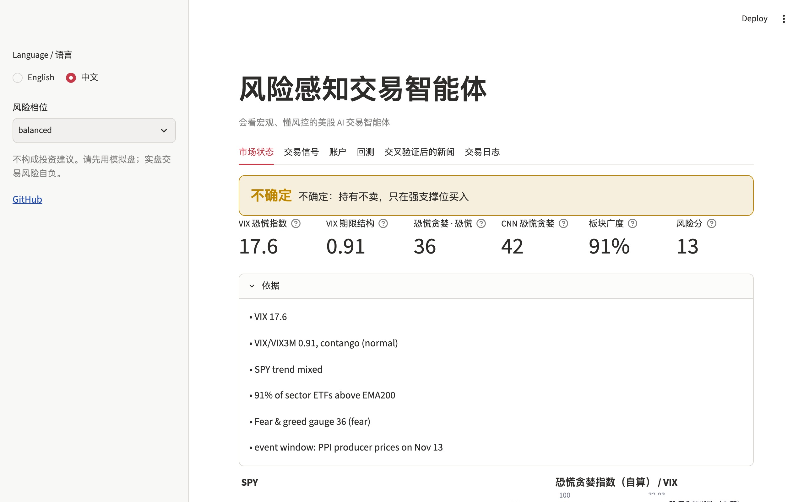</a><br><sub><b>市场</b> — 市场状态、恐慌贪婪、VIX、板块广度和宏观日历</sub></td><td width="50%"><a href="site/assets/agents_zh.jpg"></a><br><sub><b>智能体</b> — 模拟盘智能体排行榜，和 SPY 对比</sub></td></tr>
<tr><td width="50%"><a href="site/assets/decisions_zh.jpg">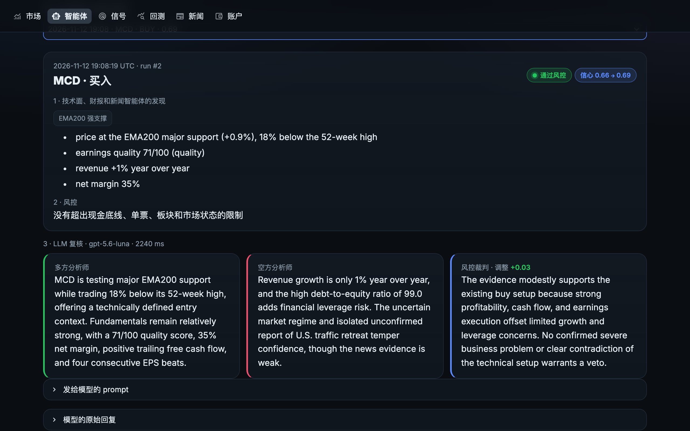</a><br><sub><b>它是怎么决定的</b> — 技术形态、风控结论，以及 LLM 的多方、空方意见和裁判结论</sub></td><td width="50%"><a href="site/assets/agent_detail_zh.jpg">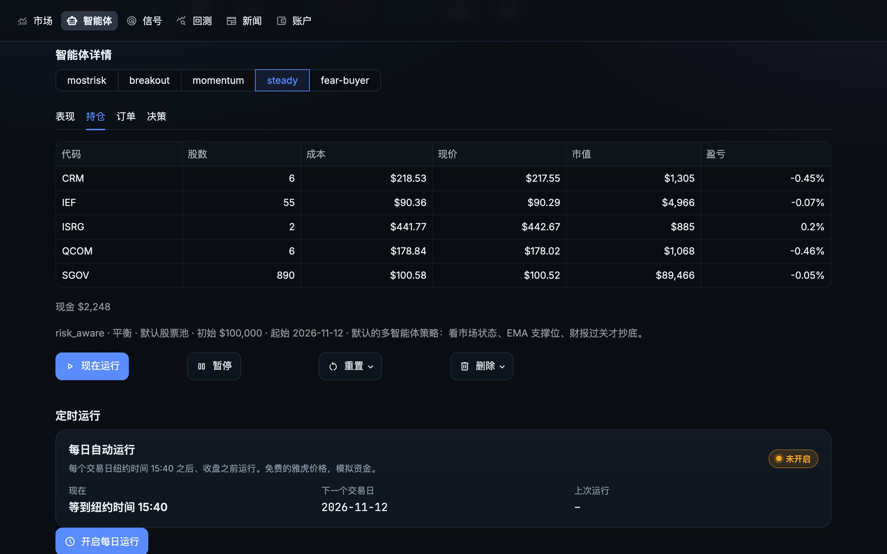</a><br><sub><b>智能体详情</b> — 持仓、订单和每个决策的理由</sub></td></tr>
<tr><td width="50%"><a href="site/assets/signals_zh.jpg">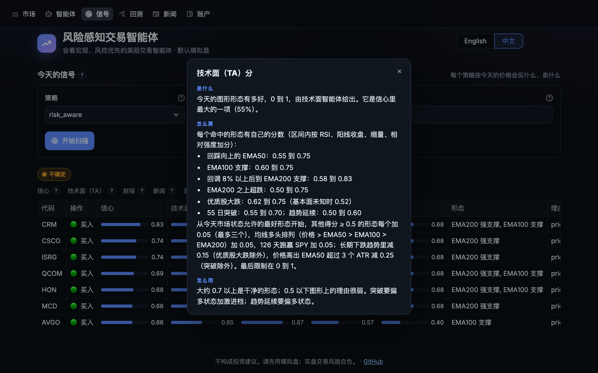</a><br><sub><b>信号</b> — 策略今天会买什么、卖什么：信心分和它的技术面（TA）、财报、新闻、宏观四项，每一项都有 ? 可以点开看说明</sub></td><td width="50%"><a href="site/assets/backtest_zh.jpg">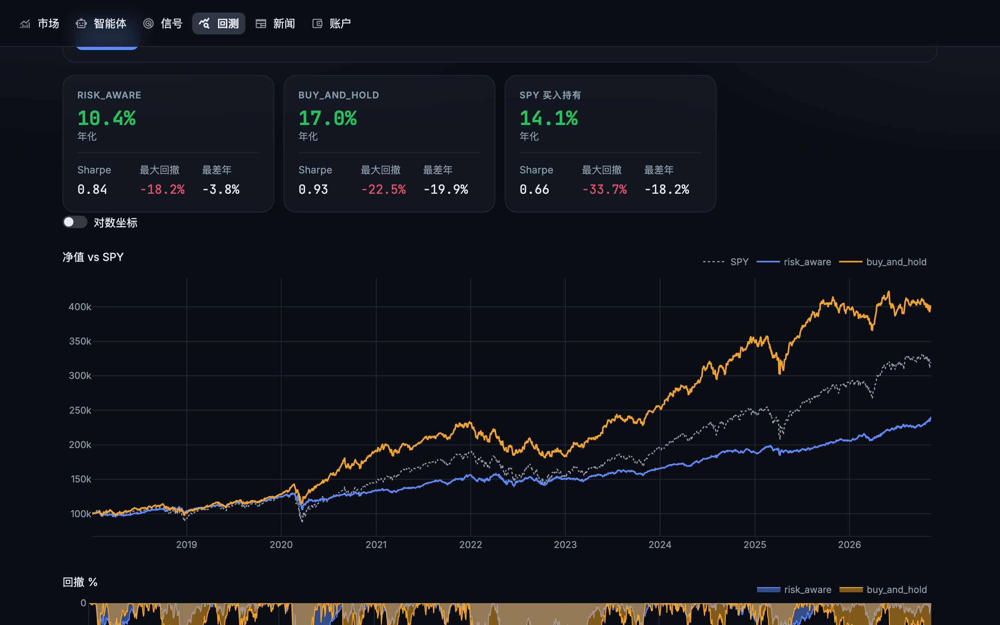</a><br><sub><b>回测</b> — 任意策略和 SPY 对比，含回撤和每笔交易</sub></td></tr>
<tr><td width="50%"><a href="site/assets/news_zh.jpg">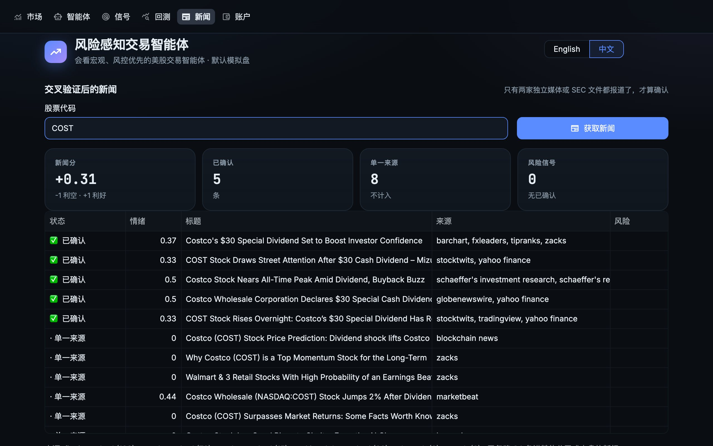</a><br><sub><b>交叉验证新闻</b> — 两家独立媒体、公司自己的通稿或 SEC 公告报道了才算确认</sub></td><td width="50%"><a href="site/assets/backtest_news_zh.jpg">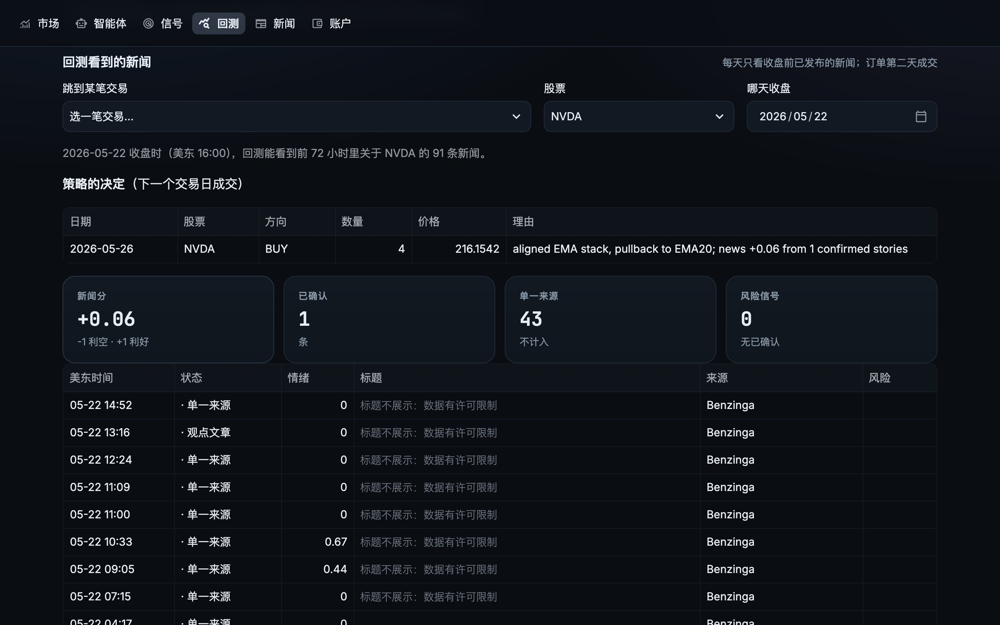</a><br><sub><b>回测看到的新闻</b> — 选任意一笔交易，看回测在那天收盘时看到了哪些标题、怎么判断的，以及第二天下了什么单</sub></td></tr>
</table>

## 🔌 支持的券商

| 券商 | `broker.name` | 模拟盘 | 安装 | 状态 |
|---|---|---|---|---|
| 内置模拟盘 | `paper` | 始终是 | 内置 | 已测试 |
| Alpaca | `alpaca` | 有 | 内置 | **已在模拟盘实测**（下单、成交、撤单、完整交易循环） |
| Public.com | `public` | 无（只有实盘） | 内置 | 按官方 API 文档做了单元测试 |
| Tradier | `tradier` | 沙盒 | 内置 | 按官方 API 文档做了单元测试 |
| 盈透 IBKR | `ibkr` | 模拟账户 | `.[ibkr]` | 基于 `ib_async` 编写 |
| 嘉信 Schwab | `schwab` | 无 | `.[schwab]` | 基于 `schwab-py` 编写 |
| tastytrade | `tastytrade` | cert 沙盒 | `.[tastytrade]` | 基于官方 `tastytrade` SDK 编写 |
| 富途 / moomoo | `futu` | 模拟交易 | `.[futu]` | 基于 `futu-api`（OpenD）编写 |
| 老虎证券 | `tiger` | 模拟账户 | `.[tiger]` | 基于 `tigeropen` 编写 |
| 长桥 | `longbridge` | 模拟账户 | `.[longbridge]` | 基于 `longport` 编写 |

各家券商怎么配置（key、网关、模拟账户）见 [docs/zh/brokers.md](docs/zh/brokers.md)。基于 SDK 的几个接口还没有在真实账户上跑过，欢迎反馈使用情况。

## 🔒 安全机制

- 除非你改了券商配置，`riskaware run` 用的是模拟账户；加 `--dry-run` 只预览，什么都不发送。
- 实盘下单需要同时满足：配置文件里 `execution.mode: live`，命令加 `--live`，并且手动确认（或加 `--yes`）。
- 安全开关：限价必须在报价附近的范围内、单笔金额上限、每次运行的订单数上限、休市日不交易；订单 ID 按日期确定性生成，同一天重复运行不会重复下单。
- `riskaware halt` 一键停止所有下单，`riskaware resume` 恢复。
- 每次运行、每个决定、每笔订单都记在本地 SQLite 交易日志里（`~/.riskaware/journal.db`），看板里可以查看。
- API key 只放在 `.env` 里（参考 [examples/.env.example](examples/.env.example)），不会写进配置文件或日志。

## 🔧 配置

`riskaware init` 会生成带中英注释的 `riskaware.yaml`，所有字段都可以省略。

```yaml
language: zh                 # en | zh
profile: balanced            # conservative 保守 | balanced 平衡 | aggressive 激进
profile_overrides:
  cash_floor: 0.30           # 现金 + 短期国债始终不低于 30%
  hard_stop: 0.30            # 亏损 30% 紧急止损（null 为不设）
broker:
  name: futu                 # 富途 / moomoo
  options: {simulate: true, security_firm: FUTUINC}
universe:
  preset: megacap            # megacap | tech | defensive | etf | sectors，可用 + 组合
  symbols: [PLTR, SHOP]
  cash_vehicle: SGOV         # 闲置现金买短期国债 ETF
news:
  min_independent_sources: 2 # 两家独立媒体报道才算确认
llm:
  enabled: false
  provider: openai           # 或 anthropic；openai 指任何 OpenAI 兼容接口
  model: deepseek-chat
  base_url: https://api.deepseek.com/v1
  api_key_env: DEEPSEEK_API_KEY
```

`riskaware config` 显示最终生效的配置；`riskaware doctor` 检查数据源和券商连接。

## 🧰 内部结构

### 💻 命令一览

| 命令 | 作用 |
|---|---|
| `riskaware init` | 配置向导 |
| `riskaware doctor` | 检查依赖、数据源、券商连接 |
| `riskaware regime` | 市场状态和即将到来的宏观事件 |
| `riskaware calendar [--earnings] [--refresh]` | FOMC、CPI、非农、PPI、GDP、PCE 和财报日 |
| `riskaware scan` | 今天的交易信号 |
| `riskaware analyze 代码` | 一只股票的技术面、财报、新闻和结论 |
| `riskaware news 代码 [--all]` | 交叉验证后的新闻 |
| `riskaware plan` | 用你的账户预演今天的订单 |
| `riskaware run [--dry-run] [--live]` | 跑一次交易循环 |
| `riskaware schedule [--print-cron]` | 每个交易日在 `execution.run_time`（美东时间）自动运行 |
| `riskaware portfolio` | 账户、持仓、未成交订单 |
| `riskaware backtest [--news]` | 回测和策略对比（`--news` 回放新闻；安装包自带 2020、2022、2026 年） |
| `riskaware lab 文件 [--check-only] [--save 名字]` | 检查策略有没有偷看未来、有没有副作用，再在单独的进程里回测 |
| `riskaware news-history build / import / status / show` | 回测用的本地历史新闻库 |
| `riskaware research day / run / baselines / trade / runs / data` | 冻结的 2020、2022、2026 年市场（`--period`）：任意一天的数据、带防偷看检查的实验、LLM 交易 |
| `riskaware strategies` / `new-strategy` | 列出内置策略 / 生成策略模板 |
| `riskaware brokers` | 支持的券商及所需配置 |
| `riskaware halt` / `resume` | 一键停止 / 恢复交易 |
| `riskaware agents [init\|add\|run\|list\|show\|pause\|resume\|reset\|remove]` | 模拟盘智能体 |
| `riskaware agents schedule --install` | 每个交易日自动运行智能体 |
| `riskaware mcp` | 给 Claude 等 AI 助手用的 MCP 服务器 |
| `riskaware dashboard` | 网页看板 |

### 📁 目录结构

```
src/riskaware/      Python 包本体
  agents/           宏观状态、技术形态、财报质量、新闻
  strategy/         策略接口、内置策略、示例、波段基准策略、加载器
  risk.py           风控（现金底线、各类上限、分批、状态规则）
  engine.py         模拟盘 / 实盘交易循环、安全开关、日志、持仓状态
  backtest/         回测引擎、指标、HTML 报告
  research/         冻结的 2020、2022、2026 年市场、按日期查询、实验、防偷看检查、LLM 交易会话
  news/             Finviz + RSS + SEC 新闻源、相关性过滤、交叉验证、2020、2022、2026 年新闻文件
  data/             价格（Yahoo、CSV、模拟数据）、FOMC/BLS/BEA 日历、基本面、CNN 恐慌贪婪指数
  brokers/          模拟盘 + 9 家券商接口
  options/          回测用的期权定价和合约选择
  llm/              可选的多空辩论复核
  dashboard/        Streamlit 网页看板（页面、主题、图表）
  arena.py          模拟盘智能体：账户、每日运行、排行榜
  scheduler.py      每日后台任务（launchd、cron、计划任务）
  mcp_server.py     给 Claude 和其他 MCP 客户端用的工具
  cli.py            riskaware 命令
tests/              离线测试（pytest）
docs/               使用指南和设计说明；docs/zh/ 是中文指南和中文更新记录
examples/           示例配置、示例策略、.env.example
scripts/            重建自带的行情和新闻数据、生成发版说明和 Claude Desktop 扩展、隐私检查和它的提交钩子
server.json         每次发版发布到 MCP Registry 的条目
site/               中英双语项目网站和指南（GitHub Pages）
docker/             Dockerfile 和 docker-compose.yml
.devcontainer/      GitHub Codespaces 和 VS Code 开发容器配置
.github/            CI、发布和网站部署流程，Issue 和 PR 模板，参与贡献、安全和行为准则说明
```

---

## ❓ 常见问题

网站上有更完整的回答：[用新闻回测，不用未来函数](https://jackson-cmd.github.io/risk-aware-trading-agents/zh/news-backtesting.html) · [按时间点记录的 2026 年美股数据](https://jackson-cmd.github.io/risk-aware-trading-agents/zh/point-in-time-market-data.html) · [测试 LLM 交易智能体](https://jackson-cmd.github.io/risk-aware-trading-agents/zh/llm-trading-agents.html)。

### 怎么用新闻回测交易策略，又不用到未来函数（look-ahead）？

用 `riskaware backtest --news`；想要一份可以引用的记录，就用 `riskaware research run`。新闻按时间点回放：每一天，策略只能看到当天纽约时间 16:00 收盘之前发布的标题和 SEC 公告，订单在下一个交易日开盘成交。研究工具箱的每次实验还会把三个切点之后的数据换成随机的再跑一遍，每个切点之前的决定都不能变。详见[用新闻回测](docs/zh/news-history.md)和[研究工具箱](docs/zh/research.md)。

### 回测用的历史新闻数据从哪里来？

2020、2022 和 2026 年的数据随安装包提供，都是 64 只美国大盘股：分别是 19,618、29,300 和 16,945 条新闻，Benzinga 标题（只有标题；2026 年另有 SEC 8-K 公告），每条都带发布时间。其他年份可以用 `riskaware news-history build` 免费下载 SEC 8-K 公告，也可以用你自己的 API key 下载 Benzinga 标题；任何包含时间、代码和标题的 CSV 也能导入。详见 [docs/zh/news-history.md](docs/zh/news-history.md)。

### 有没有免费的、按时间点记录的美股价格、VIX 和新闻数据？

有。研究工具箱里有三段冻结的市场：2026 年至今、2022 年和 2020 年，每段都有 64 只股票和 25 个 ETF 从前两年起的日线、VIX 期限结构（VIX9D、VIX、VIX3M、VVIX）和当年的新闻，并附带 SHA-256 哈希，论文可以准确引用用到的数据。`riskaware research day 2022-06-13` 可以看到那天收盘时已知的全部信息。详见[自带哪些数据](docs/zh/research.md#自带哪些数据)。

### 怎么公平地评测一个 LLM 交易智能体？

让它在一段冻结的市场（2026、2022 或 2020 年）上一步一步做决定：用 `riskaware research trade --llm ...`，或者通过 MCP 调 `trading_session_start`。每份观察只包含那天收盘时已知的信息，订单在次日开盘成交，整次运行连同每一笔订单和相对 SPY 的指标一起保存。盲测模式会替换股票代码、公司名和日期，模型没法凭记忆知道某只股票后来怎么样。详见 [LLM 智能体](docs/zh/research.md#让-llm-把一个时段交易一遍)。

### Claude、ChatGPT（Codex）或 Gemini 能帮我回测策略吗？

能，通过 MCP。运行 `riskaware mcp-setup claude-desktop --apply`（或 `claude-code`、`codex`、`gemini`），然后用一句话描述策略。助手会把它写成代码；代码先检查有没有写日期、股票代码和副作用，再在单独的进程里运行，最后给出指标、置信区间和防偷看检查的结论。详见 [MCP 服务器](#-mcp-服务器)和[策略实验室](docs/zh/strategy-lab.md)。

### 新闻情绪能让波段交易策略更好吗？

在我们 2026 年、只用一个标题来源的测试里不能。给五种常见波段策略（趋势跟随、RSI(2) 均值回归、突破、回调买入、新闻后的惯性）加上新闻过滤，每一个都略差了一点；按正面标题买入，也不如按同样幅度的价格异动买入。趋势跟随赚了 +21.1%，同期 SPY 是 +12.1%。详见[结果](#-研究工具箱)。

### 不想拿真钱冒险，怎么先模拟交易？

默认就是模拟盘。`riskaware run` 用内置的模拟账户交易，`riskaware agents` 每个交易日用模拟资金跑多个策略，Alpaca 这类券商的模拟账户也能用。实盘交易要打开三个开关才行。详见[安全机制](#-安全机制)。

### 支持哪些券商？

内置模拟盘、Alpaca、盈透（Interactive Brokers）、Public.com、嘉信（Charles Schwab）、tastytrade、Tradier、富途/moomoo、老虎证券和长桥。详见[支持的券商](#-支持的券商)。

## 🧭 后续计划

- 回测使用 SEC XBRL 的历史时点财报数据
- 实盘期权下单（接入各券商的期权链）、保护性看跌和领口策略
- 更多券商（Webull、E*TRADE）以及加密货币、港股、A 股
- 滚动前推（walk-forward）的参数研究

## 🤝 参与贡献

欢迎提 issue 和 PR：新的券商、数据源、策略、翻译都可以。提 PR 前请先运行 `pip install -e ".[dev]" && pytest`，并看一下 [CONTRIBUTING.md](.github/CONTRIBUTING.md)。问题和想法发到 [Discussions](https://github.com/jackson-cmd/risk-aware-trading-agents/discussions)，bug 提到 [Issues](https://github.com/jackson-cmd/risk-aware-trading-agents/issues/new/choose)，安全问题请私下报告（[SECURITY.md](.github/SECURITY.md)）。参与者都要遵守[行为准则](.github/CODE_OF_CONDUCT.md)。

## 📝 引用

[](https://doi.org/10.5281/zenodo.24202496)

如果在研究里用到了本项目或冻结的市场数据，请引用。每个版本都存档在 Zenodo；[10.5281/zenodo.24202496](https://doi.org/10.5281/zenodo.24202496) 总是指向最新版本，每个版本在那里也有自己的 DOI。GitHub 页面上的 **Cite this repository** 按钮可以给出其他格式（[CITATION.cff](CITATION.cff)）；引用数据时，再加上时段、它的版本，以及 `src/riskaware/research/data/` 下它的 manifest 里的 SHA-256。

```bibtex
@software{risk_aware_trading_agents,
  title   = {Risk-Aware Trading Agents: AI trading agents for US stocks with point-in-time news backtesting},
  author  = {{Risk-Aware Trading Agents contributors}},
  year    = {2026},
  version = {0.7.2},
  doi     = {10.5281/zenodo.24202496},
  url     = {https://github.com/jackson-cmd/risk-aware-trading-agents}
}
```

## ❗ 免责声明

本软件仅用于研究和学习，不构成投资建议，也不推荐买卖任何证券。交易有亏损风险。账户发出的每一笔订单都由你自己负责，请先用模拟盘测试。

## 📜 开源协议

[MIT](LICENSE)
