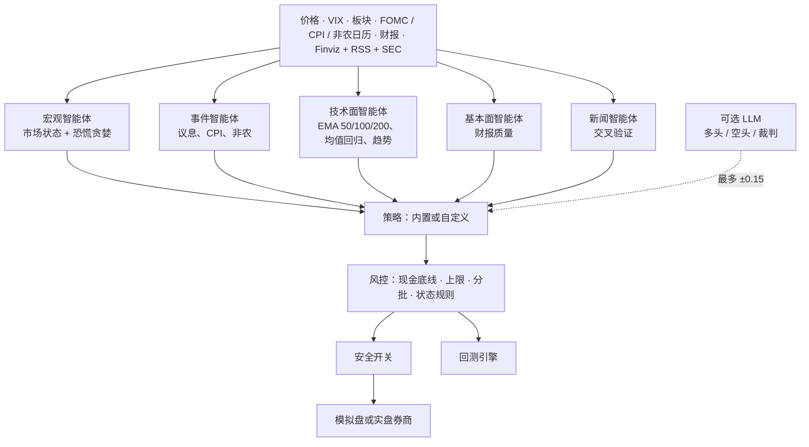

<div align="center">

# 📈 风险感知交易智能体 · Risk-Aware Trading Agents

### 先看宏观日历、恐慌指数和经过交叉验证的新闻，再决定买不买的美股 AI 交易智能体

*别人恐慌时买入 · 始终留 30% 现金 · 从不恐慌割肉*

**FOMC · CPI · 非农 · VIX 决定市场状态 · 回踩 EMA 50 / 100 / 200 时买入 · 财报过关才抄底 · Finviz + RSS + SEC 新闻交叉验证 · 每天自动跑的模拟盘智能体 · 给 Claude 用的 MCP 服务器 · 11 个策略（含期权）· 回测你自己的策略 · 10 家券商的模拟盘和实盘 · 中文和 English**

📊 **2026 年带新闻回测：收益 +15.9%，SPY +12.1% · 最大回撤 -5.3%，SPY -8.9% · 夏普 1.70，SPY 0.77** · [详情](#2026-年至今带新闻)

[English → README.md](README.md) · [项目主页](https://jackson-cmd.github.io/risk-aware-trading-agents/?lang=zh) · [新功能](#-新功能) · [截图](#-截图一览) · [快速开始](#-快速开始) · [模拟盘智能体](#-模拟盘智能体) · [MCP](#-mcp-服务器) · [策略实验室](#-策略实验室) · [策略库](#-策略库) · [支持的券商](#-支持的券商) · [更新记录](CHANGELOG_zh.md)

[](https://github.com/jackson-cmd/risk-aware-trading-agents/actions/workflows/ci.yml)
[](https://www.python.org/)
[](LICENSE)
[](#-安全机制)
[](CHANGELOG_zh.md)
[](#-mcp-服务器)
[](#-策略库)
[](#-支持的券商)
[](README.md)


</div>

---

## 目录

- [🆕 新功能](#-新功能) · [📸 截图一览](#-截图一览) · [💡 设计思路](#-设计思路) · [✨ 主要功能](#-主要功能) · [🚀 快速开始](#-快速开始)
- [🤖 模拟盘智能体](#-模拟盘智能体) · [🔗 MCP 服务器](#-mcp-服务器) · [🧪 策略实验室](#-策略实验室)
- [🧠 工作原理](#-工作原理)：[市场状态](#不同市场状态下的做法) · [风险档位](#风险档位)
- [📊 回测](#-回测)：[用新闻回测](#用新闻回测) · [📚 策略库](#-策略库)：[期权](#期权目前只支持回测) · [🧩 写你自己的策略](#-写你自己的策略)
- [🔌 支持的券商](#-支持的券商) · [🔒 安全机制](#-安全机制) · [🔧 配置](#-配置) · [💻 命令一览](#-命令一览) · [📁 目录结构](#-目录结构)
- [🧭 后续计划](#-后续计划) · [🤝 参与贡献](#-参与贡献) · [❗ 免责声明](#-免责声明) · [📜 开源协议](#-开源协议)

## 🆕 新功能

<sub>最新版本 **0.6.1**（2026-11-12）。完整的更新历史见[更新记录](CHANGELOG_zh.md)。</sub>

| | 0.6 和 0.5 新加入 |
|---|---|
|  | **🔎 每笔回测交易背后的新闻**：看板回测页新增 **回测看到的新闻** 面板。选一笔交易，就能看到回测在那天收盘时看到的标题、哪些已确认、新闻分，以及策略第二天下的单。[怎么用 →](docs/zh/news-history.md#查看回测看到的新闻) |
|  | **🗞️ 自带 2026 年新闻**：安装包里带了内置股票池 64 只股票的 16,945 条新闻（Benzinga 标题，只有标题，加上 SEC 8-K 公告，2026 年 1 月到 11 月），`riskaware backtest --news` 或看板回测页新加的 **回放新闻** 开关，什么都不用下载就能用。2026 年至今，内置智能体带新闻回测收益 **+15.9%**，同期 SPY +12.1%；最大回撤 **-5.3%**，SPY 是 -8.9%。[看结果 →](#2026-年至今带新闻) |
|  | **🧪 说出策略，AI 写代码并回测**：通过 MCP，Claude、Codex 或 Gemini 读 `strategy_guide`，把策略写成代码，用 `backtest_code` 回测。代码先检查有没有偷看未来、有没有副作用，再放到单独的进程里跑；好用的可以保存下来，看板和模拟盘智能体都能直接用。别处拿到的代码用 `riskaware lab 文件` 一样能跑。[怎么用 →](#-策略实验室) |
|  | **🔭 回测不偷看未来**：回测每天只能看到当天收盘前发布的新闻（提前收盘的日子是 13:00），有两种读法的时间按更晚的读，策略也没法再通过拿到的价格数据摸到之后的价格。[细节 →](docs/zh/news-history.md#回测怎么防止偷看未来) |
|  | **🔑 不需要 API key**：智能体的复核可以走你的 Claude、ChatGPT 或 Gemini 订阅，用你已经登录的命令行工具：`--llm claude-cli`、`--llm codex-cli` 或 `--llm gemini-cli`（Gemini CLI 或 Antigravity）。[怎么用 →](docs/zh/agents.md#不需要-api-key用你的订阅) |
|  | **🔌 一条命令接上 MCP**：`riskaware mcp-setup claude-desktop`（或 `claude-code`、`codex`、`gemini`、`antigravity`）把智能体接到对应的应用里，用大白话问行情、让智能体运行。[怎么配置 →](#-mcp-服务器) |
|  | **🗄️ 自己的新闻库**：其他年份用 `riskaware news-history` 在你自己的电脑上建一个按发布时间存的新闻库（免费的 SEC 8-K 公告、你自己的 Benzinga key 或任意 CSV），回测按同样的规则回放。[怎么用 →](docs/zh/news-history.md) |

<sub>0.4.0 让每个智能体都能配 LLM 复核（GPT、Claude 或免费的本地模型），每个决定都有记录，新闻也更难造假；0.3.0 加入了每天自动跑的模拟盘智能体、MCP 服务器和新看板；0.2.0 加入了期权回测和四个股票策略。详见[更新记录](CHANGELOG_zh.md)。</sub>

## 📸 截图一览

网页看板（`riskaware dashboard`）的每一页，中英文都有。点图片可以看大图。

<table>
<tr><td width="50%"><a href="site/assets/dashboard_zh.jpg"></a><br><sub><b>市场</b> — 市场状态、恐慌贪婪、VIX、板块广度和宏观日历</sub></td><td width="50%"><a href="site/assets/agents_zh.jpg"></a><br><sub><b>智能体</b> — 模拟盘智能体排行榜，和 SPY 对比</sub></td></tr>
<tr><td width="50%"><a href="site/assets/decisions_zh.jpg"></a><br><sub><b>它是怎么决定的</b> — 技术形态、风控结论，以及 LLM 的多方、空方意见和裁判结论</sub></td><td width="50%"><a href="site/assets/agent_detail_zh.jpg"></a><br><sub><b>智能体详情</b> — 持仓、订单和每个决策的理由</sub></td></tr>
<tr><td width="50%"><a href="site/assets/signals_zh.jpg"></a><br><sub><b>信号</b> — 策略今天会买什么、卖什么，附信心分和理由</sub></td><td width="50%"><a href="site/assets/backtest_zh.jpg"></a><br><sub><b>回测</b> — 任意策略和 SPY 对比，含回撤和每笔交易</sub></td></tr>
<tr><td width="50%"><a href="site/assets/news_zh.jpg"></a><br><sub><b>交叉验证新闻</b> — 两家独立媒体、公司自己的通稿或 SEC 公告报道了才算确认</sub></td><td width="50%"><a href="site/assets/backtest_news_zh.jpg"></a><br><sub><b>回测看到的新闻</b> — 选任意一笔交易，看回测在那天收盘时看到了哪些标题、怎么判断的，以及第二天下了什么单</sub></td></tr>
</table>

---

## 💡 设计思路

很多交易机器人要么见信号就追，要么得有量化团队才配得起来。这个项目走的是长线投资者熟悉的一套简单、讲得清的纪律：好公司回调到均线时买，市场恐慌但财报依然扎实时加仓，涨得太远时减仓，行情不明朗时不恐慌割肉，并且始终留一笔现金。四个智能体分别看市场、宏观日历、公司基本面和新闻，最后由一个规则明确的风控模块决定每一笔订单。

> 不构成投资建议。默认是模拟盘，实盘需要同时打开三个开关。

## ✨ 主要功能

- **看宏观的市场状态判断。** 综合 VIX 及其期限结构（VIX/VIX3M）、板块广度、信用偏好（HYG 对 IEF）、避险需求、用免费数据自算的恐慌贪婪指数（同时显示 CNN 恐慌贪婪指数作参考），以及 **FOMC 议息、CPI、非农、PPI、GDP、PCE** 的发布日历，把市场分成四种状态：偏多、中性、不确定、避险。
- **低买高卖。** 回踩 **EMA 50 / 100 / 200** 时买入；RSI(2) 和 z-score 均值回归；**财报过关才抄底**（看营收增长、利润率、自由现金流、负债、EPS 是否超预期）；强势行情里做突破和趋势延续。股价远远高于 EMA50 时分批止盈，跌破下行的 EMA50 时趋势减仓。
- **不恐慌卖出。** 市场处于不确定或避险状态时只持有、不卖出，只在强支撑位买入。只有公司自己在 8-K 公告或通稿里确认的重大利空（破产、退市、财报重述），或者你设置的硬止损，才会触发强制卖出。
- **风控优先。** **现金加短期国债始终不低于 30%**；单只股票、单个板块、高波动"小博大"仓位都有上限；按波动率决定仓位大小；分批建仓；保守档另配国债仓位；闲置现金自动买短期国债 ETF；回撤过大自动暂停买入；一键停止交易。
- **新闻交叉验证。** 汇总 Finviz（免费）、Google News、Nasdaq、Seeking Alpha、Yahoo 的 RSS，以及公司自己的 **SEC 8-K 公告**。一条新闻只算到它提到的那家公司头上；被两家独立媒体报道、公司自己发了通稿，或者有 SEC 公告佐证，才算"已确认"，上面的风险信号会挡住新的买入。但只有公司自己的 8-K 公告，或者公司通稿证实了独立媒体先报道的消息，才会触发强制卖出，所以一条假新闻、一份假通稿加上别家的转载，或者别家公司的坏消息，都没法让它清仓。辟谣会抵消它所否认的那条新闻，不会被当成确认。
- **10 家券商，统一接口。** 内置模拟盘，以及 **Alpaca、盈透（IBKR）、Public.com、嘉信（Schwab）、tastytrade、Tradier、富途/moomoo、老虎证券、长桥**。
- **期权策略（回测）。** 一个激进的买 call 策略和 wheel（卖现金担保 put 加备兑 call），有权利金上限，卖 put 的保证金不占现金底线，支持行权和到期结算。
- **什么都能回测，包括你自己的策略。** 只要写一个 Python 方法，同一个策略对象就能在回测、模拟盘和实盘里运行，并且走同一套风控。多个策略可以并排对比，生成 HTML 报告；还能按发布时间回放新闻：2026 年的标题和 SEC 公告随安装包自带，其他年份来自本地新闻库（SEC 8-K 公告、你自己的 Benzinga key 或 CSV）。
- **每天自动跑的模拟盘智能体。** 几个策略可以同时跑，每个都有自己的模拟账户，用免费价格交易。后台任务每个交易日让它们交易一次，排行榜拿它们和 SPY 对比。
- **能在 Claude 里用（MCP）。** `riskaware mcp` 让 Claude、Cursor 或任何 MCP 客户端都能查市场状态、信号、新闻、回测，以及管理模拟盘智能体。用大白话说出策略，AI 把它写成代码并回测，代码会先检查有没有偷看未来。
- **可选的 LLM 复核，每个智能体单独设置。** 多头分析师、空头分析师和风控裁判（GPT、Claude、任何 OpenAI 兼容模型比如 DeepSeek 或通义千问，或者用 Ollama 跑的免费本地模型）可以把信心分最多调高或调低 0.15，或者否决一笔买入。它们不能自己发起交易，也不能改任何限额。新闻只作为加了引号的不可信文本交给它们；每次的 prompt 和回复都存在本地日志里，每个决定是怎么做出来的都能看到。
- **中英双语。** 命令行、网页看板、回测报告和文档都支持中文和英文。

## 🚀 快速开始

```bash
git clone https://github.com/jackson-cmd/risk-aware-trading-agents
cd risk-aware-trading-agents
pip install -e ".[dashboard,mcp]"    # 需要 Python 3.10+
```

```bash
riskaware --lang zh init              # 两分钟配置向导：语言、风险档位、券商、股票池
riskaware --lang zh regime            # 市场状态、VIX、恐慌贪婪指数、下次 FOMC / CPI / 非农
riskaware --lang zh scan              # 今天的交易信号，每条都附理由
riskaware --lang zh analyze NVDA      # 各个智能体对一只股票的看法
riskaware --lang zh news AAPL         # 交叉验证后的新闻
riskaware --lang zh backtest --compare buy_and_hold,ema_bounce
riskaware --lang zh run               # 跑一次模拟盘交易（内置模拟账户）
riskaware --lang zh agents init       # 四个示例模拟盘智能体
riskaware --lang zh agents run        # 现在让它们交易一次
riskaware agents schedule --install   # 以后每个交易日自动交易
riskaware --lang zh dashboard         # 网页看板，右上角可切换中英文
```

上面这些命令都不需要券商账户或 API key。在配置文件里写 `language: zh`，以后就不用每次加 `--lang zh`。

## 🤖 模拟盘智能体

一个智能体就是一个策略加一个属于它自己的模拟账户。选好策略（内置的或你自己写的文件）、风险档位、股票池和初始资金，它就每个交易日用雅虎财经的免费价格在这个账户里交易一次。几个智能体可以同时跑，看看谁能跑赢 SPY。智能体只会用内置的模拟账户，永远不会连接券商。

```bash
riskaware agents init                                    # steady、momentum、breakout、fear-buyer
riskaware agents add dips --strategy rsi2 --universe tech --cash 25000
riskaware agents add mine --strategy my_dip.py:MyDip --profile aggressive
riskaware agents add luna --strategy risk_aware --llm openai:gpt-5.6-luna   # 配一个 LLM 复核
riskaware agents add local --strategy risk_aware --llm ollama:qwen2.5:3b    # 免费的本地模型
riskaware agents run                                     # 让所有活跃的智能体现在交易一次
riskaware agents why luna                                # 它是怎么决定的：形态、风控、多方/空方/裁判
riskaware agents                                         # 排行榜
riskaware agents schedule --install                      # 以后每个交易日自动运行
```

后台任务（macOS 上是 LaunchAgent，Linux 上是一行 crontab，Windows 上是计划任务）在工作日每 15 分钟唤醒一次，每个交易日纽约时间 15:40 之后、收盘之前，让每个智能体交易一次。它会跳过节假日，电脑睡眠醒来会补跑，某个智能体出错也不影响其他的。每个智能体的账户、日志和每天的净值都存在 `~/.riskaware/arena/名字/`。网页看板的「智能体」页能看到排行榜，也能新建、运行、暂停、重置和删除智能体；其中的「决策」页显示每个决定是怎么做出来的，包括 LLM 的多方、空方意见和结论，以及发给它的完整 prompt。用 GPT 需要在 `.env` 里设置 `OPENAI_API_KEY`；用本地模型需要装 [Ollama](https://ollama.com)（`ollama pull qwen2.5:3b`）；`--llm claude-cli`、`codex-cli` 或 `gemini-cli` 则通过命令行工具用你的 Claude、ChatGPT 或 Gemini 订阅，不需要 API key。详见 [docs/zh/agents.md](docs/zh/agents.md)。


## 🔗 MCP 服务器

`riskaware mcp` 通过 Model Context Protocol 提供这些智能体的能力，Claude、Codex、Gemini、Cursor 或任何 MCP 客户端都能直接用，走你的订阅，不需要 API key。`riskaware mcp-setup` 会打印（加 `--apply` 则直接执行）接入那一步：

```bash
pip install -e ".[mcp]"
riskaware mcp-setup claude-desktop --apply   # 也可以是 claude-code、codex（用你的 ChatGPT 登录）、gemini、antigravity
```

一共十三个工具：`market_regime`、`scan`、`analyze_stock`、`stock_news`、`list_strategies`、`backtest`、`strategy_guide`、`backtest_code`、`agents_leaderboard`、`agent_detail`、`agent_decisions`、`agents_create` 和 `agents_run`。它们要么只读，要么只操作本地模拟账户，没有任何工具能向券商下单。之后直接问就行，比如「现在市场是什么状态，这周有什么重要数据？」或者「用 100 万美元在 megacap 上回测 2018 年以来的 wheel」。ChatGPT 本身只能连远程服务器，所以 OpenAI 这边用 Codex，它走你的 ChatGPT 登录。详见 [docs/zh/agents.md](docs/zh/agents.md#在-claudechatgpt-或-gemini-里使用mcp)。

## 🧪 策略实验室

用大白话说出你想要的策略，让 AI 来写。通过 MCP，Claude、Codex 或 Gemini 读 `strategy_guide`，把策略写成一个 Python 类，再用 `backtest_code` 回测。代码运行前，实验室会拒绝写死在代码里的日期和股票代码（两者都会让回测知道未来），也不允许读写文件、联网、访问私有属性。检查通过后，在一个没有任何 API key、有时间上限的单独进程里回测，返回的指标和 SPY、买入持有放在一起；有问题就返回要改的行。

> 写一个策略：上升趋势里连跌两天、最近新闻偏正面时买入，持有 10 天或涨 8% 卖出。用 2026 年的 tech 股票池带新闻回测。

`save_as` 把好用的策略保存下来，之后看板里能看到，也能当模拟盘智能体每天跑。从别处拿到的代码，用 `riskaware lab my_strategy.py --preset tech` 做同样的检查和回测。详见 [docs/zh/strategy-lab.md](docs/zh/strategy-lab.md)。

## 🧠 工作原理



### 不同市场状态下的做法

| 市场状态 | 典型触发条件 | 买入 | 卖出 | 仓位系数 |
|---|---|---|---|---|
| 🟢 **偏多** | SPY 在上行的 EMA50 和 EMA200 之上，VIX < 20，多数板块站上 EMA200 | 回调、突破、抄底 | 止盈、趋势破位减仓 | 100% |
| ⚪ **中性** | 其余情况 | EMA 支撑、均值回归、优质股抄底 | 止盈 | 75% |
| 🟡 **不确定** | FOMC 议息前两天、CPI 和非农发布前一天、VIX 20–30、恐慌指数 < 35、下跌趋势 | 只在 EMA100 / EMA200 支撑买 | **不卖：持有** | 50% |
| 🔴 **避险** | VIX ≥ 30、跌破 EMA200 且 VIX 期限倒挂、信用紧张 | 只抄优质股和宽基 ETF，小批量 | **不卖：持有** | 35% |

紧急卖出（公司自己在 8-K 公告或通稿里确认的严重利空，或者档位里的硬止损）在任何状态下都有效。

### 风险档位

| | 保守 | 平衡 | 激进 |
|---|---|---|---|
| 现金 + 短期国债底线 | 30% | 30% | 30% |
| 国债仓位（IEF） | 15% | 5% | 0% |
| 单只股票 / 单个板块上限 | 5% / 20% | 7% / 25% | 10% / 35% |
| 高波动"小博大"仓位 | 0% | 3%（最多 2 只） | 7%（最多 3 只） |
| 最低信心分 | 0.65 | 0.58 | 0.52 |
| 抄底所需的财报分 | 70 | 60 | 50 |
| 止盈触发涨幅 | +20% | +25% | +30% |
| 突破买入 | 关 | 关 | 开 |

所有限额都可以在 `riskaware.yaml` 里改。每个仓位分三批建（目标仓位的 50% / 25% / 25%）；加第二、三批需要价格跌到更深的支撑，或者持仓已经盈利；减过仓的股票，下一次回调时还能补回来。

## 📊 回测

内置策略、平衡档、55 只大盘股（`megacap` 股票池）、10 万美元本金、收盘出信号次日成交、5 个基点滑点，时间 2018 年 1 月到 2026 年 11 月：

| | risk_aware | SPY 买入持有 |
|---|---|---|
| 年化收益 | 10.4% | 14.1% |
| 波动率 | 9.3% | 19.0% |
| 夏普比率 | 0.84 | 0.66 |
| 最大回撤 | -18.2% | -33.7% |
| 最差年份 | -3.7% | -18.2% |
| 平均股票仓位 / 现金加短债 | 57% / 39% | 100% / 0% |


请客观看待这组数字：长牛市里它因为始终留 30% 以上现金，收益比指数低；市场下跌时它的亏损大约只有指数的一半。股票池是今天的大盘股，有幸存者偏差；这组数字没有用新闻和财报数据（2026 年带新闻的结果见下文）；过去的表现不代表未来。用 `riskaware backtest --compare buy_and_hold` 可以自己复现。

```bash
riskaware backtest --strategy risk_aware --compare buy_and_hold,ema_bounce,rsi2 --start 2018-01-01 --open
riskaware backtest --preset etf --profile conservative     # 只用 ETF、保守档
riskaware backtest --symbols AAPL,MSFT,NVDA,COST --cash 25000
riskaware backtest --synthetic                             # 离线演示，不下载数据
```

每次回测都会生成一个独立的 HTML 报告（各项指标、带市场状态底色的净值和回撤图、月度收益、每笔交易和理由）以及 CSV 文件。

### 2026 年至今，带新闻

同一个智能体、同样的设置，回测 2026 年 1 月 2 日到 11 月 11 日，这次读安装包自带的新闻：这 56 只股票的 15,542 条 Benzinga 标题和 605 份 SEC 公告，每天只看当天收盘前已经发布的。

| 2026 年 1 月 2 日 – 11 月 11 日 | risk_aware + 新闻 | risk_aware，不带新闻 | SPY 买入持有 |
|---|---|---|---|
| 收益 | **+15.9%** | +15.4% | +12.1% |
| 波动率 | 8.2% | 7.8% | 14.0% |
| 夏普比率 | 1.70 | 1.73 | 0.77 |
| 最大回撤 | **-5.3%** | -5.3% | -8.9% |
| 平均股票 / 现金加短债 | 60% / 35% | 61% / 34% | 100% / 0% |


智能体平均只用 60% 的资金持股，收益却比 SPY 多 3.8 个百分点；最大回撤只有 SPY 的六成：三月那波下跌里它跌了 5.3%，SPY 跌了 8.9%。今年新闻让收益多了半个百分点。十个月的回测时间偏短，上面 2018–2026 年的那组数字仍然更有参考价值。用 `riskaware backtest --preset megacap --start 2026-01-02 --end 2026-11-11 --news` 可以自己复现。

### 用新闻回测

回测只能用当天已经能看到的新闻，所以每条新闻都要有发布时间。2026 年的新闻随安装包自带：内置股票池 64 只股票的 16,945 条（Benzinga 标题，只有标题，加上 SEC 8-K 公告，2026 年 1 月 1 日到 11 月 11 日）。其他年份用 `riskaware news-history` 在你自己的电脑上建新闻库（`~/.riskaware/news`，不进代码仓库）。回测加 `--news` 会把两者一起按天回放，走的是和实盘一样的聚类和两家来源交叉验证。每天只能看到当天收盘前（美东时间 16:00，提前收盘的日子是 13:00）发布的新闻，第二天才成交。

```bash
riskaware backtest --strategy examples/strategies/news_earnings_drift.py --preset megacap --start 2026-01-02 --news   # 2026 年什么都不用下载
riskaware news-history build --preset core --contact-email you@example.com   # 2018 年以来的 SEC 8-K 公告
riskaware news-history build --symbols AAPL,NVDA --source benzinga             # 用你自己的 BENZINGA_API_KEY
riskaware news-history import my_news.csv --tz America/New_York               # 列：timestamp, symbol, headline[, source, url, sentiment]
riskaware news-history status
riskaware news-history show NVDA --date 2024-05-22                             # 回测在那天收盘时看到了什么
riskaware backtest --strategy examples/strategies/news_earnings_drift.py --preset core --news --compare buy_and_hold
```

| 来源 | 存进新闻库的内容 | 费用 |
|---|---|---|
| 安装包自带 | 内置股票池 64 只股票的 2026 年 Benzinga 标题（只有标题）和 SEC 8-K 公告 | 免费，装好就有 |
| SEC EDGAR | 每一份 8-K（财报、高管变动、并购、减值、财报重述），带 SEC 受理时间 | 免费；SEC 要求注明联系邮箱 |
| Benzinga | 用你自己的新闻 API key 拉到的标题 | 你的 Benzinga 套餐 |
| CSV | 任何你有权使用的新闻 | — |

`core` 股票池是 SPY、QQQ、AAPL、MSFT、NVDA、AMZN、GOOGL、META、TSLA。SPY、QQQ 是基金不是公司，SEC 新闻库里基本没有它们的公告；议息、CPI、非农日历本来就在每次回测里决定市场状态。Benzinga 算一家来源，只有 Benzinga 报道的新闻在有 SEC 公告或第二家媒体佐证之前都算"单一来源"。你下载或导入的新闻只存在你自己的电脑上。详见 [docs/zh/news-history.md](docs/zh/news-history.md)。

**更多历史数据。** 我们手里的新闻库大得多，2011 到 2026 年约 320 万条 Benzinga 标题，放不进安装包，所以只带了内置股票池的 2026 年。如果你需要更多年份或更多股票，欢迎开 issue，我们再看怎么提供，比如做成单独下载。

## 📚 策略库

所有内置策略都走同一套风控，所以都会守住现金底线。用 `riskaware backtest --strategy 名字` 回测任意一个，用 `--compare a,b,c` 一起对比。

| 策略 | 类型 | 思路 |
|---|---|---|
| `risk_aware` | 股票（默认） | 上面介绍的多智能体策略 |
| `momentum_rotation` | 股票 | 每月持有 6 个月相对强度最强、站在 EMA200 之上的股票 |
| `donchian_breakout` | 股票 | 海龟式：放量创 55 日新高买入，跌破 20 日低点卖出 |
| `bollinger_reversion` | 股票 | 上升趋势中收盘跌破布林带下轨买入，回到中轨卖出 |
| `fear_greed_dca` | 股票 / ETF | 市场恐慌时分批买入，极度贪婪时减仓 |
| `ema_bounce`、`rsi2`、`golden_cross`、`buy_and_hold` | 股票 | 简单的参考策略和基准 |
| `aggressive_calls` | 期权 | 强势上升趋势回调时，买入 45–60 天到期、delta 约 0.6 的看涨期权；赚 100% 止盈，亏 50% 止损 |
| `wheel` | 期权 | 在支撑位附近卖出 delta 约 0.25 的现金担保看跌期权；被行权拿到股票后，在成本价以上卖备兑看涨期权 |

2018 年 1 月到 2026 年 11 月，`megacap` 股票池的回测结果：

| 策略 | 档位、本金 | 年化收益 | 夏普 | 最大回撤 | 最差年份 |
|---|---|---|---|---|---|
| `wheel` | 激进、100 万美元 | 14.1% | 1.12 | -21.7% | +5.8% |
| `momentum_rotation` | 平衡、10 万美元 | 12.5% | 0.91 | -18.2% | -8.2% |
| `risk_aware` | 平衡、10 万美元 | 10.4% | 0.84 | -18.2% | -3.8% |
| `donchian_breakout` | 平衡、10 万美元 | 9.8% | 0.86 | -12.6% | -6.7% |
| `aggressive_calls` | 激进、10 万美元 | 6.7% | 0.30 | -40.3% | -24.7% |
| `bollinger_reversion` | 平衡、10 万美元 | 4.5% | 0.58 | -4.4% | +0.8% |
| SPY 买入持有 | | 14.1% | 0.66 | -33.7% | -18.2% |

### 期权（目前只支持回测）

期权策略可以买入看涨或看跌期权、卖现金担保看跌期权、卖备兑看涨期权。风控会限制：买入期权的权利金总额（`options_sleeve`：保守 0%、平衡 3%、激进 12%）和单笔上限（`options_per_trade`：0 / 1% / 3%）；卖 put 的保证金不能占用 30% 的现金底线，被行权后的持仓也不能超过单票上限；为备兑 call 担保的股票不会被卖掉。到期时按内在价值结算；卖出的 put 被行权就买入股票，备兑 call 被行权就卖出股票。

市面上没有免费的历史期权报价，所以回测用 Black-Scholes 定价，隐含波动率由模型估算（指数 ETF 直接用 VIX；个股用历史波动率加 10% 的波动率溢价，再按 VIX 调整），每次成交付一半的 4% 买卖价差，外加每张 0.65 美元手续费。结果会随这些假设变化：去掉 10% 的波动率溢价后，wheel 的夏普降到 0.81；`aggressive_calls` 的年化在 3% 到 15% 之间，取决于价差和波动率的假设，但最大回撤始终在 -40% 左右。期权回测只能看策略的大致形态，不能当成收益预测。这个版本里 `riskaware run` 会跳过期权订单。

卖一张 put 需要准备买 100 股的现金，而且要在单票上限以内，所以 wheel 只会交易行权价 × 100 放得下的股票（10 万美元的激进账户每只大约 1 万美元）。测试 wheel 时请用 `--cash 1000000`，或者换成股价较低的股票池。

## 🧩 写你自己的策略

```bash
riskaware new-strategy my_dip          # 用模板生成 my_dip.py
riskaware backtest --strategy my_dip.py --compare risk_aware,buy_and_hold
riskaware run --strategy my_dip.py     # 用它跑模拟盘
```

```python
from riskaware.strategy import Action, Signal, Strategy

class MyDip(Strategy):
    name = "my_dip"
    default_params = {"rsi_entry": 30, "take_profit": 0.20}

    def on_bar(self, ctx):
        signals = []
        for sym in ctx.universe:
            row = ctx.row(sym)                 # 今天收盘时的各项指标
            if row is None:
                continue
            pos = ctx.position(sym)
            if pos is None and row["close"] > row["ema200"] and row["rsi14"] < self.params["rsi_entry"]:
                signals.append(Signal(sym, Action.BUY, strength=0.7, reason="上升趋势中的超卖"))
            elif pos and pos.gain >= self.params["take_profit"]:
                signals.append(Signal(sym, Action.SELL, strength=0.8, fraction=0.5, reason="止盈一半"))
        return signals
```

策略只负责说"想做什么、有多大把握"；买多少由风控决定，现金底线、各种上限和市场状态规则也由风控执行，所以你的策略自动得到同样的保护。`ctx.market` 里有市场状态、VIX 和即将到来的事件；实盘时 `ctx.quality(sym)` 和 `ctx.news(sym)` 给出财报评分和验证过的新闻；回测加 `--news` 时 `ctx.news` 也能用。详见 [docs/zh/custom-strategies.md](docs/zh/custom-strategies.md)。也可以用大白话描述，让 AI 在[策略实验室](#-策略实验室)里帮你写。

## 🔌 支持的券商

| 券商 | `broker.name` | 模拟盘 | 安装 | 状态 |
|---|---|---|---|---|
| 内置模拟盘 | `paper` | 始终是 | 内置 | 已测试 |
| Alpaca | `alpaca` | 有 | 内置 | **已在模拟盘实测**（下单、成交、撤单、完整交易循环） |
| Public.com | `public` | 无（只有实盘） | 内置 | 按官方 API 文档做了单元测试 |
| Tradier | `tradier` | 沙盒 | 内置 | 按官方 API 文档做了单元测试 |
| 盈透 IBKR | `ibkr` | 模拟账户 | `.[ibkr]` | 基于 `ib_async` 编写 |
| 嘉信 Schwab | `schwab` | 无 | `.[schwab]` | 基于 `schwab-py` 编写 |
| tastytrade | `tastytrade` | cert 沙盒 | `.[tastytrade]` | 基于官方 `tastytrade` SDK 编写 |
| 富途 / moomoo | `futu` | 模拟交易 | `.[futu]` | 基于 `futu-api`（OpenD）编写 |
| 老虎证券 | `tiger` | 模拟账户 | `.[tiger]` | 基于 `tigeropen` 编写 |
| 长桥 | `longbridge` | 模拟账户 | `.[longbridge]` | 基于 `longport` 编写 |

各家券商怎么配置（key、网关、模拟账户）见 [docs/zh/brokers.md](docs/zh/brokers.md)。基于 SDK 的几个接口还没有在真实账户上跑过，欢迎反馈使用情况。

## 🔒 安全机制

- 除非你改了券商配置，`riskaware run` 用的是模拟账户；加 `--dry-run` 只预览，什么都不发送。
- 实盘下单需要同时满足：配置文件里 `execution.mode: live`，命令加 `--live`，并且手动确认（或加 `--yes`）。
- 安全开关：限价必须在报价附近的范围内、单笔金额上限、每次运行的订单数上限、休市日不交易；订单 ID 按日期确定性生成，同一天重复运行不会重复下单。
- `riskaware halt` 一键停止所有下单，`riskaware resume` 恢复。
- 每次运行、每个决定、每笔订单都记在本地 SQLite 交易日志里（`~/.riskaware/journal.db`），看板里可以查看。
- API key 只放在 `.env` 里（参考 [.env.example](.env.example)），不会写进配置文件或日志。

## 🔧 配置

`riskaware init` 会生成带中英注释的 `riskaware.yaml`，所有字段都可以省略。

```yaml
language: zh                 # en | zh
profile: balanced            # conservative 保守 | balanced 平衡 | aggressive 激进
profile_overrides:
  cash_floor: 0.30           # 现金 + 短期国债始终不低于 30%
  hard_stop: 0.30            # 亏损 30% 紧急止损（null 为不设）
broker:
  name: futu                 # 富途 / moomoo
  options: {simulate: true, security_firm: FUTUINC}
universe:
  preset: megacap            # megacap | tech | defensive | etf | sectors，可用 + 组合
  symbols: [PLTR, SHOP]
  cash_vehicle: SGOV         # 闲置现金买短期国债 ETF
news:
  min_independent_sources: 2 # 两家独立媒体报道才算确认
llm:
  enabled: false
  provider: openai           # 或 anthropic；openai 指任何 OpenAI 兼容接口
  model: deepseek-chat
  base_url: https://api.deepseek.com/v1
  api_key_env: DEEPSEEK_API_KEY
```

`riskaware config` 显示最终生效的配置；`riskaware doctor` 检查数据源和券商连接。

## 💻 命令一览

| 命令 | 作用 |
|---|---|
| `riskaware init` | 配置向导 |
| `riskaware doctor` | 检查依赖、数据源、券商连接 |
| `riskaware regime` | 市场状态和即将到来的宏观事件 |
| `riskaware calendar [--earnings] [--refresh]` | FOMC、CPI、非农、PPI、GDP、PCE 和财报日 |
| `riskaware scan` | 今天的交易信号 |
| `riskaware analyze 代码` | 一只股票的技术面、财报、新闻和结论 |
| `riskaware news 代码 [--all]` | 交叉验证后的新闻 |
| `riskaware plan` | 用你的账户预演今天的订单 |
| `riskaware run [--dry-run] [--live]` | 跑一次交易循环 |
| `riskaware schedule [--print-cron]` | 每个交易日在 `execution.run_time`（美东时间）自动运行 |
| `riskaware portfolio` | 账户、持仓、未成交订单 |
| `riskaware backtest [--news]` | 回测和策略对比（`--news` 回放新闻；安装包自带 2026 年） |
| `riskaware lab 文件 [--check-only] [--save 名字]` | 检查策略有没有偷看未来、有没有副作用，再在单独的进程里回测 |
| `riskaware news-history build / import / status / show` | 回测用的本地历史新闻库 |
| `riskaware strategies` / `new-strategy` | 列出内置策略 / 生成策略模板 |
| `riskaware brokers` | 支持的券商及所需配置 |
| `riskaware halt` / `resume` | 一键停止 / 恢复交易 |
| `riskaware agents [init\|add\|run\|list\|show\|pause\|resume\|reset\|remove]` | 模拟盘智能体 |
| `riskaware agents schedule --install` | 每个交易日自动运行智能体 |
| `riskaware mcp` | 给 Claude 等 AI 助手用的 MCP 服务器 |
| `riskaware dashboard` | 网页看板 |

## 📁 目录结构

```
src/riskaware/
  agents/      宏观状态、技术形态、财报质量、新闻
  data/        价格（Yahoo、CSV、模拟数据）、FOMC/BLS/BEA 日历、基本面、CNN 恐慌贪婪指数
  news/        Finviz + RSS + SEC 新闻源、聚类和交叉验证
  strategy/    策略接口、内置策略、示例、加载器
  risk.py      风控（现金底线、各类上限、分批、状态规则）
  brokers/     模拟盘 + 9 家券商接口
  engine.py    模拟盘 / 实盘交易循环、安全开关、日志、持仓状态
  backtest/    回测引擎、指标、HTML 报告
  llm/         可选的多空辩论复核
  dashboard/   Streamlit 网页看板（页面、主题、图表）
  arena.py     模拟盘智能体：账户、每日运行、排行榜
  scheduler.py 每日后台任务（launchd、cron、计划任务）
  mcp_server.py  给 Claude 和其他 MCP 客户端用的工具
site/          中英双语项目主页（GitHub Pages）
docs/          设计说明和使用指南（中英文）
```

## 🧭 后续计划

- 回测使用 SEC XBRL 的历史时点财报数据
- 实盘期权下单（接入各券商的期权链）、保护性看跌和领口策略
- 更多券商（Webull、E*TRADE）以及加密货币、港股、A 股
- 滚动前推（walk-forward）的参数研究

## 🤝 参与贡献

欢迎提 issue 和 PR：新的券商、数据源、策略、翻译都可以。提 PR 前请先运行 `pip install -e ".[dev]" && pytest`。详见 [CONTRIBUTING.md](CONTRIBUTING.md)。

## ❗ 免责声明

本软件仅用于研究和学习，不构成投资建议，也不推荐买卖任何证券。交易有亏损风险。账户发出的每一笔订单都由你自己负责，请先用模拟盘测试。

## 📜 开源协议

[MIT](LICENSE)
