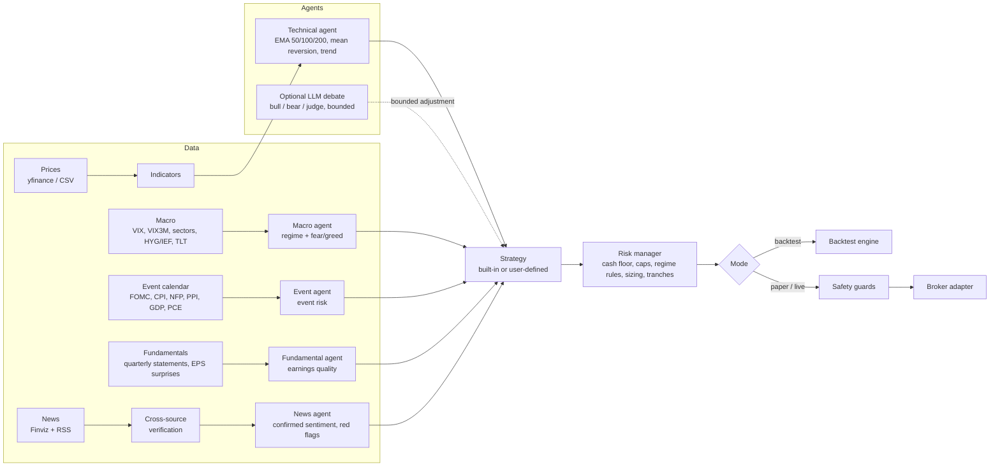

# Design and Build Plan

This document is the plan the project is built against. It explains what the
system does, how the parts fit together, and which rules the trading logic
follows. User-facing docs live in the README and the other files in `docs/`.

## 1. Goals

1. A long-only US stock trading agent that holds positions for weeks to months,
   buys low and sells high, follows trends when the market is healthy, and
   refuses to panic-sell when the market is uncertain.
2. Risk awareness first: every order passes a deterministic risk engine that
   keeps at least 30% of the account in cash or T-bills, caps position, sector
   and speculative exposure, and reacts to macro events (FOMC, CPI, jobs
   report), volatility (VIX and its term structure) and a fear-and-greed gauge.
3. One strategy object runs unchanged in backtests, paper trading and live
   trading, so what a user tests is what trades.
4. Users can plug in their own strategies (a Python class with one method) and
   still get the risk engine, the backtester and every broker for free.
5. Multiple brokers behind one interface, with paper trading as the default
   and live trading behind several explicit switches.
6. Free data only by default (Yahoo Finance prices, Finviz news, RSS feeds,
   Federal Reserve and BLS calendars, CNN Fear & Greed), with caching and
   graceful fallbacks.
7. Friendly: `pip install`, `riskaware init`, `riskaware scan`, readable
   explanations for every decision, a dashboard, and bilingual docs.

Options are supported in backtests only (since 0.2.0; see the README's strategy library).
Non-goals: live option orders for now, crypto, intraday trading, high-frequency execution,
short selling, and leverage.

## 2. Architecture

### Package layout

| Path | Responsibility |
|---|---|
| `riskaware/config.py` | Pydantic config, risk profiles, YAML + `.env` loading |
| `riskaware/types.py` | Shared data classes and enums |
| `riskaware/indicators.py` | Vectorized indicators (EMA, RSI, ATR, ADX, MACD, Bollinger, z-score, Donchian) |
| `riskaware/marketcal.py` | NYSE trading calendar (holidays, half days) |
| `riskaware/data/` | Price, macro, event, fundamental and sentiment providers with disk cache |
| `riskaware/news/` | Finviz scraper, RSS readers, clustering and cross-source verification, finance lexicon |
| `riskaware/agents/` | Macro, event, technical, fundamental, news and LLM agents |
| `riskaware/strategy/` | `Strategy` base class, the built-in risk-aware strategy, examples, loader |
| `riskaware/risk.py`, `riskaware/sizing.py` | Hard constraints, position sizing and tranche logic |
| `riskaware/brokers/` | One adapter per broker behind a common interface |
| `riskaware/engine.py`, `riskaware/guards.py`, `riskaware/journal.py` | Live and paper cycle, safety checks, SQLite journal |
| `riskaware/backtest/` | Event-driven daily backtester, metrics, HTML report |
| `riskaware/cli.py` | Typer CLI |
| `riskaware/dashboard/` | Streamlit dashboard |

## 3. Market regime

The macro agent turns market data into one of four regimes. Each regime has a
fixed policy that the risk manager enforces, whatever the strategy asks for.

| Regime | Typical trigger | Buys | Sells | Size multiplier |
|---|---|---|---|---|
| `RISK_ON` | SPY above a rising EMA50 and EMA200, VIX below 20, most sectors above their EMA200 | trend pullbacks, breakouts, mean reversion, dips | take-profit trims and trend exits | 1.00 |
| `NEUTRAL` | none of the other three | pullbacks to EMA support, mean reversion, quality dips | take-profit trims only | 0.75 |
| `UNCERTAIN` | inside a macro event window (FOMC, CPI, jobs report), VIX 20 to 30, VIX term structure flat, or fear gauge below 35 | only at EMA100 / EMA200 support or deep mean reversion | none (hold); emergency exits only if enabled | 0.50 |
| `RISK_OFF` | VIX at or above 30, VIX backwardation with SPY below EMA200, or credit stress | quality dips and broad ETFs in small tranches | none (hold); emergency exits only if enabled | 0.35 |

Inputs: VIX level and its ratio to VIX3M (backwardation means stress), SPY trend
(EMA50, EMA200, slope), sector breadth (share of the 11 SPDR sector ETFs above
their EMA200), credit appetite (HYG versus IEF), safe-haven demand (SPY versus
TLT), the composite fear-and-greed gauge and scheduled macro events.

The fear-and-greed gauge is computed from free price data so that it also
exists in backtests: market momentum, sector breadth, VIX versus its 50-day
average, VIX term structure, safe-haven demand and junk-bond demand, each
turned into a one-year percentile and averaged. When available, the live CNN
Fear & Greed index is shown next to it.

## 4. Event risk

Events and their default weights: FOMC decision 1.0, CPI 0.8, jobs report 0.7,
PCE 0.5, PPI 0.4, GDP 0.4, quarterly options expiration 0.2. Weights of 0.7 and
above switch the regime to `UNCERTAIN`; lower ones only add to the risk score. FOMC dates come
from the Federal Reserve (2015 to 2027 are bundled), CPI, jobs and PPI dates
from BLS release archives (2003 onward bundled, upcoming dates refreshed from
the BLS calendar), GDP and PCE from the BEA schedule when reachable. Future
dates that are not published yet are estimated by rule and marked `estimated`.

An event puts the market into `UNCERTAIN` from two trading days before an FOMC
decision through the decision day, and on the day before CPI or the jobs report
(decisions run near the close, so a pre-market release is already known on its
own day). Per-symbol earnings dates block new buys in the three trading days
before a report.

## 5. Signals

### Buy setups (technical agent)

| Setup | Rule (defaults) |
|---|---|
| `ema50_support` | uptrend (EMA50 above EMA200, EMA50 rising) and the day's low touches EMA50 within a band of max(1%, 0.5 ATR) while the close holds above EMA50 minus max(2%, 1 ATR) |
| `ema100_support` | same touch test at EMA100 with EMA100 above EMA200 or a flat-to-rising EMA200 |
| `ema200_support` | touch at EMA200 with EMA200 not falling more than 1% over 20 days and at least a 10% pullback from the 52-week high |
| `mean_reversion` | close above EMA200 and RSI(2) below 10, or 20-day z-score below -2, or close below the lower Bollinger band |
| `quality_dip` | at least 15% below the 52-week high, RSI(14) below 40, a stabilizing close, and the fundamental agent rates the company `QUALITY` (or the symbol is a broad ETF) |
| `trend_breakout` | `RISK_ON` only: close above the prior 55-day high on 1.5x average volume with the EMA stack aligned and ADX above 20 |
| `trend_continuation` | `RISK_ON` only: EMA stack aligned, pullback to EMA20, RSI(14) between 40 and 60 |

The deeper the support level, the higher the base score, so a touch of EMA200 in
a long-term uptrend is the strongest single setup. A falling EMA200 cuts the
score unless the dip passes the fundamental check, which keeps the agent from
catching falling knives.

### Conviction

`conviction = 0.55 * technical + 0.20 * fundamental + 0.15 * news + 0.10 * macro`,
with weights configurable. The optional LLM judge can move conviction by at most
±0.15 and can veto a buy, but it can never create a trade, raise size limits or
override the risk manager.

### Exits

| Exit | Allowed in | Rule (defaults, balanced profile) |
|---|---|---|
| `take_profit` | `RISK_ON`, `NEUTRAL` | gain at least 25%, held at least 10 days, and price 4 ATR above EMA50 or RSI(14) at least 78: sell one third |
| `trend_exit` | `RISK_ON`, `NEUTRAL` | gain at least 10% and three closes below a falling EMA50: sell half |
| `thesis_break` | all (if emergency exits enabled) | a severe red flag the company itself backs: its 8-K carries the item (bankruptcy, delisting notice, non-reliance), or its own press release confirms a bankruptcy, going-concern doubt, delisting, restatement or auditor exit that independent outlets reported first (see §7) |
| `hard_stop` | all (if enabled) | loss beyond the profile's hard stop (30% balanced) |

There is no ordinary stop-loss. Position sizing and diversification bound the
loss of any single name instead, which fits a weeks-to-months holding period.

## 6. Risk profiles

| Setting | Conservative | Balanced | Aggressive |
|---|---|---|---|
| Cash + T-bill floor | 30% | 30% | 30% |
| Treasury sleeve (IEF) | 15% | 5% | 0% |
| Max single position | 5% | 7% | 10% |
| Max sector | 20% | 25% | 35% |
| Max positions | 20 | 15 | 12 |
| Speculative sleeve (high-vol names) | 0% | 3% (2 names) | 7% (3 names) |
| Minimum conviction | 0.65 | 0.58 | 0.52 |
| Quality score needed for a dip buy | 70 | 60 | 50 |
| Take-profit trigger | +20% | +25% | +30% |
| Hard stop (emergency) | 25% | 30% | 35% |
| Breakout entries | off | off | on |
| Pause new buys at portfolio drawdown | 15% | 20% | 30% |

Every position is bought in tranches (default 50% / 25% / 25% of its target). A
later tranche needs either a deeper support touch (price at least one ATR below
the last entry) or, in `RISK_ON` / `NEUTRAL`, a position that is already in
profit, after at least five trading days. Add-ons are sized by what is missing
from the target, so a position trimmed into strength can be rebuilt on the next
pullback. Position size is the smaller of the conviction-scaled cap and a
volatility cap (0.75% of equity at risk per two-ATR move), then multiplied by the
regime multiplier.

Cash management: the cash floor counts cash plus a T-bill ETF (default `SGOV`).
Idle cash above a 2% buffer is parked in that ETF. Selling it to fund a buy is
cash management, not a risk sell, so it is allowed in every regime. Every buy
respects the floor; when rising prices push cash more than two points below it,
the agent trims its biggest winners back to the floor, but only in `RISK_ON` and
`NEUTRAL` (no selling in uncertain markets).

## 7. News verification

Sources: Finviz quote-page news (free), Google News RSS, Nasdaq RSS, Seeking
Alpha RSS, Yahoo Finance RSS and SEC EDGAR 8-K filings. Items are de-duplicated,
then clustered by title similarity and shared event keywords within 72 hours.
Each cluster is graded by who carries it:

| Status | Carried by |
|---|---|
| `PRIMARY` | the company's own SEC 8-K filing |
| `ISSUER` | the company's own press release on a press-release wire (Business Wire, PR Newswire, GlobeNewswire, Internet Wire, Accesswire, Newsfile, ...) |
| `CONFIRMED` | at least two independent outlets (outlets owned by one group count once) |
| `UNCONFIRMED` | a single outlet |
| `OPINION` | listicles and "should you buy" pieces, ignored |

A press wire is the company's own channel. Outlets that rewrite a release do not
confirm it, several wires carrying one release are still one source, and anyone
with a wire account can post a release in a company's name.

Unconfirmed news gets a fifth of the weight of confirmed news. What a red flag
does depends on who backs it:

| Red flag on | Effect |
|---|---|
| a single outlet | a small conviction penalty; never a sell |
| two independent outlets, or a company release that is the first word on the story | blocks new buys; no forced sale |
| the company's 8-K item (1.03 bankruptcy, 3.01 delisting notice, 4.02 non-reliance) | emergency exit (`thesis_break`) |
| the company's own release confirming what at least two independent outlets reported an hour or more earlier | emergency exit for bankruptcy, going concern, delisting, restatement and auditor exits, unless a denial disputes it |

A release that is the first word on a story, plus the outlets that repeat it, is
exactly what a planted release looks like, so it never forces a sale on its own;
the sale waits for the 8-K. A story with a severe red flag never scores above
-0.5, even when its words sound neutral. Allegations made by others (fraud, SEC charges,
short-seller reports, probes, data breaches) never force a sale: a company release
that mentions one is a response to it. The profile's hard stop is the backstop.

Negation and denials. A red-flag phrase does not count when its own clause negates
or denies it: "denies bankruptcy report", "is not filing for Chapter 11", "has no
plans to file", "the rumor is false", "calls the report baseless", "finds fake
release". A court or a regulator rejecting something is still news ("judge rejects
the bankruptcy plan"). Denials form their own clusters, so a denial is never
counted as a publisher of the story it denies, however similar the words. A
denial clears the red flags of the story it names (or, when it calls a release or
story fake without naming it, of the red-flag stories of the 24 hours before) if it
is at least as well sourced: a single outlet can clear a single-source rumor; a
story from two outlets or a company release takes the company's own statement or
release, or two outlets reporting the denial. Nothing clears an 8-K, and the
company's denial does not clear allegations made by others. Cleared stories drop
out of the news score and are listed in `red_flags_denied`.

## 8. Brokers

| Broker | Adapter | Paper / sandbox | Library |
|---|---|---|---|
| Built-in paper broker | `paper` | yes (local) | none |
| Alpaca | `alpaca` | yes | REST (requests) |
| Public.com | `public` | no (live only) | REST (requests) |
| Tradier | `tradier` | yes (sandbox) | REST (requests) |
| Interactive Brokers | `ibkr` | yes (paper account) | `ib_async` |
| Charles Schwab | `schwab` | no | `schwab-py` |
| tastytrade | `tastytrade` | yes (cert sandbox) | `tastytrade` |
| Futu / moomoo | `futu` | yes (simulate) | `futu-api` |
| Tiger Brokers | `tiger` | yes (paper account) | `tigeropen` |
| Longbridge | `longbridge` | yes (paper account) | `longport` |

All adapters implement `connect`, `account`, `positions`, `quote`,
`place_order`, `cancel_order` and `open_orders`, and report whether they point
at a paper environment.

## 9. Safety model

* `riskaware run` defaults to a dry run; paper brokers place paper orders.
* A live order needs `execution.mode: live` in the config, the `--live` flag,
  and an interactive confirmation (or `--yes`).
* Guards: kill switch file (`riskaware halt`), maximum orders per run, maximum
  order value, limit price within a band around the last quote, no trading on
  market holidays, stale-quote check, and deterministic client order ids so a
  rerun on the same day cannot duplicate an order.
* Every run, decision and order goes to a local SQLite journal.

## 10. Backtesting

* Daily bars, signals on the close of day t, fills on day t+1: at the open if the
  open is inside the limit, at the limit if the day's range reaches it,
  otherwise the order expires. Commission and slippage are configurable.
* The same strategy and risk manager code runs in the backtest; the regime and
  fear gauge series are computed from the same functions as live.
* Cash earns the T-bill ETF return; the treasury sleeve is rebalanced monthly.
* Point-in-time inputs: event dates are known in advance; fundamentals are
  unknown in backtests (dip buys fall back to a technical proxy: rising EMA200
  and a positive year) and news is live-only. Point-in-time SEC fundamentals are
  on the roadmap. These limits are printed in every report.
* Output: metrics table (CAGR, volatility, Sharpe, Sortino, max drawdown,
  Calmar, win rate, profit factor, average holding period, exposure, turnover,
  minimum cash ratio), comparison with SPY buy-and-hold, equity and drawdown
  charts with regime shading, monthly returns, trades CSV, self-contained HTML.
* Several strategies can be compared side by side in one command.

## 11. Testing plan

Offline unit tests with synthetic data cover indicators, calendar rules, regime
classification, each buy setup and exit, risk constraints (cash floor never
breached, caps, no sells in `UNCERTAIN`/`RISK_OFF`), sizing and tranches, news
clustering and confirmation (a single fake headline, a fake press release that
other outlets repeat, denials and negation, abbreviations such as "Ch. 11"), the paper
broker, mocked REST adapters (Alpaca, Public, Tradier), the guards, the
journal, custom strategy loading and an end-to-end backtest. Live checks: a real
backtest on Yahoo data, and a paper order placed and cancelled on an Alpaca
paper account through the CLI.

## 12. Milestones

1. Scaffold, config, types, calendar, indicators.
2. Data providers and news verification.
3. Agents, strategy interface, risk manager, sizing.
4. Brokers, guards, journal, engine.
5. Backtester and report.
6. CLI, dashboard, LLM layer, notifications.
7. Tests, docs, CI, Docker; end-to-end checks.
