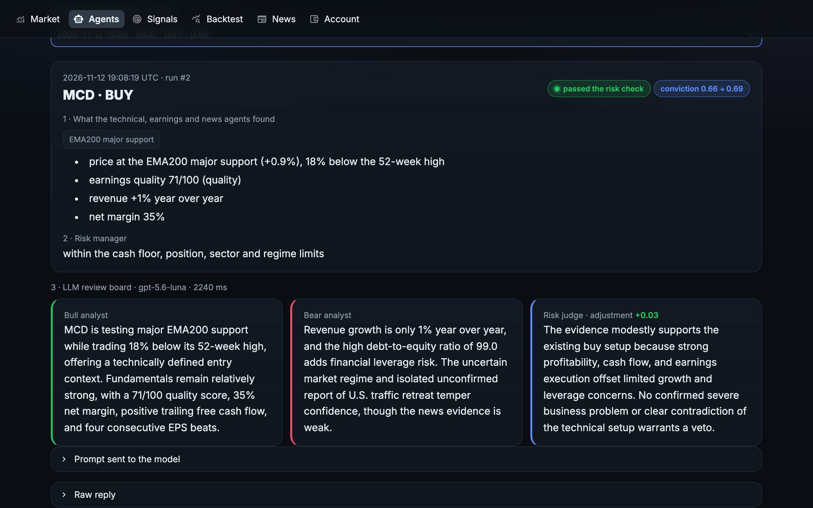

# Paper-trading agents and the MCP server

[中文](zh/agents.md)

An agent is a strategy with its own paper account. You pick the strategy (a built-in one or your own file), a risk profile, a stock list and the starting cash; the agent then trades that account once every trading day on free Yahoo Finance prices. Several agents with different ideas run side by side, and the leaderboard shows which one is doing better than SPY.

Agents never touch a broker. They always use the built-in paper account, whatever your configuration says about brokers or live trading.

## Start in three commands

```bash
riskaware agents init                  # four starter agents: steady, momentum, breakout, fear-buyer
riskaware agents run                   # trade them once now
riskaware agents schedule --install    # from now on, every trading day by itself
```

`riskaware agents` (or `riskaware agents list`) prints the leaderboard; `riskaware dashboard` shows it with equity curves on the **Agents** page, where you can also create, run, pause, reset and delete agents.

| Starter | Strategy | Profile | Stock list |
|---|---|---|---|
| `steady` | `risk_aware` | balanced | your config's list |
| `momentum` | `momentum_rotation` | balanced | your config's list |
| `breakout` | `donchian_breakout` | aggressive | your config's list |
| `fear-buyer` | `fear_greed_dca` | conservative | `etf` |

## Your own agents

```bash
riskaware agents add dips --strategy rsi2 --universe tech --cash 25000
riskaware agents add mine --strategy ~/strategies/my_dip.py:MyDip --profile aggressive
riskaware agents add slow --strategy ema_bounce --symbols NVDA,AAPL,COST --param band=0.02
```

- `--strategy`: any name from `riskaware strategies`, or `path/to/file.py:ClassName` (see [custom strategies](custom-strategies.md)).
- `--universe`: `megacap`, `tech`, `defensive`, `etf`, `sectors`, or several joined with `+`; `--symbols` adds names.
- `--param key=value` passes strategy parameters; a misspelled parameter is rejected when you create the agent, not at 15:40 the next day.
- `riskaware agents show NAME` lists positions, the equity by day and the latest orders; `pause`, `resume`, `reset` and `remove` do what they say.

Everything an agent owns lives in `~/.riskaware/arena/NAME/`: the paper account (`NAME.json`), its position memory, a journal of every run, decision and order (`journal.db`) and one row per trading day in `equity.csv`. The definitions are in `~/.riskaware/arena/agents.yaml`, which you can also edit by hand.

## An LLM for each agent

Any agent can have its own review board: a bull analyst, a bear analyst and a risk judge read the evidence for each buy candidate (setups, reasons, earnings quality, the market regime and the verified headlines) and answer in a fixed JSON format. The judge can move conviction by at most ±0.15 or veto the buy. It cannot create a trade, change a size or a limit, or sell anything, and news reaches it only as quoted, untrusted text.

```bash
riskaware agents add luna --strategy risk_aware --llm openai:gpt-5.6-luna
riskaware agents add local --strategy risk_aware --llm ollama:qwen2.5:3b
riskaware agents llm steady anthropic:claude-opus-5-5     # change an existing agent; `off` turns it off
riskaware llm-check ollama:qwen2.5:3b                     # one sample review: is the key or the model working?
```

| Choice | What it uses | Needs |
|---|---|---|
| `openai:MODEL` | OpenAI, e.g. `gpt-5.6-luna` (reasoning switched off, so a review takes a few seconds) | `OPENAI_API_KEY` in `.env` |
| `ollama:MODEL` | a free local model on your computer, e.g. `qwen2.5:3b` | [Ollama](https://ollama.com): `ollama pull qwen2.5:3b`, then `ollama serve` |
| `anthropic:MODEL` | Claude through the official SDK | `pip install -e ".[llm]"` and `ANTHROPIC_API_KEY` |
| `compat:MODEL` | any OpenAI-compatible server (DeepSeek, Groq, OpenRouter, vLLM, LM Studio) | `--llm-base-url` and `--llm-key-env` |

Replies are requested in strict JSON schema mode, so the model has to answer in the expected shape; a reply that still does not fit is ignored, and the trade goes ahead on the rules alone. In a quick comparison on one day of buy candidates, `gpt-5.6-luna` answered in about 2.5 seconds with adjustments between -0.04 and +0.05, while the 3B local model took about 7.5 seconds and mostly answered +0.00: a small local model is free and private but adds little judgment.

### See how a decision was made



Every run stores, for each buy candidate, the setups and reasons, the risk manager's verdict, and the LLM's bull case, bear case, verdict, the exact prompt it was sent and its raw reply. Nothing leaves your computer except the prompt itself, sent to the model you chose (or to no one, with a local model).

- Dashboard: **Agents → Decisions**, then pick a decision.
- Terminal: `riskaware agents why NAME [SYMBOL]`; add `--prompt` to print the prompt and the raw reply.
- Claude: the `agent_decisions` MCP tool.

The daily job reads the same `.env` as your manual runs, so keep `OPENAI_API_KEY` in the folder where you ran `riskaware agents schedule --install` or in `~/.riskaware/.env`. Without a key the agent still trades, without the review.

## How the daily run works

`riskaware agents schedule --install` adds a background job that wakes up every 15 minutes on weekdays and runs `riskaware agents run --scheduled`:

- macOS: a LaunchAgent in `~/Library/LaunchAgents/io.github.risk-aware-trading-agents.plist`
- Linux: one line in your crontab, marked `# riskaware-agents`
- Windows: a Task Scheduler task named `RiskAwareTradingAgents`

On each wake-up the command checks New York time and does nothing unless it is a trading day, after `execution.run_time` (15:40 by default) and before the close. Then it trades every active agent that has not traded yet today. Waking often instead of once keeps it right across time zones and daylight saving, and a laptop that was asleep at 15:40 catches up when it wakes, as long as the market is still open. A day is traded once: an agent you ran by hand earlier the same day is skipped. If an agent fails (for example, its strategy file raises an error), the others still trade, and it is retried at most three times that day.

```bash
riskaware agents schedule              # installed or not, next trading day, last run
riskaware agents log                   # what the job did
riskaware agents schedule --uninstall  # stop it
```

The job runs in the folder where you installed it, so it uses that folder's `riskaware.yaml` and `.env`. Notifications (Telegram, Discord, Slack) set up in the config also receive a summary after each daily run.

## Use it from Claude (MCP)

The MCP server lets an AI assistant ask the agents questions and run them. It needs the `mcp` extra:

```bash
pip install -e ".[mcp]"
claude mcp add riskaware -- riskaware mcp          # Claude Code
```

For Claude Desktop, Cursor or another client, add a stdio server that runs `riskaware mcp`:

```json
{
  "mcpServers": {
    "riskaware": { "command": "riskaware", "args": ["mcp"] }
  }
}
```

| Tool | What it does |
|---|---|
| `market_regime` | today's regime, VIX, fear and greed, breadth, the reasons, and the macro events of the next 30 days |
| `scan` | today's signals for a strategy and a profile, on your list or the symbols you name |
| `analyze_stock` | indicators, technical setups, earnings quality, verified news and the decision for one stock |
| `stock_news` | cross-verified headlines and red flags for one stock |
| `list_strategies` | the built-in strategies |
| `backtest` | a backtest of any strategy against SPY buy and hold |
| `agents_leaderboard` | all paper agents ranked, with the schedule status |
| `agent_detail` | one agent's settings, positions, equity by day and recent orders |
| `agent_decisions` | how an agent made its recent decisions, with the LLM's bull, bear and verdict (and, if asked, the prompts) |
| `agents_create` | create a paper agent, optionally with an LLM (`openai:gpt-5.6-luna`, `ollama:qwen2.5:3b`) |
| `agents_run` | run agents once now on their paper accounts (or as a dry run) |

All tools are read-only or act on local paper accounts. There is no tool that can send an order to a broker.

Then ask in plain words, for example: "What regime is the market in and what is coming up this week?", "Backtest the wheel on megacap with $1M since 2018", or "Create an agent that runs bollinger_reversion on the tech list with $20k and show me the leaderboard."
