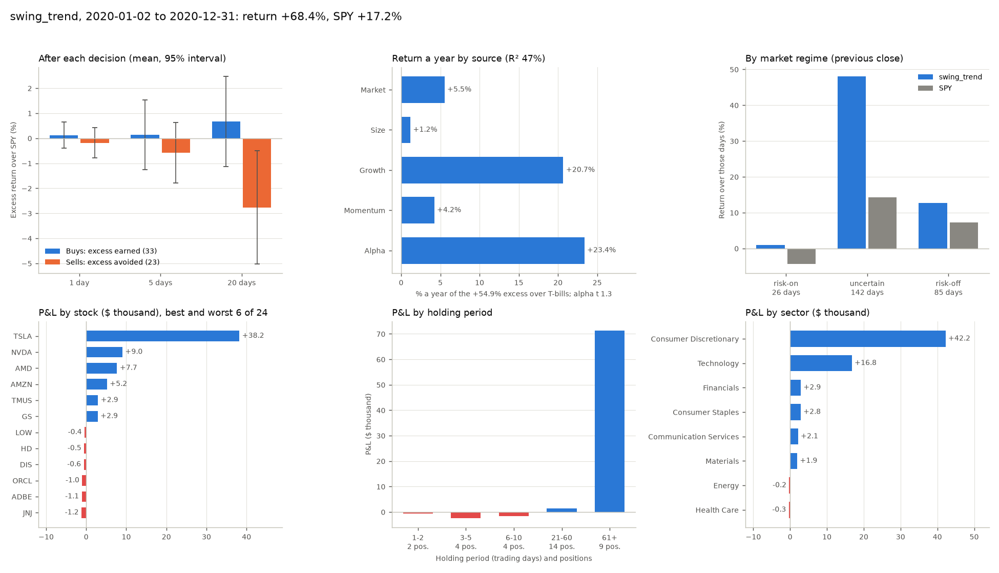

# Run analysis: what a strategy or an LLM agent made its money on

[中文](zh/analysis.md)

A year's return says little about skill. It is one draw from one market, and a lean toward the market or toward growth stocks, or one lucky position, can make it. `riskaware research analyze` takes a saved record (an experiment, a baseline run or an LLM trading session) and answers three questions: did the decisions themselves beat the market, how much of the return is factor exposure, and where did the profit and loss come from? It reads only the record and the frozen market of its period, runs nothing again, and writes `analysis.json`, `analysis.md` and `analysis.png` next to the record.

- [Run it](#run-it)
- [Decisions](#decisions)
- [Factor attribution](#factor-attribution)
- [Where the P&L came from](#where-the-pl-came-from)
- [What the five swing strategies made their money on](#what-the-five-swing-strategies-made-their-money-on)
- [Reading the numbers](#reading-the-numbers)
- [What analysis.json holds](#what-analysisjson-holds)

## Run it

```bash
riskaware research run --strategy swing_trend --period 2020
riskaware research analyze <run id or folder>
riskaware research analyze <folder written by research baselines>   # every run in it, side by side
```

The run id is the one `research run` prints and `riskaware research runs` lists; a record's folder or a finished trading session's id works too. Given a folder of runs, such as the one `riskaware research baselines` writes, it analyzes each run and writes `analysis.md` and `analysis.csv` with one row per run. `--json` prints every number, `--no-chart` skips the picture.

```python
from riskaware.research.analysis import analyze_run

res = analyze_run("~/.riskaware/research/runs/<run id>")
res["summary"]    # the headline numbers, flat, for a leaderboard
res["findings"]   # the answers in sentences
```

Over MCP the tool is `experiment_analysis(run_id)`: after `run_experiment` or a trading session, ask Claude "what did this run make its money on?".

The analysis of trend following in 2020 with news, which made +68.4% against SPY's +17.2%:



Its decisions had no edge (the stocks it bought beat SPY by +0.14% over the next five days, t = 0.2), growth exposure made +20.7% a year, nine positions held more than 60 trading days made nearly all the money, and Tesla, bought on 17 April 2020 and held to the end of the year, made 56% of the profit on its own.

## Decisions

A year of daily returns is a few hundred correlated days, but a run makes hundreds of decisions, and each one can be checked. For every buy and sell in `trades.csv` the analysis takes the stock's return minus SPY's over the next 1, 5 and 20 trading days. The window starts at the open of the day the order filled (the price the decision could get, before slippage) and ends at a close; prices are total-return. A buy is credited with the excess it earned. A sell is credited with the excess it avoided, SPY's return minus the stock's, so selling a stock before it lags the market counts as a good decision.

For each horizon the report gives the number of decisions, the mean and median, the hit rate (the share above zero) and two t-statistics:

- *t (iid)* treats every decision as independent;
- *t* does not. Decisions on the same day share that day's market, and two 20-day windows that start a day apart share 19 days. Its standard error weights each pair of decisions less than h trading days apart by 1 - distance / h (a Bartlett kernel on the distance in trading days), so same-day decisions count as one cluster and overlapping windows count by what they share. With one decision per day and no overlap it equals the plain t.

The same numbers are split by what triggered the decision: `news` when the reason the decision gave (the reason column of `decisions.csv`) names news, such as "fresh positive news: ...", "red flag in the news", or an LLM's "earnings beat"; `other` otherwise; `no reason` when an LLM gave none.

The **rank IC** asks a cross-sectional question: on a decision day, did what the agent did rank the stocks by what they did next? Two scores, each correlated by rank across the run's universe with the return from the fill day's open to the close five trading days later:

| | Score | Days |
|---|---|---|
| Decision IC | +1 for the stocks it bought, -1 for those it sold, 0 for the rest | each day it traded |
| Holdings IC | the weights it held after the decision (0 for stocks it did not hold) | every decision day: each close for a strategy, each step for an LLM policy |

For each: the mean IC, its standard deviation, IC IR (the mean over the standard deviation), a t-statistic with the same kernel (h = 5), and the share of days with a positive IC.

## Factor attribution

The run's daily return over T-bills is regressed on four factors computed from the bundled prices of its period, so the attribution needs no outside data and gives the same numbers on any machine:

| Factor | Daily return | A positive exposure means |
|---|---|---|
| Market | SPY - BIL | holding stocks at all |
| Size | IWM - SPY | small caps over large caps |
| Growth | QQQ - SPY | the Nasdaq 100 over the S&P 500 |
| Momentum | the top third minus the bottom third of the period's 64 stocks, ranked by their return from 126 to 21 trading days before each month end; equal weight, ranked again every month on the prices known that day | recent winners over recent losers |

Ordinary least squares with Newey-West standard errors (Bartlett weights, floor(4 (n/100)^(2/9)) lags: 4 for a year). The report gives each exposure with its t-statistic, the alpha left over a year with its t, R², and a decomposition of the mean excess return: each exposure times its factor's mean return, plus the alpha, adds up to the run's mean daily return over T-bills times 252. A market-only regression (CAPM) sits next to it, so you can see how much of the CAPM alpha the style factors take away. KTD-Fin (arXiv 2605.28359) found that most of what LLM traders earn is market and style exposure; this is that check, on any record.

The factors' own returns over each test window (annualized arithmetic means):

| Period | Market | Size | Growth | Momentum |
|---|---:|---:|---:|---:|
| 2026 | +10.7% | +3.3% | +2.4% | -23.3% |
| 2022 | -19.3% | -2.6% | -17.6% | +7.1% |
| 2020 | +21.2% | +5.0% | +22.7% | +22.3% |

## Where the P&L came from

Each position runs from its first buy to the sell that closes it, top-ups and trims included; a position still open at the end is marked at the last close. Its P&L is the cash it returned minus the cash it took, commissions included. The positions and the T-bill interest on idle cash (the cash at each close times BIL's return that day, as the backtest pays it) add up to the run's P&L to the dollar; anything the record does not explain, such as options, shows as a separate line.

Then the P&L by:

- holding period: 1-2, 3-5, 6-10, 11-20, 21-60 and 61 or more trading days;
- market regime: the regime at the previous close, the one the positions were held under, with the run's and SPY's returns over those days;
- trigger: whether the entry, and separately the exit, gave news as its reason;
- sector and stock;
- the best and worst positions, with the reason each was bought;

and how concentrated the profit is: the share of the best position and of the best two in the positions' net P&L and in their gains, and the run's return had the best position made nothing. *Of return* in the tables is the P&L over the starting cash, in percentage points of the run's return.

## What the five swing strategies made their money on

The baselines on all three periods (`riskaware research baselines --period 2026`, `2022`, `2020`, then `riskaware research analyze` on each folder): the 56 megacap stocks, plain execution with at most 10 equal positions, orders at the next open with 5 bps slippage, without and with news. Returns are the same as in [the research kit](research.md#five-swing-strategies-with-and-without-news).

Buys: the stocks' excess return over SPY in the five trading days from the fill. Sells: the excess they avoided. Exposures and alpha: the four-factor regression. Without it: the run's return had its best position made nothing.

2026-01-02 to 2026-11-11, a rising market:

| Strategy | News | Return | Buys (t) | Sells (t) | Decision IC (t) | Alpha a year (t) | Market | Size | Growth | Momentum | Best position | Without it |
|---|---|---:|---:|---:|---:|---:|---:|---:|---:|---:|---|---:|
| swing_trend | without | +21.1% | -0.56% (-0.7) | +0.37% (0.6) | -0.008 (-0.5) | +17.6% (1.5) | 0.40 | 0.24 | -0.01 | 0.13 | AMD 2026-04-09 | +10.6% |
| swing_trend | with | +19.6% | -0.49% (-0.6) | +0.70% (1.2) | -0.002 (-0.1) | +16.0% (1.4) | 0.41 | 0.26 | 0.04 | 0.13 | AMD 2026-04-09 | +9.2% |
| swing_rsi2 | without | +12.7% | +0.59% (2.2) | -0.17% (-0.6) | 0.014 (1.2) | +7.6% (0.8) | 0.62 | 0.00 | -0.11 | 0.12 | CAT 2026-07-29 | +11.3% |
| swing_rsi2 | with | +10.8% | +0.54% (1.9) | -0.16% (-0.5) | 0.009 (0.8) | +5.7% (0.6) | 0.57 | 0.01 | -0.11 | 0.10 | CAT 2026-07-29 | +9.5% |
| swing_breakout | without | -0.3% | -0.46% (-0.9) | +0.12% (0.2) | -0.004 (-0.2) | -7.8% (-0.5) | 0.59 | 0.26 | -0.05 | 0.08 | TXN 2026-04-09 | -3.9% |
| swing_breakout | with | -3.5% | -0.55% (-1.1) | +0.11% (0.2) | -0.010 (-0.5) | -11.6% (-0.8) | 0.59 | 0.23 | -0.04 | 0.07 | TXN 2026-04-09 | -7.0% |
| swing_pullback | without | +2.3% | -0.49% (-0.8) | +0.63% (1.0) | -0.013 (-1.0) | -1.5% (-0.3) | 0.26 | -0.00 | -0.33 | 0.05 | V 2026-10-01 | +1.3% |
| swing_pullback | with | +1.7% | -0.72% (-1.2) | +0.62% (0.9) | -0.016 (-1.1) | -2.4% (-0.5) | 0.24 | -0.01 | -0.29 | 0.04 | V 2026-10-01 | +0.8% |
| swing_news | without | +15.7% | -0.67% (-1.6) | +0.26% (0.5) | 0.000 (0.0) | +6.7% (0.5) | 0.55 | 0.01 | -0.20 | -0.10 | QCOM 2026-04-27 | +10.7% |
| swing_news | with | +4.4% | -0.46% (-1.0) | -0.11% (-0.2) | 0.002 (0.2) | -0.7% (-0.1) | 0.31 | 0.04 | 0.05 | 0.04 | AMD 2026-04-22 | +0.0% |

2022-01-03 to 2022-12-30, the rate-hike bear market:

| Strategy | News | Return | Buys (t) | Sells (t) | Decision IC (t) | Alpha a year (t) | Market | Size | Growth | Momentum | Best position | Without it |
|---|---|---:|---:|---:|---:|---:|---:|---:|---:|---:|---|---:|
| swing_trend | without | -6.0% | -0.13% (-0.3) | +0.55% (1.6) | 0.012 (0.9) | -4.7% (-0.5) | 0.55 | -0.06 | -0.46 | 0.05 | XOM 2022-01-04 | -9.6% |
| swing_trend | with | -5.0% | -0.13% (-0.3) | +0.52% (1.5) | 0.011 (0.8) | -3.5% (-0.4) | 0.55 | -0.07 | -0.45 | 0.04 | XOM 2022-01-04 | -8.6% |
| swing_rsi2 | without | -2.2% | +0.08% (0.3) | -0.38% (-1.0) | -0.005 (-0.4) | +1.6% (0.2) | 0.30 | 0.12 | 0.00 | 0.20 | LOW 2022-12-07 | -2.8% |
| swing_rsi2 | with | -5.7% | -0.04% (-0.1) | -0.45% (-1.3) | -0.010 (-1.0) | -2.4% (-0.3) | 0.30 | 0.09 | -0.02 | 0.18 | AAPL 2022-01-25 | -6.3% |
| swing_breakout | without | -12.8% | +0.66% (2.1) | -0.33% (-0.6) | 0.002 (0.1) | -13.0% (-1.3) | 0.44 | -0.05 | -0.39 | 0.00 | CVX 2022-01-05 | -15.7% |
| swing_breakout | with | -13.7% | +0.55% (1.4) | -0.37% (-0.7) | -0.000 (-0.0) | -14.4% (-1.5) | 0.43 | -0.04 | -0.41 | 0.00 | CVX 2022-01-05 | -16.6% |
| swing_pullback | without | -4.7% | +0.49% (1.1) | -0.40% (-1.0) | 0.006 (0.5) | -3.7% (-0.9) | 0.18 | -0.06 | -0.01 | 0.10 | BAC 2022-01-25 | -5.6% |
| swing_pullback | with | -4.0% | +0.50% (1.0) | -0.61% (-1.5) | 0.001 (0.1) | -3.5% (-0.9) | 0.17 | -0.07 | -0.04 | 0.07 | BAC 2022-01-25 | -4.9% |
| swing_news | without | -13.3% | +0.21% (0.6) | -0.02% (-0.1) | 0.003 (0.3) | -8.4% (-0.8) | 0.47 | -0.09 | -0.18 | -0.08 | TSLA 2022-03-21 | -15.7% |
| swing_news | with | -14.1% | -0.22% (-0.7) | -0.15% (-0.6) | -0.012 (-1.2) | -9.8% (-1.2) | 0.46 | -0.01 | -0.13 | 0.05 | CVX 2022-02-28 | -15.5% |

2020-01-02 to 2020-12-31, the COVID crash and rebound:

| Strategy | News | Return | Buys (t) | Sells (t) | Decision IC (t) | Alpha a year (t) | Market | Size | Growth | Momentum | Best position | Without it |
|---|---|---:|---:|---:|---:|---:|---:|---:|---:|---:|---|---:|
| swing_trend | without | +36.6% | +0.31% (0.4) | -0.13% (-0.2) | 0.013 (0.7) | +8.5% (0.7) | 0.24 | 0.08 | 0.66 | 0.17 | NVDA 2020-04-07 | +27.5% |
| swing_trend | with | +68.4% | +0.14% (0.2) | -0.59% (-1.0) | -0.001 (-0.0) | +23.4% (1.3) | 0.26 | 0.24 | 0.91 | 0.19 | TSLA 2020-04-17 | +30.3% |
| swing_rsi2 | without | +14.0% | +0.53% (2.2) | +0.13% (0.4) | 0.009 (0.9) | -1.3% (-0.1) | 0.43 | 0.09 | 0.26 | 0.05 | NKE 2020-09-21 | +12.5% |
| swing_rsi2 | with | +12.7% | +0.39% (1.8) | +0.30% (1.0) | 0.008 (0.9) | -1.4% (-0.1) | 0.38 | 0.08 | 0.24 | 0.04 | NKE 2020-09-21 | +11.2% |
| swing_breakout | without | +33.1% | -0.03% (-0.0) | -1.44% (-2.0) | -0.024 (-1.3) | +6.9% (0.4) | 0.27 | 0.13 | 0.79 | -0.03 | TSLA 2020-04-14 | +21.6% |
| swing_breakout | with | +30.4% | -0.04% (-0.1) | -1.49% (-2.0) | -0.021 (-1.1) | +5.8% (0.3) | 0.26 | 0.13 | 0.74 | -0.01 | TSLA 2020-04-14 | +19.2% |
| swing_pullback | without | +2.3% | +0.12% (0.4) | -0.32% (-0.5) | 0.009 (0.7) | -2.3% (-0.2) | 0.12 | -0.02 | 0.08 | 0.02 | TMUS 2020-10-30 | +0.9% |
| swing_pullback | with | +3.3% | +0.13% (0.4) | -0.29% (-0.5) | 0.008 (0.5) | -0.4% (-0.0) | 0.11 | -0.02 | 0.04 | 0.03 | TMUS 2020-10-30 | +1.9% |
| swing_news | without | +9.4% | +0.30% (0.6) | -0.66% (-2.0) | -0.018 (-1.6) | -9.3% (-0.6) | 0.44 | 0.05 | 0.64 | -0.17 | AMD 2020-07-23 | +5.4% |
| swing_news | with | +28.4% | +0.12% (0.4) | -0.29% (-1.1) | -0.014 (-1.2) | +8.1% (0.5) | 0.36 | 0.06 | 0.63 | -0.18 | TSLA 2020-08-17 | +24.6% |

Who made money from what:

- **No run has a significant alpha.** After market, size, growth and momentum, all 30 alphas have a t-statistic between -1.5 and 1.5. The biggest returns are factor exposure plus a few positions. Under the market alone (CAPM), trend following in 2020 with news shows an alpha of +48.7% a year with t = 2.3; growth, size and momentum take half of it away (+23.4%, t = 1.3).
- **Trend following (`swing_trend`) earns from a few long holds and from its exposures.** Positions held more than 60 trading days made +$27,000 to +$28,000 in 2026 (15 positions), +$6,900 in 2022 and +$71,000 in 2020 with news (9 positions); in every period, the positions held 20 days or less lost money. In 2026 one position made half the profit: AMD, bought on 9 April and sold on 28 August, 51 to 55% of the positions' P&L; without it the runs return +10.6% and +9.2% instead of +21.1% and +19.6%. The 2020 run with news rests on Tesla, bought on 17 April 2020 and held to the end (+$38,000, 56% of the profit; +30.3% without it instead of +68.4%), and its growth exposure of 0.91 made +20.7% a year. Its buys had no edge over five days in any period (t between -0.7 and 0.4).
- **RSI(2) (`swing_rsi2`) is the only rule with an edge in its decisions.** The stocks it bought beat SPY over the next five days by +0.59% in 2026 (t = 2.2, 312 buys without news) and +0.53% in 2020 (t = 2.2), but not in 2022 (+0.08%, t = 0.3). The money comes from positions held one or two days (+$24,000 in 2026, +$25,000 in 2020); positions held 6 to 10 days, up to its 10-day limit, lost $12,000 to $17,000 in every period. The profit is spread out (the best position made at most 14% of it). The edge is small next to its market exposure of 0.3 to 0.6, and its alpha is not significant (t at most 0.8).
- **Breakouts (`swing_breakout`) were a growth bet that paid in 2020** (growth exposure 0.74 to 0.79, worth +17 to +18% a year; Tesla again the best position, 35 to 37% of the profit) and lost in 2026 and 2022. In 2022 the stocks it bought did beat SPY over five days (+0.66%, t = 2.1, without news: energy breakouts), but a market exposure of 0.44 in a falling market cost 8.4% a year. Its sells cost money in 2020: the stocks it sold beat SPY by 1.4 to 1.5% over the next five days (t = -2.0); it sold too early in the rebound.
- **Buying the dip (`swing_pullback`)** has the lowest market exposure (0.11 to 0.26), makes little in any year, and nothing in it is significant.
- **Post-news drift (`swing_news`)**: the buys on fresh positive headlines had no edge over five days in any year (2026 -0.46%, t = -1.0; 2022 -0.22%; 2020 +0.12%). The run is mostly market and growth exposure (R² up to 54%). The gap to its price-only twin (+4.4% against +15.7% in 2026, +28.4% against +9.4% in 2020) does not show in the decision statistics, so it comes mostly from which stocks got the ten slots.
- **In 2022 every strategy lost less than SPY because it held less of the market, not because it picked better stocks.** Market exposures of 0.17 to 0.55 cost 3 to 11% a year, and every alpha is within noise. Trend following and breakouts leaned away from growth (exposures of -0.39 to -0.46, worth +7 to +8% a year) and made their money in energy (XOM, CVX). On the 72 days after a risk-off close SPY rose 9.5% (bear-market rallies), and the strategies caught at most 4.1% of it.
- **Exits cost money in the 2020 rebound.** Over 20 days, the stocks sold by trend following, breakouts and news drift beat SPY by 1.9 to 2.8% (t between -2.2 and -4.1): they sold stocks that kept rising.
- **No rule ranks stocks.** Every decision and holdings IC is between -0.04 and +0.04 and none is significant (|t| at most 1.8). The returns come from when the rules hold stocks and from a few positions, not from picking the better stocks on a given day.

For a leaderboard of strategies or LLM agents this means: rank on the decision statistics (the robust t of the buys' and sells' excess return, the decision IC) and on the alpha's t rather than on the return, show the factor exposures next to the return, and flag a run whose best two positions made half its profit or more (`summary.concentrated` in `analysis.json`).

## Reading the numbers

- A t-statistic of 2 is about the 5% level for one test. Thirty runs with several statistics each will show a few such values by chance; a result that repeats across periods (RSI(2)'s buys in 2026 and 2020) means more than one that does not.
- One period is one market. Growth exposure paid in 2020 and cost in 2022; an exposure is a bet on the factor, not skill.
- The decision statistics count from the open of the fill day and leave out slippage and the cash a position ties up; the P&L includes both.
- News-triggered means the reason names news. A news filter that keeps a strategy out of a stock leaves no decision behind, so compare the runs with and without news for the filter's own effect.
- The factors are built from 64 of today's large caps and four ETFs, chosen with hindsight (survivorship bias), so the momentum factor is a momentum factor among winners.
- The decision IC needs at least three stocks with prices on the day; days with only one kind of decision still count (bought against everything else).

## What analysis.json holds

| Key | What |
|---|---|
| `summary` | The headline numbers, flat: `decision_excess_5d` and its `_t` (buys and sells together), `buy_excess_5d`, `sell_avoided_5d`, `decision_hit_rate_5d`, `decision_ic`, `holdings_ic`, `alpha_annual` and `alpha_t`, `capm_alpha_annual`, `beta_market`, `beta_size`, `beta_growth`, `beta_momentum`, `r2`, `exposure_return_annual` (the part of the mean excess return a year that the exposures explain; `alpha_annual` is the rest), `news_decision_share` (the share of buys and sells whose reason names news), `news_entry_pnl`, `best_trade_share`, `return_without_best_trade`, `concentrated` |
| `decisions` | `buys`, `sells` and `all` by horizon (`1d`, `5d`, `20d`): `n`, `mean`, `median`, `hit_rate`, `se`, `t`, `t_iid` (a 95% interval is `mean` ± 1.96 `se`); `by_trigger` for five days; `counts`: every buy and sell by trigger |
| `ic` | `decision` and `holdings`: `days`, `mean`, `std`, `ir`, `t`, `t_iid`, `positive_share` |
| `factors` | `exposures` (beta and t), `alpha_annual`, `alpha_t`, `r2`, `contributions_annual`, `factor_means_annual`, `excess_return_annual`, `capm` |
| `pnl` | `reconciliation` (stocks, T-bill ETFs, cash interest, other), `by_holding_period`, `by_regime`, `by_trigger` (entry, exit), `by_sector`, `by_stock`, `best_trades`, `worst_trades`, `concentration` |
| `findings` | The answers in sentences |

The schema is `riskaware.analysis/1`. Code: `src/riskaware/research/analysis.py`; tests with known answers on synthetic data: `tests/test_analysis.py`.
