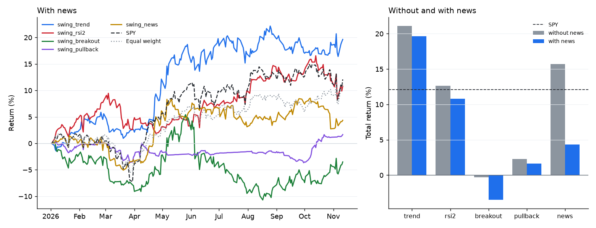

# Research kit: the frozen 2026 market

[中文](zh/research.md)

A copy of the 2026 US stock market ships with the package, so that a strategy, an LLM agent or a paper's experiment can be run again by anyone and give the same numbers. You can ask what was known at any day's close, run a strategy with orders at the next open, check that it never saw the future, and keep a record that says exactly which data and code produced each number. Claude (or any MCP client) can do all of it for you: describe a strategy in words, and it writes the code, runs the experiment and reads you the report.

- [What ships](#what-ships)
- [How a day works](#how-a-day-works)
- [Look at any day](#look-at-any-day)
- [Run an experiment](#run-an-experiment)
- [The look-ahead check](#the-look-ahead-check)
- [Ask Claude to test a strategy](#ask-claude-to-test-a-strategy)
- [Let an LLM trade the year](#let-an-llm-trade-the-year)
- [Five swing strategies, with and without news](#five-swing-strategies-with-and-without-news)
- [For papers](#for-papers)

## What ships

| | |
|---|---|
| Prices | Daily bars from 2024-01-02 to 2026-11-11 (719 trading days) for the 64 stocks of the built-in watchlists, 25 index, sector and bond ETFs, the VIX term structure (VIX9D, VIX, VIX3M) and VVIX, and four cross-asset ETFs (GLD, USO, UUP, IBIT). 2026 is the test year; 2024 and 2025 warm up slow indicators such as EMA200 and the 52-week high. |
| News | 16,945 items for the 64 stocks, January to November 2026: Benzinga headlines (titles only) and SEC 8-K filings with the time SEC accepted them. |
| Calendar | FOMC decisions, CPI, PPI and jobs reports, as scheduled in advance. |
| Indicators | Computed on the fly from the prices: EMA 20/50/100/200, RSI 2 and 14, MACD, ATR, ADX, Bollinger bands, Donchian channels, 52-week high and drawdown, momentum, relative strength and beta against SPY, realized volatility, relative volume, and the technical agent's setups. |
| Market readings | The regime (risk-on, neutral, uncertain, risk-off) and what it rests on: SPY's trend, VIX and its term structure, fear & greed computed from market data, sector breadth, credit stress, macro events. |

`riskaware research data` prints the contents and checks every file against the SHA-256 in `src/riskaware/research/data/manifest.json`. The prices come from Yahoo Finance (`scripts/build_market_bundle.py` rebuilds them). Each row keeps the price as traded (split-adjusted), the dividend and split of that day, and the factor that turns it into a total-return price; backtests and indicators use total-return prices.

Two things are left out on purpose. Futures, the dollar index and bitcoin itself settle after 16:00 New York time, so their "close" would arrive after a decision taken at the stock close. Fundamentals and analyst data are not point-in-time from any free source, so they are not in the data.

## How a day works

```
day t, 16:00 New York        after the close                      day t+1, 09:30
    stocks close    ->   the strategy sees day t and earlier   ->   orders fill at the open
                         news published before 16:00               (+5 bps slippage)
```

- The strategy decides once per trading day, after the close. It sees that day's bar and indicators, earlier bars, the market readings, its own positions, and the news published before 16:00 New York time (13:00 on early-close days).
- Orders fill at the next trading day's open. Positions are held for days or weeks; this is swing trading on daily bars, with no intraday trading.
- A headline stamped at or after the close counts from the next trading day. An item with only a date counts at the end of that day. Items dated in the future are dropped.
- VIX indices close at 16:15, a quarter of an hour after stocks; the decision is taken after the close and before the next open, when they are known.
- Uninvested cash earns the daily return of the T-bill ETF BIL.

## Look at any day

```bash
riskaware research day 2026-04-08 --symbols NVDA,TSLA --headlines 1
```

```
2026-04-08 (Wednesday)  decided after the close (16:00 New York); orders fill at the next open, 2026-04-09
Regime: UNCERTAIN (Uncertain: hold, no selling, buy only at strong support)
VIX 21.04  VIX9D 19.16  VIX3M 22.68  VVIX 111.07  term structure contango  fear & greed 54.47  breadth 0.8182  SPY 676.01 (+2.5%)
Scheduled: CPI inflation 2026-04-10, PPI producer prices 2026-04-14
 Stock   Close     1d     5d     21d  RSI14  vs EMA50  vs EMA200  Setups           News
 NVDA   182.08  +2.2%  +4.4%   -0.3%     55     +0.9%      +4.7%  EMA100 support   0.02
 TSLA   343.25  -1.0%  -7.7%  -13.9%     34    -12.8%     -12.5%                  -0.20
  NVDA 2026-04-06 05:58 unconfirmed Understanding NVIDIA's Position In Semiconductors & Semiconductor Equipment Industry Compared To Competitors
  TSLA 2026-04-08 11:59 unconfirmed Tesla's Inventory Nightmare Could Trigger 60% Slump For TSLA, JPMorgan Analyst Warns
```

Without `--symbols` it lists all 64 stocks; `--json` prints everything. In Python, `MarketView().snapshot("2026-04-08", symbols=[...])` returns the same as a dictionary; over MCP the tool is `market_day`. A weekend or holiday shows the close before it.

## Run an experiment

```bash
riskaware research run --strategy swing_rsi2 --split 2026-07-01
riskaware research run --code my_strategy.py --universe tech --no-news
riskaware research baselines          # the five swing strategies, with and without news
riskaware research runs               # saved experiments
```

```python
from riskaware.research import Experiment, run_experiment

r = run_experiment(Experiment(strategy="swing_trend", news=True, split="2026-07-01"))
print(r.summary()["metrics"], r.leak, r.folder)
```

| Setting | Default | |
|---|---|---|
| `strategy` / `code` | `risk_aware` | A built-in name, a path, or code an AI wrote (checked and run in a separate process, as in the [strategy lab](strategy-lab.md)) |
| `start`, `end` | 2026-01-02, 2026-11-11 | Any days of the bundled data after the first warm-up year |
| `universe` / `symbols` | `megacap` | megacap, tech, defensive, core, sectors, etf, or a list |
| `news` | on | Replay the 2026 news |
| `execution` | `plain` | `plain` trades exactly what the strategy says: equal-size positions, at most `max_positions` (10), long only, sells before buys. `risk_aware` adds the package's risk manager (cash floor, regime limits, tranches, caps) |
| `split` | none | First day of the out-of-sample part; the report shows both parts |
| `leak_check` | on | See below |
| `extra_news` | none | Headlines added for this experiment (`ts`, `symbol`, `headline`, `source`): counterfactual and robustness tests |

Every experiment writes a folder (by default under `~/.riskaware/research/runs/`):

| File | |
|---|---|
| `manifest.json` | The data's version and SHA-256, the package version and git commit, Python and library versions, every setting, the strategy's class, parameters and source hash, the look-ahead verdict, and the command that reproduces it |
| `metrics.json` | Return, CAGR, volatility, Sharpe, Sortino, drawdown, Calmar, win rate, profit factor, holding days, turnover, exposure; the same for SPY and the equal-weight universe; beta, alpha, information ratio, t-statistic, and bootstrap intervals |
| `equity.csv` | Strategy, SPY and equal weight by day, with cash, exposure, positions and regime |
| `trades.csv`, `decisions.csv` | Every fill; every signal, order and refused signal with its reason |
| `report.md`, `equity.png` | Tables and a chart, ready to paste |
| `strategy.py` | The code that ran |

The intervals come from 2,000 moving-block bootstrap resamples (blocks of 5 trading days) of the paired daily returns of the strategy and SPY, with a fixed seed.

## The look-ahead check

A backtest means something only if the strategy could not know what happened later. The package already keeps the future out of reach: indicator rows and price history are copies that end at the decision day, news is filtered by time, and code written by an AI may not name dates or stocks. The check tests the result instead of trusting the design. Each experiment runs again three times, on copies of the market where every price and every headline after a cut day (30%, 55% and 80% into the period) is replaced by a random one, invented good and bad news and bankruptcy filings included. A strategy that only uses what it may know makes exactly the same decisions up to each cut.

| Verdict | Meaning |
|---|---|
| `pass` | Same decisions up to every cut |
| `fail` | A decision before a cut changed when only the data after it changed; the report names the first day and decision. The tests plant such a bug (an indicator that reads tomorrow's close) to show the check catches it |
| `not repeatable` | Two runs on the same data already disagree (unseeded randomness), so the check cannot tell |

It cannot see a strategy that loads its own copy of the future from outside the backtest, which is why code from an AI may not read files or use the network.

## Ask Claude to test a strategy

Connect the MCP server once (`riskaware mcp-setup claude-desktop`, or `claude mcp add riskaware -- riskaware mcp`), then ask in words:

> Using the riskaware research tools: buy large caps after three down days when the news is not negative, sell after five days or at +5%. Tune it on January to June, then test July to November once, with and without news, and compare with SPY.

Claude reads `research_guide`, writes the strategy as code, runs `run_experiment(code=..., split="2026-07-01")` with news on and off, and reports the tables, the intervals and the look-ahead verdict, with the folders of both records. `market_day` lets it look at the days behind a trade; `experiment_report` reads a saved record back.

| MCP tool | |
|---|---|
| `research_guide` | The data, the protocol, the rules for strategy code, the baselines, advice for papers |
| `market_day(day, symbols)` | Everything known at that close |
| `run_experiment(strategy or code, ...)` | Backtest, look-ahead check, statistics, saved record |
| `trading_session_start`, `trading_session_step`, `trading_session_status` | Trade the period yourself, step by step |
| `list_experiments`, `experiment_report` | Saved records |

## Let an LLM trade the year

```bash
riskaware research trade --llm ollama:qwen2.5:3b --universe core --decide-every 5 --blind
riskaware research trade --llm openai:gpt-5.6-luna --universe megacap --decide-every 1
```

On each decision day the model gets an observation (the market readings, its portfolio, and per stock the main indicators and up to three headlines with their verified status) and answers with orders: `{"symbol": "AAPL", "action": "buy", "weight": 0.1}`, `{"action": "sell", "fraction": 1}` or `{"action": "target", "weight": 0.05}`. They fill at the next open under plain execution, and the run is saved like any experiment, with `policy_log.json` holding every step's orders. Any function from an observation to orders works too:

```python
from riskaware.research import Experiment
from riskaware.research.agent import llm_policy, run_policy

r = run_policy(llm_policy("ollama:qwen2.5:3b"), Experiment(universe="core", max_positions=5), decide_every=5, blind=True)
```

Over MCP, `trading_session_start` returns the first observation and `trading_session_step(session_id, orders)` the next one, until the result. A session keeps its orders on disk and replays them on each step, so it survives a restart.

**Blind mode.** A model trained on text from 2026 may remember how a stock did. With `blind=True` tickers become S01, S02, ..., dates become day numbers, prices are rebased to 100 on the first day, and company names and tickers in headlines become the same aliases ("S01 Stock Moves Lower As Investors Assess Its AI Edge Against S03"). It lowers the chance of recall; it cannot rule it out, since an unusual headline, a sector and a price path together may still give a stock away.

**Changing the news.** `extra_news` adds headlines to one experiment, for example to see how a strategy or a model reacts to a story that never ran. The record lists them in its manifest.

## Five swing strategies, with and without news

Five common swing strategies, written the way textbooks define them (`riskaware/strategy/swing.py`):

| Strategy | Buys | Sells |
|---|---|---|
| `swing_trend` | EMA20 crosses above EMA50, close above EMA200 | EMA20 back below EMA50, or close below EMA200 |
| `swing_rsi2` | RSI(2) under 10, close above its 200-day average (Connors) | Close above its 5-day average, or after 10 days |
| `swing_breakout` | Close above the previous 20-day high, above EMA200 (Donchian) | Close below the 10-day low, or 2 ATR under the entry |
| `swing_pullback` | RSI(14) under 40 near EMA50 while EMA50 is above EMA200 | +8%, -5%, 15 days, or below EMA200 |
| `swing_news` | News score of at least 0.10 with a positive story from the last 24 hours, no red flag, above EMA50 | After 10 days, at -6%, or on a red flag |

With news, the first four skip a buy while the stock has a red flag or a news score under -0.05, and sell on a confirmed red flag. Without news, `swing_news` becomes its price-only twin: the same trade after a day that beat SPY by 2% on 1.3 times the usual volume. The thresholds sit at the tails of the 2026 news-score distribution; they were not tuned on returns.

2026-01-02 to 2026-11-11, the 56 megacap stocks, plain execution with at most 10 equal positions, orders at the next open with 5 bps slippage:



| Strategy | News | Return | Sharpe (95% interval) | Max drawdown | Closed trades | Win rate | Avg hold (days) | Leak check |
|---|---|---:|---:|---:|---:|---:|---:|---|
| swing_trend | without | +21.1% | 1.44 (-0.36 to 3.15) | -4.7% | 37 | 35.1% | 38.0 | pass |
| swing_trend | with | +19.6% | 1.32 (-0.43 to 3.02) | -4.7% | 38 | 31.6% | 36.5 | pass |
| swing_rsi2 | without | +12.7% | 0.85 (-0.97 to 2.47) | -7.9% | 309 | 66.3% | 3.7 | pass |
| swing_rsi2 | with | +10.8% | 0.75 (-1.15 to 2.43) | -7.0% | 293 | 66.6% | 3.7 | pass |
| swing_breakout | without | -0.3% | -0.15 (-1.94 to 1.60) | -15.6% | 95 | 27.4% | 19.1 | pass |
| swing_breakout | with | -3.5% | -0.38 (-2.21 to 1.36) | -15.3% | 96 | 26.0% | 18.7 | pass |
| swing_pullback | without | +2.3% | -0.13 (-2.48 to 1.74) | -4.4% | 51 | 39.2% | 10.9 | pass |
| swing_pullback | with | +1.7% | -0.26 (-2.58 to 1.62) | -4.0% | 49 | 36.7% | 10.9 | pass |
| swing_news | without | +15.7% | 1.01 (-0.83 to 2.76) | -9.8% | 160 | 48.1% | 9.4 | pass |
| swing_news | with | +4.4% | 0.18 (-1.88 to 2.05) | -6.5% | 140 | 45.0% | 9.4 | pass |
| SPY (buy and hold) |  | +12.1% | 0.77 | -8.9% |  |  |  |  |
| Equal weight (buy and hold) |  | +11.4% | 0.85 | -7.2% |  |  |  |  |

How to read it. Trend following was the strongest rule in 2026 (Sharpe 1.44 against 0.77 for SPY, with half of SPY's drawdown), and RSI(2) roughly matched the market. Breakouts and pullback buying did not pay. The news filter made every strategy a little worse, and buying on positive headlines did worse than buying on the same-sized price move without them: with one headline feed most stories have a single source, so the filter mostly reacts to noise. The 95% intervals of all ten runs overlap and include SPY's Sharpe: ten months cannot tell these strategies apart with confidence. Every run passed the look-ahead check.

Reproduce it with `riskaware research baselines`; the numbers come out the same on any machine.

## For papers

- Decide the hypothesis, the period and the settings before looking at results. Tune on 2026-01-02 to 2026-06-30 and test once on 2026-07-01 to 2026-11-11 (`--split 2026-07-01`).
- Report the intervals, and how many variants you tried: every one is a test.
- The watchlists are today's large caps, chosen with hindsight. Compare strategies with each other and with the equal-weight universe, not only with SPY.
- Prices are adjusted for splits and dividends as of the data's last day; volumes are as traded.
- The news is one headline feed plus SEC filings, so most stories stay single-source, and confirmed stories are mostly 8-K filings. Read news results as results for this kind of feed.
- For LLM agents, say which model, how often it decided, whether it ran blind, and give the run folder.
- Cite the data version (`2026-11-11`), the SHA-256 of `market_2026.csv.gz` and `news_2026.jsonl.gz` from `manifest.json`, and the package version and commit from the run's manifest.
