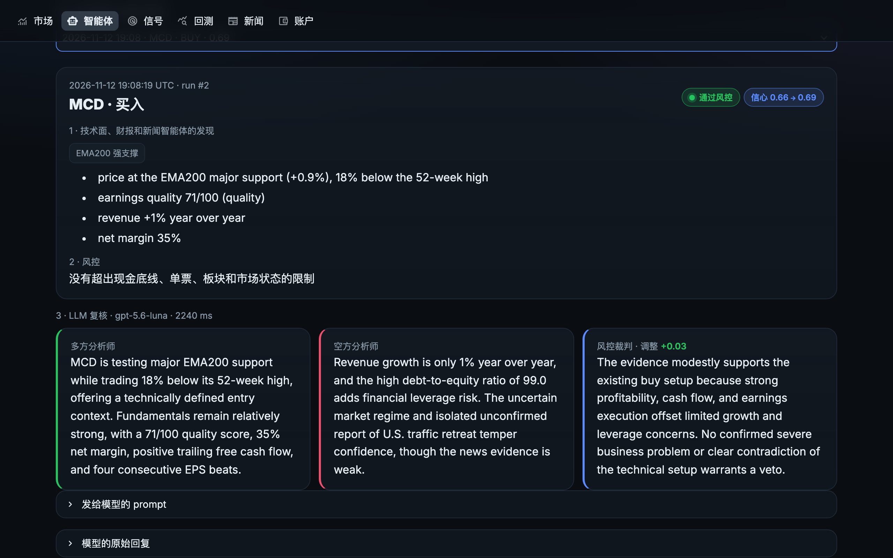

# 模拟盘智能体和 MCP 服务器

[English](../agents.md)

一个智能体就是一个策略加一个属于它自己的模拟账户。你选好策略（内置的或你自己写的文件）、风险档位、股票池和初始资金，它就每个交易日用雅虎财经的免费价格在这个账户里交易一次。几个思路不同的智能体可以同时跑，排行榜会告诉你谁跑赢了 SPY。

智能体不会连接任何券商。不管你的配置里写的是哪家券商、有没有开实盘，它们一律只用内置的模拟账户。

## 三条命令上手

```bash
riskaware agents init                  # 四个示例智能体：steady、momentum、breakout、fear-buyer
riskaware agents run                   # 现在让它们交易一次
riskaware agents schedule --install    # 以后每个交易日自动运行
```

`riskaware agents`（或 `riskaware agents list`）显示排行榜；`riskaware dashboard` 打开网页看板，在「智能体」页能看到净值曲线，也能新建、运行、暂停、重置和删除智能体。

| 示例 | 策略 | 档位 | 股票池 |
|---|---|---|---|
| `steady` | `risk_aware` | 平衡 | 配置里的股票池 |
| `momentum` | `momentum_rotation` | 平衡 | 配置里的股票池 |
| `breakout` | `donchian_breakout` | 激进 | 配置里的股票池 |
| `fear-buyer` | `fear_greed_dca` | 保守 | `etf` |

## 创建你自己的智能体

```bash
riskaware agents add dips --strategy rsi2 --universe tech --cash 25000
riskaware agents add mine --strategy ~/strategies/my_dip.py:MyDip --profile aggressive
riskaware agents add slow --strategy ema_bounce --symbols NVDA,AAPL,COST --param band=0.02
```

- `--strategy`：`riskaware strategies` 里的任意名字，或者 `路径/文件.py:类名`（见[编写自己的策略](custom-strategies.md)）。
- `--universe`：`megacap`、`tech`、`defensive`、`etf`、`sectors`，也可以用 `+` 组合；`--symbols` 额外加股票。
- `--param 参数=值` 设置策略参数；参数名拼错会在创建时直接报错，不会等到第二天 15:40 才发现。
- `riskaware agents show 名字` 查看持仓、每天的净值和最近的订单；`pause`、`resume`、`reset`、`remove` 分别是暂停、恢复、重置和删除。

每个智能体的东西都放在 `~/.riskaware/arena/名字/`：模拟账户（`名字.json`）、持仓记录、每次运行、决策和订单的日志（`journal.db`），以及每个交易日一行的 `equity.csv`。所有智能体的定义在 `~/.riskaware/arena/agents.yaml`，也可以直接手动编辑。

## 每个智能体配一个 LLM

每个智能体都可以有自己的复核小组：多方分析师、空方分析师和风控裁判，阅读每个买入候选的证据（技术形态、理由、财报质量、市场状态和经过验证的新闻标题），按固定的 JSON 格式回答。裁判最多把信心分调整 ±0.15，或者否决这笔买入。它不能发起交易、改仓位或限额，也不能卖出任何东西；新闻只作为加了引号的不可信文本交给它。

```bash
riskaware agents add luna --strategy risk_aware --llm openai:gpt-5.6-luna
riskaware agents add local --strategy risk_aware --llm ollama:qwen2.5:3b
riskaware agents llm steady anthropic:claude-opus-5-5     # 改已有的智能体；`off` 表示关闭
riskaware llm-check ollama:qwen2.5:3b                     # 发一次示例复核，看 key 或模型能不能用
```

| 写法 | 用的是什么 | 需要什么 |
|---|---|---|
| `openai:模型` | OpenAI，比如 `gpt-5.6-luna`（关掉推理，一次复核几秒钟） | `.env` 里的 `OPENAI_API_KEY` |
| `ollama:模型` | 你电脑上的免费本地模型，比如 `qwen2.5:3b` | [Ollama](https://ollama.com)：`ollama pull qwen2.5:3b`，再 `ollama serve` |
| `anthropic:模型` | 用官方 SDK 调 Claude | `pip install -e ".[llm]"` 和 `ANTHROPIC_API_KEY` |
| `compat:模型` | 任何 OpenAI 兼容服务（DeepSeek、Groq、OpenRouter、vLLM、LM Studio） | `--llm-base-url` 和 `--llm-key-env` |

回复用严格的 JSON schema 模式请求，模型必须按规定的格式回答；仍然不合格式的回复会被忽略，这笔交易照规则正常进行。用同一天的买入候选简单比了一下：`gpt-5.6-luna` 每次约 2.5 秒，调整在 -0.04 到 +0.05 之间；3B 的本地模型每次约 7.5 秒，几乎都回答 +0.00。小的本地模型免费、隐私好，但给出的判断不多。

### 不需要 API key：用你的订阅

如果你订阅了 Claude、ChatGPT 或 Gemini，智能体的复核可以通过你已经登录的命令行工具走订阅额度：

| 写法 | 工具 | 实测一次复核 |
|---|---|---|
| `claude-cli[:模型]` | Claude Code（`claude`），你的 Claude Pro / Max / Team 账号 | 需要先登录 `claude`（运行一次，用 `/login`） |
| `codex-cli[:模型]` | OpenAI Codex（`codex`），你的 ChatGPT 账号 | 约 9 秒，用掉订阅里约 17,600 个 token |
| `gemini-cli[:模型]` | Google 的 Gemini CLI（`gemini`），没装 Gemini CLI 时用 Antigravity（`agy`） | Antigravity 配 `gemini-3.8-flash-low`：约 17 秒、12,200 个 token |

```bash
riskaware llm-check codex-cli                         # 这台电脑上能不能用？
riskaware agents add plan --strategy risk_aware --llm gemini-cli:gemini-3.8-flash-low
riskaware agents llm steady claude-cli:sonnet
```

每次复核会在一个空的临时文件夹里启动一次工具，关掉它的工具调用，要求同样的 JSON schema。这些工具自带很长的系统提示，所以比 API 调用慢，也会占用订阅额度里不小的一部分；不会按 token 另外收费。要用别的可执行文件或包装脚本，用 `--llm-command`（或者环境变量 `RISKAWARE_CLAUDE_CLI`、`RISKAWARE_CODEX_CLI`、`RISKAWARE_GEMINI_CLI`）。这些工具也可能读你自己的说明文件（比如全局的 `AGENTS.md`），所以复核内容可能用你在那里设定的语言。

### 看看每个决定是怎么做出来的



每次运行都会为每个买入候选保存：技术形态和理由、风控的结论，以及 LLM 的多方意见、空方意见、结论、发给它的完整 prompt 和原始回复。除了 prompt 本身会发给你选的模型（本地模型则不发给任何人），其他东西都不离开你的电脑。

- 网页看板：「智能体 → 决策」，选一个决定。
- 命令行：`riskaware agents why 名字 [股票代码]`；加 `--prompt` 打印 prompt 和原始回复。
- Claude：MCP 工具 `agent_decisions`。

每日后台任务和手动运行读的是同一个 `.env`，所以把 `OPENAI_API_KEY` 放在执行 `riskaware agents schedule --install` 的那个文件夹，或者 `~/.riskaware/.env` 里。没有 key 时智能体照样交易，只是不经过复核。

## 每日自动运行是怎么工作的

`riskaware agents schedule --install` 会装一个后台任务，工作日每 15 分钟唤醒一次，执行 `riskaware agents run --scheduled`：

- macOS：`~/Library/LaunchAgents/io.github.risk-aware-trading-agents.plist` 里的 LaunchAgent
- Linux：crontab 里带 `# riskaware-agents` 标记的一行
- Windows：名为 `RiskAwareTradingAgents` 的计划任务

每次唤醒都会先看纽约时间：只有在交易日、`execution.run_time`（默认 15:40）之后、收盘之前才动手，然后让今天还没交易的每个活跃智能体交易一次。之所以频繁唤醒而不是只跑一次，是为了不受时区和夏令时影响；笔记本 15:40 在睡眠，醒来时只要还没收盘就会补跑。每天只交易一次：同一天你手动跑过的智能体会被跳过。某个智能体出错（比如策略文件报错）不会影响其他智能体，当天最多重试三次。

```bash
riskaware agents schedule              # 是否已开启、下一个交易日、上次运行
riskaware agents log                   # 后台任务做了什么
riskaware agents schedule --uninstall  # 关闭
```

后台任务在你执行安装命令的那个文件夹里运行，所以会用那个文件夹里的 `riskaware.yaml` 和 `.env`。配置里设置了通知（Telegram、Discord、Slack）的话，每天运行完也会收到一份汇总。

## 在 Claude、ChatGPT 或 Gemini 里使用（MCP）

MCP 服务器让 AI 应用可以直接向这些智能体提问、让它们运行，走你自己的订阅，不需要 API key。需要先装 `mcp` 扩展，然后一条命令接上一个应用（默认打印这一步，加 `--apply` 直接执行）：

```bash
pip install -e ".[mcp]"
riskaware mcp-setup claude-desktop --apply    # Claude Desktop：改它的配置文件（会留备份），然后重启应用
riskaware mcp-setup claude-code --apply       # Claude Code：claude mcp add -s user riskaware -- ...
riskaware mcp-setup codex --apply             # OpenAI Codex，用你的 ChatGPT 登录
riskaware mcp-setup gemini --apply            # Google 的 Gemini CLI
riskaware mcp-setup antigravity --apply       # Antigravity（用包装脚本时加 --command agyw）
```

ChatGPT 自己的应用只能连远程（HTTPS）的 MCP 服务器，所以 OpenAI 这边用 Codex。Cursor 等其他客户端，添加一个运行 `riskaware mcp` 的 stdio 服务器即可（`riskaware mcp-setup claude-desktop` 会打印出完整的 JSON）。

| 工具 | 作用 |
|---|---|
| `market_regime` | 今天的市场状态、VIX、恐慌贪婪、板块广度、判断依据，以及未来 30 天的宏观事件 |
| `scan` | 某个策略和档位今天的信号，可以扫描股票池或指定的股票 |
| `analyze_stock` | 单只股票的指标、技术形态、财报质量、交叉验证新闻和结论 |
| `stock_news` | 单只股票交叉验证后的新闻和风险标记 |
| `list_strategies` | 内置策略列表 |
| `backtest` | 任意策略的回测，并和 SPY 买入持有对比 |
| `agents_leaderboard` | 所有模拟盘智能体的排名和定时运行状态 |
| `agent_detail` | 单个智能体的设置、持仓、每天的净值和最近的订单 |
| `agent_decisions` | 智能体最近的决定是怎么做出来的，含 LLM 的多方、空方意见和结论（需要时也给 prompt） |
| `agents_create` | 新建模拟盘智能体，可以配 LLM（`openai:gpt-5.6-luna`、`ollama:qwen2.5:3b`、`codex-cli`、`gemini-cli`） |
| `agents_run` | 现在让智能体在模拟账户里运行一次（也可以只预演） |

所有工具要么只读，要么只操作本地模拟账户，没有任何工具能向券商发送订单。

之后直接用自然语言问就行，比如：「现在市场是什么状态，这周有什么重要数据？」「用 100 万美元在 megacap 上回测 2018 年以来的 wheel」「建一个在 tech 股票池上跑 bollinger_reversion、2 万美元的智能体，然后给我看排行榜」。
