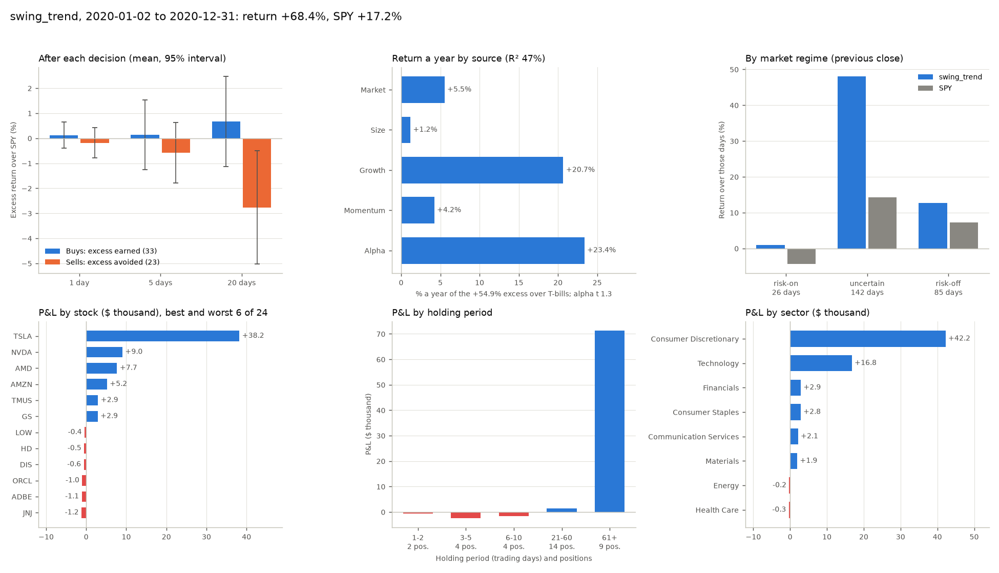

# 实验分析：一个策略或 LLM 智能体到底靠什么赚钱

[English](../analysis.md)

一年的收益说明不了多少本事。它只是一个市场里的一次抽样，偏向大盘、偏向成长股，或者碰上一笔好运气的仓位，都能做出来。`riskaware research analyze` 拿一份保存好的记录（一次实验、一次基准运行或一次 LLM 交易会话）回答三个问题：决策本身有没有跑赢市场？收益里有多少是因子暴露？盈亏从哪里来？它只读这份记录和对应时段的冻结市场，什么都不重跑，在记录旁边写下 `analysis.json`、`analysis.md` 和 `analysis.png`。

- [怎么用](#怎么用)
- [决策](#决策)
- [因子归因](#因子归因)
- [盈亏从哪里来](#盈亏从哪里来)
- [五种波段策略靠什么赚钱](#五种波段策略靠什么赚钱)
- [怎么读这些数字](#怎么读这些数字)
- [analysis.json 里有什么](#analysisjson-里有什么)

## 怎么用

```bash
riskaware research run --strategy swing_trend --period 2020
riskaware research analyze <run id 或文件夹>
riskaware research analyze <research baselines 写出的文件夹>   # 里面每次运行都分析，并排对比
```

run id 就是 `research run` 打印、`riskaware research runs` 列出的那个；记录文件夹、已经结束的交易会话的 id 也可以。给一个装着多次运行的文件夹（比如 `riskaware research baselines` 写出的那个），它会逐个分析，再写一份每次运行一行的 `analysis.md` 和 `analysis.csv`。`--json` 打印全部数字，`--no-chart` 不画图。

```python
from riskaware.research.analysis import analyze_run

res = analyze_run("~/.riskaware/research/runs/<run id>")
res["summary"]    # 榜单用的主要数字，平铺
res["findings"]   # 用句子写的结论
```

MCP 工具是 `experiment_analysis(run_id)`：跑完 `run_experiment` 或一次交易会话后，问 Claude「这次靠什么赚的钱？」就行。

2020 年开新闻的趋势跟随赚了 +68.4%（SPY +17.2%），它的分析图：



它的决策没有优势（买入的股票在之后 5 个交易日只比 SPY 多涨 0.14%，t = 0.2），成长因子暴露每年贡献 +20.7%，钱几乎全是 9 个持有超过 60 个交易日的仓位赚的，其中 2020 年 4 月 17 日买入、一直拿到年底的特斯拉一笔就占了利润的 56%。

## 决策

一年的日收益只是几百个互相关联的交易日，而一次运行会做几百个决策，每个决策都可以单独检验。对 `trades.csv` 里的每一笔买卖，分析取该股票在之后 1、5、20 个交易日相对 SPY 的超额收益：从成交当天的开盘算起（决策能拿到的价格，不含滑点），到某天收盘为止，用全收益价格。买入记它赚到的超额；卖出记它躲开的超额，也就是 SPY 的收益减去这只股票的收益，所以在一只股票跑输大盘之前卖掉，算一个好决策。

每个周期报告决策数、均值和中位数、命中率（大于零的比例）和两个 t 值：

- *t (iid)* 把每个决策当成相互独立；
- *t* 不这么假设。同一天的决策面对同一个市场，两个只差一天开始的 20 日窗口有 19 天重叠。它的标准误给每一对相距不到 h 个交易日的决策加权 1 - 距离 / h（按交易日距离的 Bartlett 核）：同一天的决策算一簇，重叠的窗口按重叠的部分算。每天一个决策、窗口不重叠时，它就等于普通的 t 值。

同样的数字还按触发原因拆开：决策给出的理由（`decisions.csv` 的 reason 列）提到新闻的算 `news`，比如「fresh positive news: ...」「red flag in the news」，或者 LLM 写的「earnings beat」之类；其余算 `other`；LLM 没给理由的算 `no reason`。

**rank IC** 问的是横截面的问题：在一个决策日，智能体的动作有没有按股票接下来的表现排好序？两种打分，各自在这次运行的股票池里，和「成交日开盘到之后第 5 个交易日收盘」的收益算秩相关：

| | 打分 | 哪些天 |
|---|---|---|
| 决策 IC | 买入的股票 +1，卖出的 -1，其余 0 | 有交易的每一天 |
| 持仓 IC | 决策之后持有的权重（没持有的为 0） | 每个决策日：策略是每天收盘，LLM 是每一步 |

每种都报 IC 均值、标准差、IC_IR（均值除以标准差）、用同样的核算的 t 值（h = 5），以及 IC 为正的天数比例。

## 因子归因

把这次运行每天超过国库券的收益，回归到四个因子上。因子都用该时段自带的价格算，不需要任何外部数据，在哪台机器上算都一样：

| 因子 | 日收益 | 暴露为正的意思 |
|---|---|---|
| 市场 | SPY - BIL | 持有股票本身 |
| 规模 | IWM - SPY | 小盘股强于大盘股 |
| 成长 | QQQ - SPY | 纳斯达克 100 强于标普 500 |
| 动量 | 该时段 64 只股票里，按每月最后一个交易日之前第 126 到第 21 个交易日的收益排序，前 1/3 减后 1/3；等权，每月用当天已知的价格重新排序 | 近期赢家强于近期输家 |

普通最小二乘，Newey-West 标准误（Bartlett 权重，滞后 floor(4 (n/100)^(2/9)) 期，一年是 4 期）。报告给出每项暴露和它的 t 值、扣掉这些暴露后剩下的年化 alpha 和它的 t 值、R²，以及平均超额收益的拆解：每项暴露乘以对应因子的平均收益，加上 alpha，正好等于这次运行每天超过国库券的平均收益乘以 252。旁边还有只用市场一个因子的回归（CAPM），可以看出风格因子拿走了多少 CAPM alpha。KTD-Fin（arXiv 2605.28359）发现 LLM 交易者赚的钱大多是市场和风格暴露；这就是对任意一份记录做的这项检查。

各时段测试区间里四个因子本身的收益（年化算术均值）：

| 时段 | 市场 | 规模 | 成长 | 动量 |
|---|---:|---:|---:|---:|
| 2026 | +10.7% | +3.3% | +2.4% | -23.3% |
| 2022 | -19.3% | -2.6% | -17.6% | +7.1% |
| 2020 | +21.2% | +5.0% | +22.7% | +22.3% |

## 盈亏从哪里来

每个仓位从第一次买入算到把它卖光的那一笔，中间的加仓和减仓都算在内；到最后还没卖的，按最后一天收盘价计价。一个仓位的盈亏是它收回的现金减去它占用的现金，佣金算在内。所有仓位加上闲置现金的国库券利息（每天收盘时的现金乘以当天 BIL 的收益，和回测付息的方式一样），正好等于这次运行的盈亏，精确到美元；记录解释不了的部分（比如期权）单列一行。

然后按下面几种方式拆开盈亏：

- 持仓时长：1-2、3-5、6-10、11-20、21-60 和 61 个交易日以上；
- 市场状态：前一天收盘时的状态，也就是持仓所处的状态，并列出这些天里这次运行和 SPY 各自的收益；
- 触发原因：开仓和平仓分别看理由里有没有提到新闻；
- 行业和单只股票；
- 最赚和最亏的仓位，以及当初买入的理由；

还有利润有多集中：最好的一个仓位、最好的两个仓位分别占所有仓位净盈亏和总盈利的比例，以及假如最好的那笔没赚钱，这次运行的收益是多少。表里的「Of return」是盈亏除以初始资金，也就是对收益贡献了多少个百分点。

## 五种波段策略靠什么赚钱

三个时段的基准（`riskaware research baselines --period 2026`、`2022`、`2020`，再对每个文件夹跑 `riskaware research analyze`）：megacap 的 56 只股票，纯执行规则，最多 10 个等额仓位，次日开盘成交，5 个基点滑点，开和不开新闻各一次。收益和[研究工具箱](research.md#五种波段策略开和不开新闻)里的一样。

买入：成交后 5 个交易日里，买入的股票相对 SPY 的超额收益。卖出：躲开的超额。暴露和 alpha：四因子回归。去掉它：假如最好的那个仓位没赚钱，这次运行的收益。

2026-01-02 到 2026-11-11，上涨行情：

| 策略 | 新闻 | 收益 | 买入 (t) | 卖出 (t) | 决策 IC (t) | 年化 alpha (t) | 市场 | 规模 | 成长 | 动量 | 最好的仓位 | 去掉它 |
|---|---|---:|---:|---:|---:|---:|---:|---:|---:|---:|---|---:|
| swing_trend | 不开 | +21.1% | -0.56% (-0.7) | +0.37% (0.6) | -0.008 (-0.5) | +17.6% (1.5) | 0.40 | 0.24 | -0.01 | 0.13 | AMD 2026-04-09 | +10.6% |
| swing_trend | 开 | +19.6% | -0.49% (-0.6) | +0.70% (1.2) | -0.002 (-0.1) | +16.0% (1.4) | 0.41 | 0.26 | 0.04 | 0.13 | AMD 2026-04-09 | +9.2% |
| swing_rsi2 | 不开 | +12.7% | +0.59% (2.2) | -0.17% (-0.6) | 0.014 (1.2) | +7.6% (0.8) | 0.62 | 0.00 | -0.11 | 0.12 | CAT 2026-07-29 | +11.3% |
| swing_rsi2 | 开 | +10.8% | +0.54% (1.9) | -0.16% (-0.5) | 0.009 (0.8) | +5.7% (0.6) | 0.57 | 0.01 | -0.11 | 0.10 | CAT 2026-07-29 | +9.5% |
| swing_breakout | 不开 | -0.3% | -0.46% (-0.9) | +0.12% (0.2) | -0.004 (-0.2) | -7.8% (-0.5) | 0.59 | 0.26 | -0.05 | 0.08 | TXN 2026-04-09 | -3.9% |
| swing_breakout | 开 | -3.5% | -0.55% (-1.1) | +0.11% (0.2) | -0.010 (-0.5) | -11.6% (-0.8) | 0.59 | 0.23 | -0.04 | 0.07 | TXN 2026-04-09 | -7.0% |
| swing_pullback | 不开 | +2.3% | -0.49% (-0.8) | +0.63% (1.0) | -0.013 (-1.0) | -1.5% (-0.3) | 0.26 | -0.00 | -0.33 | 0.05 | V 2026-10-01 | +1.3% |
| swing_pullback | 开 | +1.7% | -0.72% (-1.2) | +0.62% (0.9) | -0.016 (-1.1) | -2.4% (-0.5) | 0.24 | -0.01 | -0.29 | 0.04 | V 2026-10-01 | +0.8% |
| swing_news | 不开（只看价格） | +15.7% | -0.67% (-1.6) | +0.26% (0.5) | 0.000 (0.0) | +6.7% (0.5) | 0.55 | 0.01 | -0.20 | -0.10 | QCOM 2026-04-27 | +10.7% |
| swing_news | 开 | +4.4% | -0.46% (-1.0) | -0.11% (-0.2) | 0.002 (0.2) | -0.7% (-0.1) | 0.31 | 0.04 | 0.05 | 0.04 | AMD 2026-04-22 | +0.0% |

2022-01-03 到 2022-12-30，加息熊市：

| 策略 | 新闻 | 收益 | 买入 (t) | 卖出 (t) | 决策 IC (t) | 年化 alpha (t) | 市场 | 规模 | 成长 | 动量 | 最好的仓位 | 去掉它 |
|---|---|---:|---:|---:|---:|---:|---:|---:|---:|---:|---|---:|
| swing_trend | 不开 | -6.0% | -0.13% (-0.3) | +0.55% (1.6) | 0.012 (0.9) | -4.7% (-0.5) | 0.55 | -0.06 | -0.46 | 0.05 | XOM 2022-01-04 | -9.6% |
| swing_trend | 开 | -5.0% | -0.13% (-0.3) | +0.52% (1.5) | 0.011 (0.8) | -3.5% (-0.4) | 0.55 | -0.07 | -0.45 | 0.04 | XOM 2022-01-04 | -8.6% |
| swing_rsi2 | 不开 | -2.2% | +0.08% (0.3) | -0.38% (-1.0) | -0.005 (-0.4) | +1.6% (0.2) | 0.30 | 0.12 | 0.00 | 0.20 | LOW 2022-12-07 | -2.8% |
| swing_rsi2 | 开 | -5.7% | -0.04% (-0.1) | -0.45% (-1.3) | -0.010 (-1.0) | -2.4% (-0.3) | 0.30 | 0.09 | -0.02 | 0.18 | AAPL 2022-01-25 | -6.3% |
| swing_breakout | 不开 | -12.8% | +0.66% (2.1) | -0.33% (-0.6) | 0.002 (0.1) | -13.0% (-1.3) | 0.44 | -0.05 | -0.39 | 0.00 | CVX 2022-01-05 | -15.7% |
| swing_breakout | 开 | -13.7% | +0.55% (1.4) | -0.37% (-0.7) | -0.000 (-0.0) | -14.4% (-1.5) | 0.43 | -0.04 | -0.41 | 0.00 | CVX 2022-01-05 | -16.6% |
| swing_pullback | 不开 | -4.7% | +0.49% (1.1) | -0.40% (-1.0) | 0.006 (0.5) | -3.7% (-0.9) | 0.18 | -0.06 | -0.01 | 0.10 | BAC 2022-01-25 | -5.6% |
| swing_pullback | 开 | -4.0% | +0.50% (1.0) | -0.61% (-1.5) | 0.001 (0.1) | -3.5% (-0.9) | 0.17 | -0.07 | -0.04 | 0.07 | BAC 2022-01-25 | -4.9% |
| swing_news | 不开（只看价格） | -13.3% | +0.21% (0.6) | -0.02% (-0.1) | 0.003 (0.3) | -8.4% (-0.8) | 0.47 | -0.09 | -0.18 | -0.08 | TSLA 2022-03-21 | -15.7% |
| swing_news | 开 | -14.1% | -0.22% (-0.7) | -0.15% (-0.6) | -0.012 (-1.2) | -9.8% (-1.2) | 0.46 | -0.01 | -0.13 | 0.05 | CVX 2022-02-28 | -15.5% |

2020-01-02 到 2020-12-31，疫情暴跌和反弹：

| 策略 | 新闻 | 收益 | 买入 (t) | 卖出 (t) | 决策 IC (t) | 年化 alpha (t) | 市场 | 规模 | 成长 | 动量 | 最好的仓位 | 去掉它 |
|---|---|---:|---:|---:|---:|---:|---:|---:|---:|---:|---|---:|
| swing_trend | 不开 | +36.6% | +0.31% (0.4) | -0.13% (-0.2) | 0.013 (0.7) | +8.5% (0.7) | 0.24 | 0.08 | 0.66 | 0.17 | NVDA 2020-04-07 | +27.5% |
| swing_trend | 开 | +68.4% | +0.14% (0.2) | -0.59% (-1.0) | -0.001 (-0.0) | +23.4% (1.3) | 0.26 | 0.24 | 0.91 | 0.19 | TSLA 2020-04-17 | +30.3% |
| swing_rsi2 | 不开 | +14.0% | +0.53% (2.2) | +0.13% (0.4) | 0.009 (0.9) | -1.3% (-0.1) | 0.43 | 0.09 | 0.26 | 0.05 | NKE 2020-09-21 | +12.5% |
| swing_rsi2 | 开 | +12.7% | +0.39% (1.8) | +0.30% (1.0) | 0.008 (0.9) | -1.4% (-0.1) | 0.38 | 0.08 | 0.24 | 0.04 | NKE 2020-09-21 | +11.2% |
| swing_breakout | 不开 | +33.1% | -0.03% (-0.0) | -1.44% (-2.0) | -0.024 (-1.3) | +6.9% (0.4) | 0.27 | 0.13 | 0.79 | -0.03 | TSLA 2020-04-14 | +21.6% |
| swing_breakout | 开 | +30.4% | -0.04% (-0.1) | -1.49% (-2.0) | -0.021 (-1.1) | +5.8% (0.3) | 0.26 | 0.13 | 0.74 | -0.01 | TSLA 2020-04-14 | +19.2% |
| swing_pullback | 不开 | +2.3% | +0.12% (0.4) | -0.32% (-0.5) | 0.009 (0.7) | -2.3% (-0.2) | 0.12 | -0.02 | 0.08 | 0.02 | TMUS 2020-10-30 | +0.9% |
| swing_pullback | 开 | +3.3% | +0.13% (0.4) | -0.29% (-0.5) | 0.008 (0.5) | -0.4% (-0.0) | 0.11 | -0.02 | 0.04 | 0.03 | TMUS 2020-10-30 | +1.9% |
| swing_news | 不开（只看价格） | +9.4% | +0.30% (0.6) | -0.66% (-2.0) | -0.018 (-1.6) | -9.3% (-0.6) | 0.44 | 0.05 | 0.64 | -0.17 | AMD 2020-07-23 | +5.4% |
| swing_news | 开 | +28.4% | +0.12% (0.4) | -0.29% (-1.1) | -0.014 (-1.2) | +8.1% (0.5) | 0.36 | 0.06 | 0.63 | -0.18 | TSLA 2020-08-17 | +24.6% |

谁靠什么赚钱：

- **没有一次运行有显著的 alpha。** 扣掉市场、规模、成长和动量之后，30 个 alpha 的 t 值都在 -1.5 到 1.5 之间。最大的几笔收益是因子暴露加上少数几个仓位。只用市场一个因子（CAPM）时，2020 年开新闻的趋势跟随 alpha 是每年 +48.7%，t = 2.3；加上成长、规模和动量之后少了一半（+23.4%，t = 1.3）。
- **趋势跟随（`swing_trend`）靠少数长期持有的仓位和因子暴露赚钱。** 持有超过 60 个交易日的仓位在 2026 年赚了 +27,000 到 +28,000 美元（15 个仓位），2022 年 +6,900 美元，2020 年开新闻时 +71,000 美元（9 个仓位）；三个时段里，持有 20 天以内的仓位全都亏钱。2026 年一个仓位就占了一半利润：4 月 9 日买入、8 月 28 日卖出的 AMD，占所有仓位净盈亏的 51% 到 55%；去掉它，两次运行的收益是 +10.6% 和 +9.2%，而不是 +21.1% 和 +19.6%。2020 年开新闻那次靠的是特斯拉：2020 年 4 月 17 日买入，一直拿到年底（+38,000 美元，占利润的 56%；去掉它是 +30.3%，而不是 +68.4%），0.91 的成长暴露每年贡献 +20.7%。它的买入在任何一个时段的 5 日内都没有优势（t 在 -0.7 到 0.4 之间）。
- **RSI(2)（`swing_rsi2`）是唯一一个决策本身有优势的规则。** 它买入的股票在之后 5 个交易日里，2026 年跑赢 SPY 0.59%（t = 2.2，不开新闻时 312 次买入），2020 年跑赢 0.53%（t = 2.2），2022 年则没有（+0.08%，t = 0.3）。钱来自只拿一两天的仓位（2026 年 +24,000 美元，2020 年 +25,000 美元）；拿 6 到 10 天、一直拖到 10 天上限的仓位，每个时段都亏 12,000 到 17,000 美元。利润很分散（最好的一个仓位最多占 14%）。和 0.3 到 0.6 的市场暴露比起来，这点优势太小，alpha 并不显著（t 最高 0.8）。
- **突破（`swing_breakout`）是押成长股，在 2020 年押对了**（成长暴露 0.74 到 0.79，每年贡献 +17% 到 +18%；最好的仓位又是特斯拉，占利润的 35% 到 37%），2026 年和 2022 年都亏钱。2022 年它买入的股票在 5 天内确实跑赢了 SPY（+0.66%，t = 2.1，不开新闻：买的是能源股的突破），但在下跌的市场里 0.44 的市场暴露每年亏掉 8.4%。2020 年它的卖出是亏的：卖掉的股票在之后 5 天里跑赢 SPY 1.4% 到 1.5%（t = -2.0），在反弹里卖得太早。
- **逢低买入（`swing_pullback`）** 的市场暴露最低（0.11 到 0.26），哪年都赚得不多，没有一项是显著的。
- **新闻后漂移（`swing_news`）**：追正面新闻的买入在哪一年的 5 日内都没有优势（2026 年 -0.46%，t = -1.0；2022 年 -0.22%；2020 年 +0.12%）。这个策略的收益主要是市场和成长暴露（R² 最高 54%）。它和只看价格的对照版之间的差距（2026 年 +4.4% 对 +15.7%，2020 年 +28.4% 对 +9.4%）在决策统计里看不出来，所以主要来自 10 个仓位名额给了哪些股票。
- **2022 年每个策略都比 SPY 亏得少，是因为持有的市场少，不是因为选得好。** 0.17 到 0.55 的市场暴露每年亏掉 3% 到 11%，所有 alpha 都在噪声范围内。趋势跟随和突破避开了成长股（暴露 -0.39 到 -0.46，每年贡献 +7% 到 +8%），钱是在能源股上赚的（XOM、CVX）。在风险规避（risk-off）收盘之后的 72 天里 SPY 涨了 9.5%（熊市反弹），这些策略最多只抓到 4.1%。
- **2020 年反弹中，平仓是亏的。** 趋势跟随、突破和新闻漂移卖掉的股票，在之后 20 天里跑赢 SPY 1.9% 到 2.8%（t 在 -2.2 到 -4.1 之间）：卖掉的都是还在涨的股票。
- **没有一个规则会给股票排序。** 所有决策 IC 和持仓 IC 都在 -0.04 到 +0.04 之间，没有一个显著（|t| 最高 1.8）。这些规则的收益来自什么时候持股和少数几个仓位，而不是在某一天挑出更好的股票。

对策略或 LLM 智能体的榜单来说，这意味着：用决策统计（买入和卖出超额收益的稳健 t 值、决策 IC）和 alpha 的 t 值排序，而不是用收益排序；在收益旁边列出因子暴露；最好的两个仓位赚了一半以上利润的运行要标出来（`analysis.json` 里的 `summary.concentrated`）。

## 怎么读这些数字

- t 值为 2 大约是单次检验 5% 的水平。30 次运行、每次好几个统计量，碰巧出现几个这样的值很正常；在不同时段都出现的结果（RSI(2) 在 2026 年和 2020 年的买入）比只出现一次的更可信。
- 一个时段就是一个市场。成长暴露在 2020 年赚钱、在 2022 年亏钱；暴露是押注这个因子，不是本事。
- 决策统计从成交日开盘算起，不含滑点，也不考虑一个仓位占用的资金；盈亏把两者都算进去了。
- 「新闻触发」指理由里提到了新闻。一个新闻过滤器把策略挡在某只股票之外时，不会留下任何决策，所以要看过滤器本身的作用，得对比开和不开新闻的两次运行。
- 因子用今天的 64 只大盘股和四只 ETF 构造，是事后挑出来的（幸存者偏差），所以动量因子是赢家里面的动量。
- 决策 IC 要求当天至少有 3 只股票有价格；只有一种决策的那天也算（买入的股票对其余所有股票）。

## analysis.json 里有什么

| 键 | 内容 |
|---|---|
| `summary` | 平铺的主要数字：`decision_excess_5d` 和它的 `_t`（买入和卖出合起来）、`buy_excess_5d`、`sell_avoided_5d`、`decision_hit_rate_5d`、`decision_ic`、`holdings_ic`、`alpha_annual` 和 `alpha_t`、`capm_alpha_annual`、`beta_market`、`beta_size`、`beta_growth`、`beta_momentum`、`r2`、`best_trade_share`、`return_without_best_trade`、`concentrated` |
| `decisions` | `buys`、`sells`、`all` 按周期（`1d`、`5d`、`20d`）：`n`、`mean`、`median`、`hit_rate`、`se`、`t`、`t_iid`；5 日的 `by_trigger` |
| `ic` | `decision` 和 `holdings`：`days`、`mean`、`std`、`ir`、`t`、`t_iid`、`positive_share` |
| `factors` | `exposures`（beta 和 t）、`alpha_annual`、`alpha_t`、`r2`、`contributions_annual`、`factor_means_annual`、`excess_return_annual`、`capm` |
| `pnl` | `reconciliation`（股票、国库券 ETF、现金利息、其他）、`by_holding_period`、`by_regime`、`by_trigger`（开仓、平仓）、`by_sector`、`by_stock`、`best_trades`、`worst_trades`、`concentration` |
| `findings` | 用句子写的结论 |

结构版本是 `riskaware.analysis/1`。代码在 `src/riskaware/research/analysis.py`；用合成数据核对已知答案的测试在 `tests/test_analysis.py`。生成的 `analysis.md` 和结论句子是英文的，和 `report.md` 一样。
