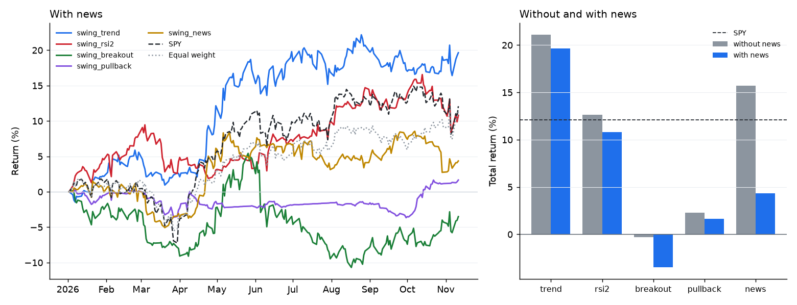

# 研究工具箱：冻结的 2026 年市场

[English](../research.md)

安装包里带了一份 2026 年美股市场的副本。不管是一个策略、一个 LLM 智能体，还是一篇论文里的实验，任何人都能重跑，跑出来的数字也一样。你可以查任意一天收盘时已经知道的全部信息，按「收盘出信号、次日开盘成交」回测一个策略，检查它有没有偷看未来，并且留下一份记录，写明每个数字是用哪份数据、哪段代码算出来的。这些事都可以交给 Claude（或任何 MCP 客户端）：你用一句话描述策略，它写代码、跑实验，再把报告读给你听。

- [自带哪些数据](#自带哪些数据)
- [一天是怎么过的](#一天是怎么过的)
- [查看任意一天](#查看任意一天)
- [做一次实验](#做一次实验)
- [防偷看检查](#防偷看检查)
- [让 Claude 测你的策略](#让-claude-测你的策略)
- [让 LLM 把这一年交易一遍](#让-llm-把这一年交易一遍)
- [五种波段策略，开和不开新闻](#五种波段策略开和不开新闻)
- [写论文时](#写论文时)

## 自带哪些数据

| | |
|---|---|
| 价格 | 2024-01-02 到 2026-11-11 的日线（719 个交易日）：内置股票池的 64 只股票、25 个指数、行业和债券 ETF，VIX 期限结构（VIX9D、VIX、VIX3M）和 VVIX，以及 4 个跨资产 ETF（GLD 黄金、USO 原油、UUP 美元、IBIT 比特币）。2026 年是测试年；2024 和 2025 两年用来给 EMA200、52 周高点这类慢指标预热。 |
| 新闻 | 64 只股票 2026 年 1 月到 11 月的 16,945 条：Benzinga 标题（只有标题）和 SEC 8-K 公告（带 SEC 受理时间）。 |
| 日程 | FOMC 议息、CPI、PPI 和非农，都是事先公布的日期。 |
| 技术指标 | 由价格现算：EMA 20/50/100/200、RSI 2 和 14、MACD、ATR、ADX、布林带、唐奇安通道、52 周高点和回撤、动量、相对 SPY 的强弱和 beta、已实现波动率、相对成交量，以及技术面智能体识别出的形态。 |
| 市场读数 | 市场状态（偏多、中性、不确定、避险）和它的依据：SPY 趋势、VIX 和期限结构、用市场数据算的恐慌贪婪、板块广度、信用压力、宏观事件。 |

`riskaware research data` 会列出内容，并用 `src/riskaware/research/data/manifest.json` 里的 SHA-256 校验每个文件。价格来自 Yahoo Finance，`scripts/build_market_bundle.py` 可以重建。每一行都保留成交时的价格（按拆股调整）、当天的分红和拆股，以及把它换算成全收益价格的系数；回测和指标用的是全收益价格。

有两类数据是故意没放进来的。期货、美元指数和比特币本身在纽约时间 16:00 之后才结算，它们的「收盘价」会晚于股市收盘时的决策。基本面和分析师数据找不到免费的、按时间点记录的来源，所以不在数据里。

## 一天是怎么过的

```
第 t 天 16:00（纽约）          收盘之后                              第 t+1 天 09:30
    股票收盘       ->   策略看到第 t 天及以前的数据          ->   订单按开盘价成交
                        和 16:00 之前发布的新闻                   （加 5 个基点滑点）
```

- 策略每个交易日收盘后做一次决定。它能看到当天的 K 线和指标、以前的 K 线、市场读数、自己的持仓，以及纽约时间 16:00 之前（提前收盘日是 13:00）发布的新闻。
- 订单在下一个交易日开盘成交。持仓一般拿几天到几周：这是基于日线的波段交易，没有日内交易。
- 时间戳在收盘时或收盘之后的标题，从下一个交易日起才算。只有日期的条目算在那天结束时。日期在未来的条目直接丢掉。
- VIX 指数 16:15 收盘，比股票晚一刻钟；决策发生在收盘之后、次日开盘之前，这时它已经知道了。
- 没用上的现金按短债 ETF BIL 的日收益计息。

## 查看任意一天

```bash
riskaware research day 2026-04-08 --symbols NVDA,AAPL,TSLA,JPM
```

不加 `--symbols` 就列出全部 64 只股票；`--json` 输出全部内容。在 Python 里 `MarketView().snapshot("2026-04-08", symbols=[...])` 返回同样的内容；MCP 里的工具叫 `market_day`。周末或假日显示前一个交易日的收盘。

## 做一次实验

```bash
riskaware research run --strategy swing_rsi2 --split 2026-07-01
riskaware research run --code my_strategy.py --universe tech --no-news
riskaware research baselines          # 五种波段策略，开和不开新闻
riskaware research runs               # 已保存的实验
```

```python
from riskaware.research import Experiment, run_experiment

r = run_experiment(Experiment(strategy="swing_trend", news=True, split="2026-07-01"))
print(r.summary()["metrics"], r.leak, r.folder)
```

| 设置 | 默认 | |
|---|---|---|
| `strategy` / `code` | `risk_aware` | 内置策略名、文件路径，或 AI 写的代码（和[策略实验室](strategy-lab.md)一样先检查，再在单独的进程里运行） |
| `start`、`end` | 2026-01-02、2026-11-11 | 数据里第一年预热期之后的任意日期 |
| `universe` / `symbols` | `megacap` | megacap、tech、defensive、core、sectors、etf，或一组代码 |
| `news` | 开 | 回放 2026 年新闻 |
| `execution` | `plain` | `plain` 完全照策略说的做：等额仓位，最多 `max_positions`（10）个，只做多，先卖后买。`risk_aware` 加上本项目的风控（现金底线、市场状态限制、分批、上限） |
| `split` | 无 | 样本外的第一天；报告会分两段列出 |
| `leak_check` | 开 | 见下文 |
| `extra_news` | 无 | 只在这次实验里加的标题（`ts`、`symbol`、`headline`、`source`）：做反事实和稳健性测试 |

每次实验都会写一个文件夹（默认在 `~/.riskaware/research/runs/` 下）：

| 文件 | |
|---|---|
| `manifest.json` | 数据版本和 SHA-256、本项目版本和 git commit、Python 和库的版本、全部设置、策略的类名、参数和源码哈希、防偷看检查的结论，以及复现用的命令 |
| `metrics.json` | 收益、年化、波动率、Sharpe、Sortino、回撤、Calmar、胜率、盈亏比、持有天数、换手、仓位；SPY 和等权组合的同样指标；beta、alpha、信息比率、t 统计量和 bootstrap 区间 |
| `equity.csv` | 每天的策略、SPY 和等权净值，以及现金、仓位、持股数和市场状态 |
| `trades.csv`、`decisions.csv` | 每笔成交；每个信号、订单和被拒的信号及原因 |
| `report.md`、`equity.png` | 可以直接贴的表格和图 |
| `strategy.py` | 实际运行的代码 |

区间来自对策略和 SPY 成对日收益的 2,000 次移动块 bootstrap（块长 5 个交易日），随机种子固定。

## 防偷看检查

回测只有在策略无法知道之后发生了什么时才有意义。本项目本来就把未来挡在外面：指标行和历史价格都是截止到决策日的副本，新闻按时间过滤，AI 写的代码不能写日期或股票代码。这项检查不靠相信设计，而是直接检验结果：每次实验都会再跑三遍，每一遍把某个切点（全期的 30%、55%、80% 处）之后的每个价格和每条标题都换成随机的，其中包括编造的好消息、坏消息和破产公告。只用了该知道的信息的策略，在每个切点之前做出的决定会完全一样。

| 结论 | 含义 |
|---|---|
| `pass` | 每个切点之前的决定都一样 |
| `fail` | 只改了切点之后的数据，切点之前的某个决定却变了；报告会写出第一天和第一个变化的决定。测试里故意埋了这样一个错误（一个读到第二天收盘价的指标），用来证明检查能抓到 |
| `not repeatable` | 同一份数据跑两遍结果就不一样（没设种子的随机性），所以检查判断不了 |

它看不到策略从回测之外自己加载的未来数据，所以 AI 写的代码不允许读文件、不允许联网。

## 让 Claude 测你的策略

先连一次 MCP 服务器（`riskaware mcp-setup claude-desktop`，或 `claude mcp add riskaware -- riskaware mcp`），然后直接说：

> 用 riskaware 的研究工具：连跌三天、新闻不负面时买入大盘股，五天后或涨 5% 卖出。用 1 到 6 月调参，再在 7 到 11 月只测一次，开和不开新闻各跑一遍，和 SPY 比。

Claude 会先读 `research_guide`，把策略写成代码，开和关新闻各跑一次 `run_experiment(code=..., split="2026-07-01")`，再告诉你表格、区间和防偷看结论，以及两份记录的文件夹。`market_day` 可以让它查某笔交易前后的那几天；`experiment_report` 可以读回保存的记录。

| MCP 工具 | |
|---|---|
| `research_guide` | 数据、流程、策略代码的规则、基准策略、写论文的建议 |
| `market_day(day, symbols)` | 那天收盘时已知的全部信息 |
| `run_experiment(strategy 或 code, ...)` | 回测、防偷看检查、统计量、保存记录 |
| `trading_session_start`、`trading_session_step`、`trading_session_status` | 自己一步一步交易这段时间 |
| `list_experiments`、`experiment_report` | 已保存的记录 |

## 让 LLM 把这一年交易一遍

```bash
riskaware research trade --llm ollama:qwen2.5:3b --universe core --decide-every 5 --blind
riskaware research trade --llm openai:gpt-5.6-luna --universe megacap --decide-every 1
```

每个决策日，模型会拿到一份观察：市场读数、它自己的持仓，以及每只股票的主要指标和最多三条带核实状态的标题。它用订单回答：`{"symbol": "AAPL", "action": "buy", "weight": 0.1}`、`{"action": "sell", "fraction": 1}` 或 `{"action": "target", "weight": 0.05}`。订单按纯执行规则在次日开盘成交，整次运行和别的实验一样保存下来，`policy_log.json` 记录每一步的订单。任何「观察 → 订单」的函数都可以用：

```python
from riskaware.research import Experiment
from riskaware.research.agent import llm_policy, run_policy

r = run_policy(llm_policy("ollama:qwen2.5:3b"), Experiment(universe="core", max_positions=5), decide_every=5, blind=True)
```

通过 MCP，`trading_session_start` 返回第一份观察，`trading_session_step(session_id, orders)` 返回下一份，直到给出结果。会话把订单存在磁盘上，每一步都重放一遍，所以服务器重启也不会丢。

**盲测模式。** 用 2026 年文本训练过的模型可能记得某只股票后来怎么样。`blind=True` 时，股票代码变成 S01、S02……，日期变成「第几天」，价格从第一天起换算成 100，标题里的公司名和代码也换成同样的化名（例如「S01 Stock Moves Lower As Investors Assess Its AI Edge Against S03」）。它能降低模型回忆起结果的可能，但排除不了：一条不寻常的标题、所属行业和价格走势放在一起，仍然可能暴露是哪只股票。

**改动新闻。** `extra_news` 可以给一次实验加几条标题，比如看策略或模型对一条从没发生过的新闻怎么反应。记录的 manifest 会列出这些标题。

## 五种波段策略，开和不开新闻

五种常见的波段策略，按教科书的定义写成（`riskaware/strategy/swing.py`）：

| 策略 | 买入 | 卖出 |
|---|---|---|
| `swing_trend` | EMA20 上穿 EMA50，收盘在 EMA200 之上 | EMA20 跌回 EMA50 之下，或收盘跌破 EMA200 |
| `swing_rsi2` | RSI(2) 低于 10，收盘在 200 日均线之上（Connors） | 收盘高于 5 日均线，或持有满 10 天 |
| `swing_breakout` | 收盘突破此前 20 天最高价，且在 EMA200 之上（唐奇安） | 收盘跌破 10 天最低价，或比买入价低 2 个 ATR |
| `swing_pullback` | EMA50 在 EMA200 之上时，RSI(14) 低于 40 且靠近 EMA50 | +8%、-5%、满 15 天，或跌破 EMA200 |
| `swing_news` | 新闻分至少 0.10、最近 24 小时有正面报道、没有风险信号，且在 EMA50 之上 | 满 10 天、跌 6%，或出现风险信号 |

开新闻时，前四个策略在股票有风险信号或新闻分低于 -0.05 时不买，出现已确认的风险信号就卖。不开新闻时，`swing_news` 变成只看价格的对照版：同样的交易，只是触发条件换成当天跑赢 SPY 2%、成交量是平常的 1.3 倍。这些门槛取在 2026 年新闻分分布的两端，没有按收益调过。

2026-01-02 到 2026-11-11，megacap 的 56 只股票，纯执行规则：最多 10 个等额仓位，次日开盘成交，5 个基点滑点：



| 策略 | 新闻 | 收益 | Sharpe（95% 区间） | 最大回撤 | 平仓次数 | 胜率 | 平均持有（天） | 防偷看检查 |
|---|---|---:|---:|---:|---:|---:|---:|---|
| swing_trend | 不开 | +21.1% | 1.44 (-0.36 到 3.15) | -4.7% | 37 | 35.1% | 38.0 | 通过 |
| swing_trend | 开 | +19.6% | 1.32 (-0.43 到 3.02) | -4.7% | 38 | 31.6% | 36.5 | 通过 |
| swing_rsi2 | 不开 | +12.7% | 0.85 (-0.97 到 2.47) | -7.9% | 309 | 66.3% | 3.7 | 通过 |
| swing_rsi2 | 开 | +10.8% | 0.75 (-1.15 到 2.43) | -7.0% | 293 | 66.6% | 3.7 | 通过 |
| swing_breakout | 不开 | -0.3% | -0.15 (-1.94 到 1.60) | -15.6% | 95 | 27.4% | 19.1 | 通过 |
| swing_breakout | 开 | -3.5% | -0.38 (-2.21 到 1.36) | -15.3% | 96 | 26.0% | 18.7 | 通过 |
| swing_pullback | 不开 | +2.3% | -0.13 (-2.48 到 1.74) | -4.4% | 51 | 39.2% | 10.9 | 通过 |
| swing_pullback | 开 | +1.7% | -0.26 (-2.58 到 1.62) | -4.0% | 49 | 36.7% | 10.9 | 通过 |
| swing_news | 不开（只看价格） | +15.7% | 1.01 (-0.83 到 2.76) | -9.8% | 160 | 48.1% | 9.4 | 通过 |
| swing_news | 开 | +4.4% | 0.18 (-1.88 到 2.05) | -6.5% | 140 | 45.0% | 9.4 | 通过 |
| SPY（买入持有） | | +12.1% | 0.77 | -8.9% | | | | |
| 等权（买入持有） | | +11.4% | 0.85 | -7.2% | | | | |

怎么看这张表：2026 年最强的是趋势跟随（Sharpe 1.44，SPY 是 0.77，回撤只有 SPY 的一半），RSI(2) 大致和大盘持平；突破和回调买入都没赚到钱。加新闻过滤让每个策略都略差一点；按正面标题买入，也不如按同样幅度的价格异动买入。原因是只有一个标题来源，多数报道只有单一出处，过滤器多半是在对噪音做反应。十组结果的 95% 区间彼此重叠，也都包含 SPY 的 Sharpe：十个月的数据不足以有把握地区分这些策略。所有运行都通过了防偷看检查。

用 `riskaware research baselines` 可以复现，在任何机器上数字都一样。

## 写论文时

- 先定好假设、区间和设置，再看结果。用 2026-01-02 到 2026-06-30 调参，在 2026-07-01 到 2026-11-11 上只测一次（`--split 2026-07-01`）。
- 报告区间，也报告一共试了多少个变体：每试一个都算一次检验。
- 股票池是今天的大盘股，是事后挑的（幸存者偏差）。策略之间互相比、和等权组合比，不要只和 SPY 比。
- 价格按数据最后一天为准做了拆股和分红调整；成交量是实际成交量。
- 新闻只有一个标题来源加 SEC 公告，所以多数报道只有单一出处，已确认的报道大多是 8-K。新闻相关的结论只适用于这类新闻源。
- 对 LLM 智能体，写清楚用的哪个模型、多久决策一次、是否盲测，并给出运行记录的文件夹。
- 引用数据版本（`2026-11-11`）、`manifest.json` 里 `market_2026.csv.gz` 和 `news_2026.jsonl.gz` 的 SHA-256，以及运行记录 manifest 里的项目版本和 commit。
